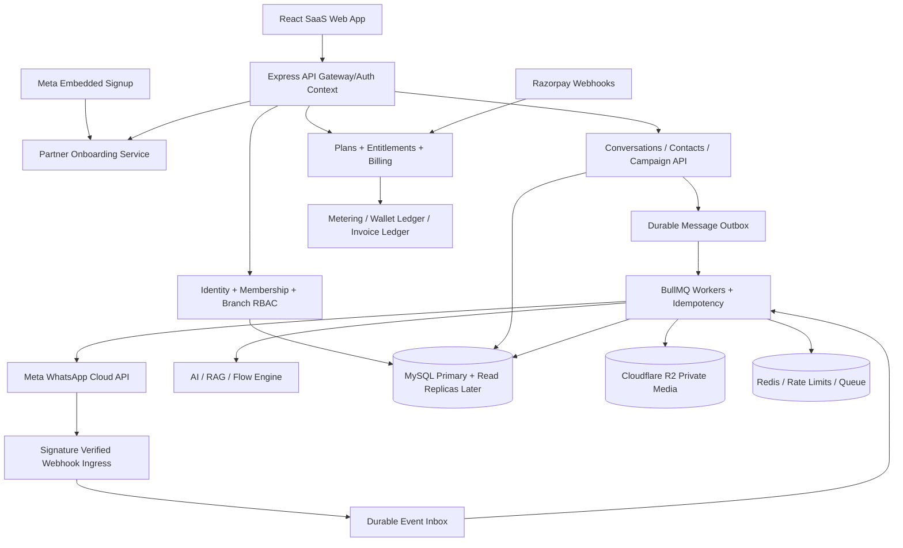
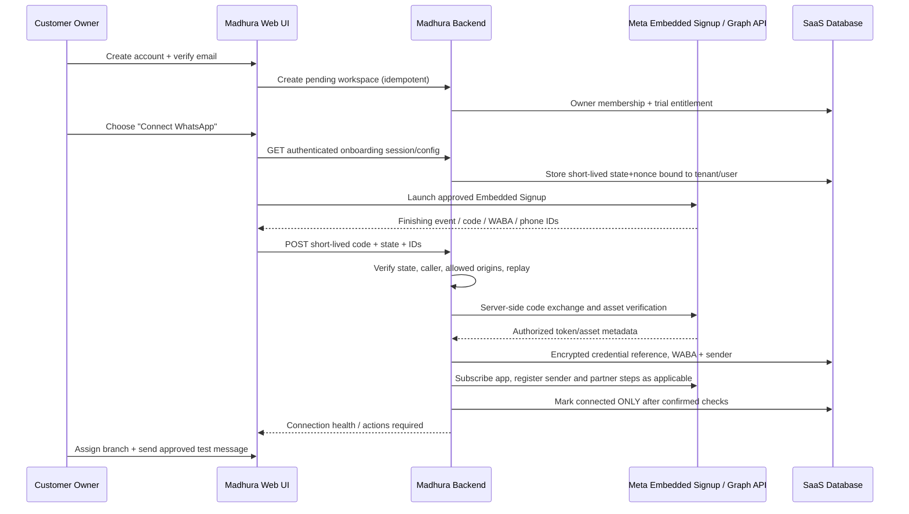

# MADHURA WHATSAPP — ENTERPRISE MULTI-TENANT SAAS MASTER BLUEPRINT

**Version:** 1.0  
**Audit date:** 2026-10-13  
**Input:** Uploaded `Madhura-wa-backend-main.zip` (134 files) and `Madhura-wa-frontend-main.zip` (80 files). Both provided GitHub URLs returned 404 through the connected GitHub integration, so conclusions about code are from the ZIP snapshots, not the remote live branches.  
**Purpose:** An implementation-ready migration blueprint to evolve an existing React + Express + MySQL WhatsApp CRM into a tenant-isolated, multi-company, multi-branch, employee-managed, Meta Embedded Signup-enabled, metered SaaS business messaging platform. **This document specifies proposed work; it does not claim the work is already implemented.**

---

## 0. One-page product contract

**Product:** Madhura WhatsApp Cloud — business messaging, team inbox, CRM-lite, automations, campaigns, AI, analytics, compliance, API access, billing, and partner administration.

**Operating hierarchy**

```text
Madhura SaaS Platform (operator / super admin)
  ├─ Organizations / Tenants (customer business accounts)
  │    ├─ Subscription / invoices / credits / usage and feature grants
  │    ├─ Meta Business Portfolio / WABA connection(s) / senders
  │    ├─ Branches (Head Office, Chennai, Coimbatore, ...)
  │    │    ├─ Teams / departments / operating hours / queues
  │    │    ├─ Employees and scoped access
  │    │    ├─ Inbox routing / contacts / campaigns / AI policies
  │    │    └─ Branch analytics / allocations
  │    ├─ Shared contacts and optional cross-branch customer history
  │    ├─ Organization automation templates / approved content
  │    └─ Integrations / domain / developer credentials / audit logs
  └─ Internal operations: provisioning, billing, risk, support and diagnostics
```

**Principles:**
1. All customer data belongs to one organization; branch limits what a user can see *inside* the organization.
2. The organization owns and authorizes its Meta connection; an employee cannot take the organization's WhatsApp number away by leaving.
3. Every write, read, websocket event, job, object-storage key, webhook mapping and exported file must be tenant scoped.
4. Billing affects *server-side entitlements*, not just buttons in React.
5. No subscription is activated by a request parameter alone. A trial is a separate explicitly defined entitlement.
6. Messages respect WhatsApp template, quality, messaging-tier, rate, opt-in and 24-hour customer service window requirements; SaaS package allocations do not override Meta rules.
7. All webhook handlers and workers are idempotent, auditable and recoverable.
8. Preserve useful existing frontend pages and engines; use an incremental, backward-compatible transition instead of a complete rewrite.

## 1. Evidence-based audit of the uploaded code

### 1.1 Existing assets worth preserving

| Snapshot path | Observed implementation | Reuse strategy |
|---|---|---|
| `frontend/src/App.js` | React routes for inbox, contacts, templates, campaigns, automations, reminders, flows, analytics, accounts and employees | Keep as route base; add organization/branch context and gated routes |
| `frontend/src/pages/whatsapp.jsx` | Full WhatsApp inbox | Add conversation ownership, branch filter, SLA, teammate collaboration and scoped realtime |
| `frontend/src/pages/whatsappFlows.jsx` | Visual bot/automation flow editor | Add tenant-scoped versioning, publish approvals, execution credits and standardized nodes |
| `frontend/src/pages/whatsappEmployees.jsx` | Employee administration and access levels | Move to role/permission/membership plus branch assignment |
| `frontend/src/pages/whatsappAccounts.jsx` | Per-user Meta account configuration and AI/account UI | Add partner embedded signup and organization-owned sender assets |
| `frontend/src/components/WAPlanModal.jsx` | Four plans and switch-plan UI | Convert to checkout, invoice, subscription and allowance UI |
| `backend/routes/authRoutes.js` | Signup, login, tenant-self-signup, staff management, `/plans`, `/tenant-info`, `/switch-plan` | Harden, separate identity from membership, make org creation transactional |
| `backend/services/tenantPlanService.js` | `tenants` table and Free/Starter/Growth/Enterprise defaults | Migrate to plan catalog + price book + subscriptions + entitlements |
| `backend/services/waDatabase.js` | WhatsApp tables, tenant columns added to some legacy tables | Replace runtime DDL with versioned migrations; complete indexes, FKs, scopes |
| `backend/routes/waConfigRoutes.js` / `services/waConfigHelper.js` | Meta Cloud API connection per `user_id` | Convert to connected business asset per organization, with member grants |
| `backend/routes/waWebhookRoutes.js` / `services/waWebhookAuth.js` | Webhook signature checks and deduplication building blocks | Expand to event inbox/outbox, canonical tenant routing and durable replay |
| `backend/services/waQueue.js` / `services/waCampaignEngine.js` | Redis/BullMQ path, send scheduling and fallback | Durable queues, throttling per sender/WABA/tenant, no synchronous production fallback |
| `backend/services/waFlowEngine.js` / `services/waAiReply.js` | Workflow execution and AI replies | Per-tenant models, budgets, tools, human approval and audit |
| `backend/routes/waPaymentsRoutes.js` | Customer-facing WA payment links and a Meta cost estimate view | Keep separated from *SaaS* subscription payments; replace mock link paths with gateway objects |
| `backend/services/clientPortalService.js` | Client portal capabilities | Keep distinct from operator/tenant admin account authority |
| `backend/tests/*` | Existing tests on sessions, access, privacy, tenant plans and webhook security | Extend with adversarial tenant-isolation and billing tests |

### 1.2 Findings that block real SaaS production

**P0-1 Cross-tenant authorization is incomplete.** Several paths contain `req.user?.tenant_id || 1` and `(tenant_id = ? OR tenant_id IS NULL)` (e.g. `routes/authRoutes.js`, `services/tenantPlanService.js`, `server.js`, `services/waCampaignEngine.js`). Legacy NULL rows must be assigned to the correct tenant through a one-time migration, **not dynamically exposed to every tenant**. Unknown tenancy must yield 403/404 instead of falling back to tenant 1.

**P0-2 User creation omits tenant assignment.** `routes/authRoutes.js` `/create-user` inserts into `users` without `tenant_id`. Legacy `/register` has the same issue and accepts employee ID without an invite context. All creation must be tied to authenticated tenant + invitation, with role grants from a permitted administrator.

**P0-3 Plan switching is free to trigger.** `POST /api/auth/switch-plan` calls `switchTenantPlan()` directly after an admin-role check, and `WAPlanModal.jsx` calls the endpoint from a plan button. No verified gateway event is required; server-side features can be upgraded without payment. Self-signup also accepts a client-submitted `plan` and creates an active tenant. Remove these as publicly reachable entitlement writes.

**P0-4 Some financial records are global.** `routes/waPaymentsRoutes.js` lists payments, marks a payment paid by ID and aggregates the Meta ledger without tenant filters. `wa_payments` is for payments a business asks its customers to make; it is not a subscription ledger. Segregate the two domains and authorize tenant + transaction ownership on *every* endpoint.

**P0-5 Payment URLs are not gateway-issued.** `/api/wa/payments/create-link` constructs a URL under `pay.madhuratech.in` and a hard-coded UPI destination; it does not prove a Razorpay payment object has been created. The `/mark-paid` handler writes `paid` from an authenticated request instead of gateway-confirmed settlement. For SaaS plans, implement Razorpay Subscriptions or Orders + validated webhook reconciliation. For customer invoices, integrate actual links and only mark verified/captured payments as paid; manual reconciliations must be separately permitted and audited.

**P0-6 Model ownership is per user.** `user_wa_configs` is keyed by `user_id` and `cloudClientForUser()` resolves by the user. A tenant may have many agents sharing the same sender; users must not separately own business credentials. `wa_accounts` needs a canonical `tenant_id`, WABA/phone asset identity and `sender_access` grants.

**P0-7 Global uniqueness collisions.** The base schema defines unique `wa_contacts.phone` and `wa_opt_outs.phone`. A customer phone must be able to appear in **different tenant contact books** without unique-key conflicts. Use `UNIQUE(tenant_id, normalized_phone)` or a compatible composite key. Opt-out scope is subject to the WhatsApp business/sender consent model and must never accidentally suppress or reveal another tenant's contacts.

**P1-8 Hard-coded per-conversation pricing.** `routes/waPaymentsRoutes.js` defines `META_RATE_CARD` as rates **per conversation**. Meta moved the principal charging model to **per delivered template message** in July 2025. Replace fixed values with versioned rate-card entries and Meta charge reconciliation.

**P1-9 Safety and reliability gaps.** `waQueue.js` can fall back to in-memory or synchronous sending when Redis is down. Production campaign state must survive restarts, enforce limits and avoid duplicate sends. Sender pools must respect Meta policies rather than attempt to evade restrictions via number rotation or “anti-ban” tactics.

**P1-10 Password/session posture.** `frontend/src/auth/AuthContext.jsx` persists a JWT in local storage; `routes/authRoutes.js` self-signup uses a weak minimum-length rule and a JWT fallback secret in that code path. Eliminate fallback secrets, establish secure session/revocation and MFA support, and use stronger password or passkey rules. Verify email ownership for workspace activation.

**P1-11 Tenant scoping of background jobs.** Several workers and event-processing code paths use default tenant 1. Require `tenantId` and `senderId` as non-null validated job payload fields, with tenant-scoped DB queries on every side effect.

**P2-12 Runtime schema evolution.** `waDatabase.js` conditionally creates/changes many tables at runtime. Use a migrator and a schema version ledger with backup/rollback procedures before commercial onboarding.

**Audit caveat:** This is static source inspection; no live staging environment, Meta account, Razorpay keys, MySQL contents or successful end-to-end production test were available. Tests in the ZIP were inspected; their presence is not proof all paths are safe.

## 2. Architecture: how companies, branches, staff and WhatsApp assets connect



**Deployment pattern:** Start with **one modular monolith API** and separate **webhook receiver**, **background worker**, **scheduler**, and **frontend** processes on reliable hosting. Modularization is sufficient initially; unnecessary early microservices add cost and operational complexity. Split services only when traffic/team requirements justify it.

**Tenancy isolation strategy:** One MySQL database, shared tables and mandatory `tenant_id` scoped queries at first. Add dedicated database deployment as an Enterprise add-on later using a routing catalog; do not create one entire server per customer on signup. Redis keys, queues, WebSockets, logs and R2 objects are namespaced per tenant. Consider business-dependent data residency.

## 3. Company hierarchy and realistic use cases

**Entity responsibilities**
- **Organization / Tenant:** legal/commercial customer, owns plan, billing, business contacts, connected WABAs, integration secrets and retention policy.
- **Branch:** operational unit with name, location, timezone, business hours, sender allocation, routing priority, brand override (where legally valid), budget and managers. A branch may use an organization-shared WhatsApp phone or a dedicated one.
- **Team:** department / queue within one or several permitted branches (Sales, Support, Billing). Employees can belong to multiple teams and branches.
- **User:** verified human identity; user may belong to several organizations through separate memberships and must explicitly switch workspace.
- **Role:** reusable bundle of permissions; scoped at org, branch or team levels; custom roles allowed.
- **Sender:** phone number ID with Meta metadata, mapped to a WABA, owned by exactly one tenant at a time; routing to branches configurable.
- **Contact:** customer record tenant-owned; may be assigned to multiple branch queues without duplicating org-wide identity.
- **Conversation:** contact + sender channel thread with `tenant_id`, preferred/current `branch_id`, assignment, service window, labels, status, SLA and last-message state.

**Example:** ABC Retail has a head office plus Coimbatore and Chennai branches. Owner sees everything. Chennai manager sees Chennai interactions only. Coimbatore sales sees only assigned Coimbatore leads. Owner connects a single WABA with two numbers; each number is assigned to a branch, while an organization-wide dashboard aggregates both. Employees leaving the business lose access, without disrupting sender credentials.

**Branch routing precedence (proposal):** explicit conversation assignment > sender-to-branch default > opt-in customer-selected branch > verified CRM branch > geo/business-hours rule > shared triage queue. Never infer branch from customer data in a way that violates tenant boundaries. Cross-branch transfers should keep an audit record and enforce destination grants.

**Optional advanced:** region/district hierarchy, franchise isolation as child tenants, brand portfolios, agency-managed tenants and sub-reseller billing. Franchise with independent legal billing/WABAs belongs in separate tenant accounts, connected through delegated administrative relationships, not unrestricted cross-tenant rows.

## 4. Authentication, authorization and permissions

**Onboarding roles:** `platform_super_admin`, `platform_support_limited`, `organization_owner`, `organization_admin`, `billing_admin`, `branch_manager`, `team_lead`, `agent`, `campaign_manager`, `automation_builder`, `analyst`, `auditor`, `developer_api` plus fully custom roles.

**Permissions:** `org.read`, `org.manage`, `branch.create`, `branch.manage`, `staff.invite`, `staff.role.assign`, `sender.connect`, `sender.manage`, `inbox.view_all`, `inbox.view_assigned`, `inbox.reply`, `inbox.transfer`, `contact.export`, `campaign.create`, `campaign.approve`, `campaign.send`, `automation.edit`, `automation.publish`, `ai.configure`, `billing.read`, `billing.manage`, `api_key.create`, `analytics.export`, `audit.read`.

**Effective access** = active verified identity AND active org membership AND active tenant AND role permission AND branch/team resource scope AND subscription entitlement AND resource policy (e.g., consent and WhatsApp window). Deny by default; owner is not a magic bypass of billing or provider restrictions.

**Proposed middleware:** `authenticate` -> `selectTenant` -> `loadMembership` -> `authorize(permission, resourceScope)` -> `requireEntitlement(feature)` -> endpoint. TenantId is validated against DB, never guessed or silently defaulted. For admin-owned cross-tenant operations, require an explicit support impersonation grant with expiry, reason, logging and visible banner; no raw superadmin “see all” SQL.

**Sessions:** short-lived access with server-side refresh-token rotation or hardened same-site HTTP-only session cookies (depending on deployment architecture); CSRF defense for cookie auth; MFA for admins/billing; re-authentication for connected assets and payouts. Password reset and email verification should be mandatory. Staff join via expiring single-use invite links; no trusting a submitted `role` or `tenant_id`.

## 5. MySQL schema v2: canonical entities

These are **new or changed** entities. UUID/ULID IDs can be used for new public IDs while retaining legacy integers internally. Money is integer minor units, never floating-point.

| Table | Required fields / keys |
|---|---|
| `organizations` or upgraded `tenants` | id, slug unique, legal_name, brand_name, owner_user_id, billing_country, timezone, status, created_at |
| `branches` | id, tenant_id, parent_branch_id nullable, name, code, timezone, manager_id, status, `UNIQUE(tenant_id,code)` |
| `teams` | id, tenant_id, branch_id nullable, name, routing_config_json |
| `users` | id, email unique, verified_at, password_hash / identity provider, MFA state, status |
| `organization_memberships` | id, tenant_id, user_id, membership_status, joined_at, unique(tenant_id,user_id) |
| `staff_branch_memberships` | tenant_id, user_id, branch_id, team_id nullable, constraints and FKs |
| `roles`, `permissions`, `role_permissions`, `membership_roles` | tenant-scoped custom roles and grants, resource scopes |
| `invitations` | tenant_id, email, role_ids, branch_ids, token_hash, expiry, used_at, invited_by |
| `waba_connections` | id, tenant_id, meta_business_id, waba_id, partner_type, encrypted_token_ref, status, last_sync_at, unique(waba_id) with transfer rules |
| `wa_senders` | id, tenant_id, waba_connection_id, phone_number_id globally unique, display_phone, verified_name, quality, meta_limits, status |
| `sender_branch_assignments` | tenant_id, sender_id, branch_id, is_default, routing_weight |
| `sender_access` | tenant_id, sender_id, user_id/team_id, permission scope |
| `contacts` | id, tenant_id, normalized_phone, name, tags, custom_fields; unique(tenant_id, normalized_phone) |
| `consents` | id, tenant_id, contact_id, sender_id nullable, channel, purpose, source, proof_uri, captured_at, revoked_at |
| `conversations` | id, tenant_id, sender_id, contact_id, branch_id, owner_user_id, team_id, status, last_activity_at, service_window_expires_at |
| `messages` | id, tenant_id, conversation_id, sender_id, meta_message_id, direction, kind, status, currency_cost, source, created_at; unique provider dedupe scoped appropriately |
| `message_status_events` | tenant_id, message_id, provider_status, event_time, raw_event_ref |
| `campaigns`, `campaign_recipients` | tenant_id, branch_id, sender_id/pool_id, approval, scheduling, consent_snapshot, status |
| `automation_definitions`, `automation_versions`, `automation_executions` | tenant_id, scope, immutable version, execution idempotency |
| `ai_assistants`, `ai_tool_grants`, `ai_knowledge_sources` | tenant_id, branch_id nullable, enabled_model, spend limits, permissions |
| `plans`, `plan_prices`, `plan_features` | catalog and versioned feature/quantity rules |
| `subscriptions`, `subscription_items` | tenant_id, provider, provider_sub_id, plan_version, status, period dates, external identity |
| `invoices`, `invoice_lines`, `payments`, `refunds` | tenant_id, amounts minor units, tax data, reference IDs, immutable snapshots |
| `usage_events`, `usage_aggregates` | tenant_id, feature, unit, source_event_id unique, quantity, billable_period |
| `wallet_accounts`, `wallet_entries`, `credit_reservations` | double-entry or auditable append-only accounting; no mutable client-controlled balance |
| `rate_cards`, `provider_cost_events` | country/category/effective_date/version, official cost + settlement source |
| `webhook_receipts`, `job_outbox`, `job_attempts`, `dead_letters` | tenant_id where resolved, provider identity, unique idempotency key, signature status, attempts |
| `audit_events` | tenant_id, actor_id, operation, subject, before/after redacted, time, IP, trace_id |
| `platform_support_sessions` | operator, tenant_id, reason, approval, time_limit, activity trail |

**Illustrative migration DDL — adjust to your real schema before executing:**

```sql
CREATE TABLE branches (
  id BIGINT UNSIGNED AUTO_INCREMENT PRIMARY KEY,
  tenant_id BIGINT UNSIGNED NOT NULL,
  parent_branch_id BIGINT UNSIGNED NULL,
  code VARCHAR(40) NOT NULL,
  name VARCHAR(180) NOT NULL,
  timezone VARCHAR(64) NOT NULL DEFAULT 'Asia/Kolkata',
  status ENUM('active','paused','archived') NOT NULL DEFAULT 'active',
  created_at TIMESTAMP NOT NULL DEFAULT CURRENT_TIMESTAMP,
  UNIQUE KEY uq_branch_code (tenant_id, code),
  KEY idx_branch_tenant_status (tenant_id, status)
) ENGINE=InnoDB;

CREATE TABLE organization_memberships (
  id BIGINT UNSIGNED AUTO_INCREMENT PRIMARY KEY,
  tenant_id BIGINT UNSIGNED NOT NULL,
  user_id BIGINT UNSIGNED NOT NULL,
  status ENUM('invited','active','suspended','removed') NOT NULL,
  created_at TIMESTAMP NOT NULL DEFAULT CURRENT_TIMESTAMP,
  UNIQUE KEY uq_org_user (tenant_id, user_id),
  KEY idx_user_status (user_id, status)
) ENGINE=InnoDB;

CREATE TABLE wa_senders (
  id BIGINT UNSIGNED AUTO_INCREMENT PRIMARY KEY,
  tenant_id BIGINT UNSIGNED NOT NULL,
  waba_connection_id BIGINT UNSIGNED NOT NULL,
  phone_number_id VARCHAR(128) NOT NULL,
  display_phone VARCHAR(32),
  status ENUM('pending','connected','restricted','disconnected') NOT NULL DEFAULT 'pending',
  UNIQUE KEY uq_meta_phone_id (phone_number_id),
  KEY idx_tenant_sender (tenant_id, id)
) ENGINE=InnoDB;

CREATE TABLE usage_events (
  id BIGINT UNSIGNED AUTO_INCREMENT PRIMARY KEY,
  tenant_id BIGINT UNSIGNED NOT NULL,
  meter_key VARCHAR(100) NOT NULL,
  quantity BIGINT NOT NULL,
  external_event_id VARCHAR(191) NOT NULL,
  occurred_at DATETIME(3) NOT NULL,
  inserted_at TIMESTAMP DEFAULT CURRENT_TIMESTAMP,
  UNIQUE KEY uq_usage_source (meter_key, external_event_id),
  KEY idx_usage_tenant_month (tenant_id, meter_key, occurred_at)
) ENGINE=InnoDB;
```

**Important migration detail:** Legacy `users`, `teammember`, `wa_contacts`, `wa_accounts`, `wa_opt_outs`, templates, campaigns and logs must be assigned to the correct tenant and have keys/indexes changed. Populate legacy NULL tenant IDs only from reliable ownership evidence; quarantine ambiguous rows for manual review. Do not set every NULL to tenant 1 blindly. Composite foreign-key design must ensure child and parent share tenant scope. Add unique keys after duplicate cleanup. Maintain shadow columns and dual-read/dual-write only temporarily, with checkpoints and rollback.

## 6. Meta partner Embedded Signup: verified, production-ready customer onboarding

**Key clarification:** You said you already have Meta partner/provider API access. Confirm in Meta dashboards whether your verified role is a **Tech Provider**, **Tech Partner** or **Solution Partner**, what permissions are **Advanced Access** and Live, and whether **credit-line sharing** is available for that commercial relationship. A Tech Provider with Embedded Signup is not necessarily the party that pays Meta's messaging invoice. Keep Meta access, customer billing and partner credit lines separate.

**Verification consists of distinct steps** (not all identical or automatic):
1. **Madhura platform verification:** your Meta business portfolio verification, app configuration, use-case approval/App Review, correct permissions, callback URL, Webhooks, privacy policy, HTTPS, required partner reviews/agreements.
2. **Customer business onboarding:** customer authorizes through Meta login, chooses/creates a business portfolio and WABA, completes Meta's applicable verification and account checks, assigns or registers a phone and obtains required display-name/number readiness.
3. **Customer identity inside Madhura:** verify email, accept SaaS terms and opt-in policy, ensure business owner/authorized delegate, authorize subscription payment when applicable. A completed Meta popup is not equivalent to verified payment or fully functioning sender.

**Required consented journey (proposed):**



**Implementation details:**
- Configure the approved Facebook Login for Business/Embedded Signup configuration ID, JS SDK, requested permissions and allowed redirect domains; ensure `business_management`, `whatsapp_business_management` and `whatsapp_business_messaging` permission/access configuration is correct for your approved use case. Verify current scope requirements in Meta's App Review, not from old examples.
- Begin signup with server-issued `state`, nonce and 5–10 minute expiry tied to `tenant_id`, `user_id` and browser session. Handle popup interruption and repeated finish events safely.
- On completion, exchange the **short-lived authorization code on your backend**; never store a long-lived access token in React, browser storage or logs. Verify WABA/phone assets using the appropriate current Graph API version and authorized token. Store secret material using envelope encryption/KMS or secret manager, include rotation and revoke/uninstall tracking.
- Fetch shared WABA and phone IDs, determine actual business owner, assign partner access/system users as authorized, subscribe to webhook events using `/{WABA-ID}/subscribed_apps`, register phone using supported API flows, and verify the verified display/quality/health.
- **Credit line:** Perform `share credit line` only if your approved partner type and commercial setup require and permit it; otherwise show the customer's Meta payment setup/checklist. Never assume Meta messaging costs are included in the Madhura plan.
- Upsert `waba_connections` and `wa_senders` by Meta IDs transactionally. Unique globally by `phone_number_id` and `waba_id` where required. Reject connection to a second customer workspace unless an explicit supported transfer, with proof and audit, succeeds.
- Handle existing numbers, migrations, coexistence with WhatsApp Business App where currently supported, missing permission, rejected business verification, invalid PIN, duplicate WABA, revoked permission, expired tokens and degraded connection states.
- Subscribe webhook ingress once per connected asset, map `phone_number_id → sender_id → tenant_id`, validate HMAC against the correct app secret, then queue. Deal with edits to business profile/templates/display name asynchronously with polling/webhooks as supported.
- Build health statuses: `not_started`, `authorization_pending`, `connecting`, `needs_verification`, `needs_phone_registration`, `needs_billing`, `connected`, `restricted`, `revoked`, `disconnected`. Show the exact next action per state.
- Do not hardcode Graph API version in multiple files; wrap it in a versioned adapter and test upgrades.

**Meta onboarding UI checklist:**
1. Connect Meta Business (button); authenticate on Meta; choose existing/create portfolio.
2. Select/create WABA; choose existing phone or register supported new number; verify ownership when required.
3. Show business verification, display name review, registration, messaging limit and quality statuses separately.
4. Show provider payment/credit setup requirement (dependent on partner model).
5. Assign connected number(s) to branch/team; configure hours, welcome template, opt-in method.
6. Send a compliant test message; configure webhook health and confirm inbound and delivery receipts.
7. Publish account readiness dashboard; retry errors with diagnostics.

**Official documentation:** [Meta WhatsApp Business Platform — Embedded Signup collection](https://www.postman.com/meta/whatsapp-business-platform/documentation/du6gzjv/embedded-signup), [Meta — required endpoints](https://www.postman.com/meta/whatsapp-business-platform/folder/k77cwzj/step-2-integrate-with-required-endpoints), [Meta Business Platform overview](https://www.postman.com/meta/whatsapp-business-platform/overview).

## 7. Two distinct billing systems — do not mix them

**A. Madhura SaaS subscription billing:** Customer organization pays Madhura for access, seats, branches, connected numbers, automations, AI usage and optional add-ons. Managed by `subscriptions`, `invoices`, `payments`, `usage_events`, `entitlements` and Razorpay.

**B. WhatsApp/Meta communication charges:** A Meta payment relationship charges the approved payer for template messages using Meta's current country/category/tier rates. Your software can present estimates, costs and optionally charge prepaid usage **only if you are contractually and technically responsible for that bill**. Markup, if any, must be explicit and consistent with your partner agreement. The tenant's own Meta-billed messages should not be silently charged again by Madhura.

**C. Customer invoice collection (optional product feature):** One Madhura tenant requests money from its own customers over WhatsApp. This is a different `merchant_payment_links` domain, under that tenant's connected merchant/gateway account or a valid supported platform payment arrangement. Do not reuse SaaS billing payment IDs or credentials.

**Billing truth:** provider notification + verified signature + provider API reconciliation + local immutable ledger; never use a frontend “success” redirect or an employee's manual marking alone to create a paid subscription.

## 8. Suggested subscription catalog (illustrative INR positioning, NOT live provider prices)

Current code defines **Free ₹0 / Starter ₹1,499 / Growth ₹3,999 / Enterprise ₹9,999**. Treat these as *existing application defaults*, not finalized commercial promises. Proposed future catalog below shows how to encode independent dimensions and add-ons. Evaluate unit economics before selling unlimited entitlements.

| Quota / feature | Free Trial | Starter | Growth | Business | Enterprise |
|---|---:|---:|---:|---:|---:|
| Monthly software fee (illustrative) | ₹0 | ₹1,499 | ₹3,999 | ₹9,999 | Custom |
| Organizations | 1 | 1 | 1 | 1 | Contract |
| Branches | 1 | 1 | 3 | 10 | Contract |
| Human seats | 2 | 5 | 15 | 50 | Contract |
| Cloud API sender numbers | 1 test/eligible | 1 | 3 | 10 | Contract |
| Contact records | 100 | 2,500 | 25,000 | 100,000 | Contract |
| Platform-managed outbound allowance | Demo cap | 5,000 | 25,000 | 100,000 | Contract |
| Team inbox | Basic | Yes | Yes | Yes | Yes |
| Campaign scheduler | Disabled | Limited | Yes | Yes | Yes |
| Flow automations | Demo | 3 active | 20 active | 100 active | Contract |
| AI credits included | Demo | Add-on | Allowance | Higher allowance | Contract |
| Custom roles & approval | No | Basic | Yes | Advanced | Advanced |
| Branch routing | No | Basic | Yes | Advanced | Advanced |
| API/webhook access | No | Limited | Yes | Yes | Yes |
| Reports/exports | Basic | Standard | Advanced | Advanced | Custom |
| SLA / dedicated isolation | No | Standard | Standard | Priority | Contract |

**Critical commercial language:** Software outbound allowance = number of actions/jobs/features permitted in Madhura, not a grant of free Meta messages. Actual deliverability, price and sending limits are enforced independently by Meta.

**Flexible dimensions:** seats, branches, sender lines, AI tokens/credits, knowledge storage, contacts, monthly processing throughput, automation executions, API calls, message retention, feature booleans and support tier. Store all as configurable plan feature records, not 20 hard-coded conditionals.

**Add-ons:** extra branch, extra seat, extra sender slot, AI top-up, conversation retention, branded portal, CRM integration, extra workflow executions, dedicated support, private deployment, white-label. Each has effective date, proration rules, tax treatment and a cancellation path.

## 9. Entitlement and usage engine

**Decision function:** `authorize(tenant, user, action, resource)` + `evaluateEntitlement(tenant, feature)` + `reserveQuota(tenant, meter, quantity)` + `commitOrReleaseReservation()`. This runs on the server for API routes, BullMQ workers, scheduled automations, AI calls and media operations.

**Rules:**
- Plan definitions immutable and versioned (`starter@v2`); subscriptions pin a price/feature version until scheduled migration.
- Soft threshold notifications at e.g. 80/90/100%; hard stops for billable credit or policy limits, configurable plan-specific grace for invoices. WhatsApp receipts/inbound support should not be cut off merely because outbound marketing credits are exhausted.
- Atomic `reserve` before queuing expensive work; `commit` once actual chargeable action occurred, `release` when canceled/undelivered as appropriate. Never charge for a duplicate webhook/job.
- A user cannot update `plan`, `credits`, `usage`, `tenant_id`, `subscription.status` directly through generic CRUD.
- Reconcile processing usage with messages, AI token records, send status and provider invoices. Track `attempted`, `accepted`, `sent`, `delivered`, `failed` separately.
- Usage unit for Meta passthrough should use official billable message evidence and effective rate card, not current static conversation counts.
- Every dimension has a per-tenant counter by cycle and a unique event ID. Use a DB transaction/row lock or atomic counters backed by reconciled SQL; Redis is a cache, not the financial truth.

**Pseudocode:**

```js
async function queueCampaignSend(ctx, senderId, recipientId, request) {
  const sender = await senders.getByIdAndTenant(senderId, ctx.tenantId);
  await authorize(ctx, 'campaign.send', { branchId: sender.branchId });
  await entitlements.require(ctx.tenantId, 'campaigns.enabled');
  await compliance.requireOptInAndTemplateWindow(ctx.tenantId, sender, recipientId, request);
  const key = `campaign:${request.campaignId}:${recipientId}:${senderId}`;
  return db.transaction(async (tx) => {
    const existing = await tx.outbox.findByKeyForUpdate(key);
    if (existing) return existing; // duplicate retry, no repeat charge
    const hold = await tx.wallet.reserve(ctx.tenantId, 'outbound_action', 1, key);
    return tx.outbox.insert({ tenantId: ctx.tenantId, senderId, recipientId, key, holdId: hold.id, request });
  });
}
```

## 10. Real Razorpay SaaS subscriptions / paid-plan verification

Razorpay supports plans, subscriptions and webhooks; gateway availability and permitted mandate options depend on your merchant account.

**Payment state machine:**
`trialing → checkout_pending → authenticating/authorized → active → past_due/pending → grace → restricted → cancelled`; separate `refund_pending/refunded` and `suspended_for_risk`. Renewals must be reconciled across payment failures and asynchronous notifications.

**Plan purchase flow:**
1. Customer selects a plan or addon in React.
2. Backend fetches *canonical price book* by SKU/version; does not trust amount or entitlement from browser.
3. Backend creates a gateway customer and plan/subscription (or one-time Order for top-up), stores provider IDs and pending purchase intent.
4. UI opens Razorpay Checkout/hosted subscription authorization using provider-issued details only.
5. Backend verifies checkout signature where applicable, stores receipt as `processing`, and waits for confirmed subscription/payment webhooks or fetches gateway state for immediate UX confirmation.
6. Webhook receiver checks raw-body HMAC with webhook secret; applies idempotency using gateway event ID; validates tenant/customer/subscription amount/currency/reference and, where needed, captured status.
7. A billing worker reconciles provider status and transitions subscription to active/past_due/cancelled; entitlement update and invoice ledger write happen in the same transaction/outbox pattern.
8. Billing jobs handle retries, renewals, proration, downgrade at period end, refunds, cancellations, credit expiries and GST invoice details.
9. Customer can view downloadable invoices, saved plan terms, payment history, upcoming renewal, credit consumption and cancel/change flow.

**Webhook events to support based on selected Razorpay product:** `subscription.activated`, `subscription.pending`, `subscription.halted`, `subscription.cancelled`, `subscription.paused`, `subscription.resumed`, payment captured/failed, order/payment-link events if used. Do not assume every integration sends the same payload; verify current API/version and subscribe to actual supported events.

**Critical prohibitions:** Do not keep `/api/auth/switch-plan` as an independently privileged bypass. Change to a billing endpoint that creates `pending_change`; only webhook-confirmed payment/authorized plan change activates. Do not trust `plan` sent during `/self-signup`; put all signups into server-issued, rate-limited trial or free-tier entitlements with verified owner email.

**References:** [Razorpay subscriptions API](https://github.com/razorpay/markdown-docs/blob/master/api/payments/subscriptions.md), [Razorpay subscriptions product](https://razorpay.com/subscriptions/), [Razorpay payments signature verification](https://razorpay.com/docs/server-integration/python/test-app/), [Razorpay security checklist](https://razorpay.com/security/checklist).

## 11. Optional prepaid wallet and credit system

**Credit types must be explicit and non-fungible without conversion rules:**
- `software_actions` — campaign/automation sends, if your plan meters these.
- `ai_credits` — model-generated replies/RAG/tokens/tool executions.
- `meta_prepaid` — ONLY if Madhura pays Meta on behalf of the tenant and the contract provides a prepaid billing product.
- `promotional_credit` — temporary non-withdrawable grant, separate expiry and ledger category.

**Ledger:** append-only `wallet_entries` with ID, debit/credit, balance account, event source, currency/unit, tax metadata, reservation, linked provider event, `reversal_of`, immutable created timestamp. Enforce conservation or auditable grants; never simply `UPDATE tenants SET credits = credits + request.amount` from HTTP. Top-up creates pending order, HMAC-verified payment, captured/settled verification, one credit journal posting; retries do not double-credit.

**Example:** Growth organization buys an additional AI credit pack. Razorpay captured event posts one credit to tenant AI wallet. AI assistant reserves 100 units before a job, costs 64 actual units, commits 64 and releases 36. If a model request fails with no billable work, release all 100; billable partial streaming needs a documented policy. Account shows each event with actor and reason.

## 12. WhatsApp messaging and shared team inbox

**Inbox:** unified list filtered by permitted sender/branch/team; statuses open, pending, snoozed, resolved; unread, priority, labels, internal notes, attachments, canned replies, typing/read receipts when provider permits, draft messages, assigned agent, audit timeline, bulk assignment, collision detection, escalation and SLA timer. Display provider 24-hour window status and whether a template is needed for initiating contact.

**Routing:** select branch and queue based on sender mapping, intent and business hours; support round-robin, least-loaded, sticky agent, priority/customer tier, reassignment, after-hours fallback and manual takeover. Branch transfer requires authority and writes audit event. Agents cannot route data to a workspace they do not belong to.

**Contacts:** import with dedupe within tenant, custom fields, tags, segments, lists, last-touch history, consent evidence, opt-out, suppression rules, normalization to E.164 with explicit country handling. Remove default `opt_in_status = 1` as an implicit proof of marketing consent. Contact CRM sync supports `external_system` + `external_id` under tenant scope, conflict resolution and idempotency.

**Messages:** use canonical send API that validates sender + recipient ownership, templates, service-window rules, subscription, consent, Meta rate limits, idempotency and branch access *before* accepting job. Deduplicate provider webhook events and map statuses correctly. Store sensitive message content with retention and access controls.

## 13. Campaign and template builder: dynamic but compliant

**Campaign lifecycle:** draft -> segment import -> consent audit -> approved-template selection -> estimated platform + Meta cost -> optional manager approval -> schedule -> deliver -> monitor -> pause/cancel -> analyze. No uncontrolled “blast all contacts” shortcut. Import may normalize/filter suppression lists and report rejected recipients with reason.

**Meta templates:** maintain local drafts and actual Meta statuses distinctly (draft, submitted, approved, rejected, paused, disabled). Sync category, components, language, variable count, quality and review feedback by WABA. Local templates seeded as `APPROVED` in your database are *not* automatically approved by Meta for every customer WABA. Use template APIs and reconcile real approval.

**Advanced features:** A/B variants with separate approvals, custom audience segments, branch-specific calendars, click-to-WhatsApp entry source, reusable variables, CRM personalization, campaign budget, approval workflows, attribution and opt-out automatic suspension.

**Send controls:** per-tenant maximum throughput, Meta phone/WABA limits and quality constraints, per-recipient frequency caps, quiet hours, compliance holds and fair scheduling. Any `anti-ban`, spintax or sender-pool feature must not be used to circumvent Meta restrictions, bypass consent or hide abusive messaging.

## 14. AI Sense-style agent platform

**Three modes:**
1. Agent assist: summarize, suggested replies, intent, translation, CRM lookup. Human clicks Send.
2. Rule-driven autonomous: narrow approved tasks like product FAQ, order status and business-hours replies.
3. AI agent with tools: qualify lead, book appointment, check invoice, create CRM ticket, collect information, hand off to human with approval for high-impact actions.

**AI tenant design:** each organization configures assistant identity, languages, tone, model policy (supported provider), agent working hours, allowed tools, approved knowledge sources and monthly spending. Each branch optionally overrides default knowledge/prompts without accessing another branch's data. Retrieval must filter on tenant_id and permitted branch IDs; vector DB namespace is not sufficient without authorization tests.

**Flow engine actions:** `trigger`, `condition`, `router`, `send_template`, `send_interactive`, `collect_input`, `set_attribute`, `crm_lookup`, `create_lead`, `assign_team`, `delay`, `http_request_allowlisted`, `human_handoff`, `ai_answer`, `ai_extract`, `fallback`, `finish`. Publish immutable versions; version executions; replay events safely; support pause/retry/dead-letter. Protect external tool connectors with scoped credentials, SSRF controls, input validation and sandboxing.

**Safety gates:** verified tools + least privilege, output validation, no arbitrary account changes, approval before financial updates or customer commitments, prompt-injection defense for customer messages and retrieved documents, PII redaction, human takeover, stop-keyword and opt-out compliance. Run evaluation tests for hallucination, disclosure and routing on each AI model/prompt change.

**AI billing:** model provider cost event = model identifier, prompt/completion tokens, prices and versioned rate, inferred/actual usage, request latency; propagate `tenantId/branchId/assistantId` into tracing without exposing customer content in generic logs. Enforce reservations, tenant budgets and global abuse limits.

## 15. Dynamic customization engine

**Custom fields:** tenant-owned definitions for contacts, conversations, campaigns, tickets, leads and sender metadata. Field definitions: type, key, label, required, default, choice list, validation, unique-in-tenant, sensitive flag, visibility and edit permission. Prefer searchable indexed typed values or JSON plus governed indexes; avoid arbitrary SQL or unvalidated formulas.

**Views:** saved filters, columns, ordering, grouping and exports scoped by permission. Managers can build `branch-specific` or `organization-wide` views. User's last selected branch/view persisted server-side or safely in local settings, never treated as access control.

**Custom dashboards:** modular widgets (new leads, assignment load, campaign status, conversions, delivery, cost, AI transfers), with dataset server-side filtering; plan gating applies to exports as well.

**Business rules:** no-code routing and approval automation with triggers, conditions, actions, schedule and audit; evaluation engine carries resource scope. Limit cyclic triggers, recursion depth, duration and per-tenant execution quotas.

## 16. UI/UX sitemap: user journeys and page-level behaviors

```text
PUBLIC: Landing / Features / Prices / Docs / Partner / Login / Signup
ONBOARDING: Verify Email → Workspace → Trial/Plan → Connect Meta → Verify Sender → Branch Setup → Invite Team → Launch
APP SHELL
  Overview            organization metrics + branch switcher + tasks
  Shared Inbox        conversations / assignments / notes / SLA / channels
  Contacts            lists / custom fields / consent / imports / segments
  Campaign Studio     campaigns / template manager / approvals / audience
  Automation          workflow builder / versions / executions / tests
  AI Studio           assistants / prompts / KB / tools / budget / evaluations
  Numbers & Channels  WABAs / phones / quality / health / sync / assignments
  Team & Access       employees / invites / roles / permissions / activity
  Branches            branches / hours / managers / routing / limits
  Analytics           sender/branch/team/reporting / costs / exports
  Integrations        CRM connectors / API keys / webhooks / audit
  Billing             subscription / usage / invoices / addons / wallets
  Settings            business profile / consent / policies / security
OPERATOR CONSOLE (SEPARATE ACCESS)
  Tenants / Plans / Subscriptions / Partner Meta status / Risk / Support / Audit / Incidents
```

**Interaction contracts:** organization switcher sets verified membership context; branch switcher only lists authorized branches. Every filtered table, search, bulk action, export, socket room and cache key must apply the same scope. Breadcrumbs show organization/branch. Disabled upsell controls explain plans, but backend remains authoritative. Onboarding is resumable with step status, retry, diagnostics and no duplicate connection/payment.

**Plan checkout UI states:** select tier -> show actual subtotal/tax/renewal and Meta-charge disclosure -> gateway checkout -> `pending_confirmation` -> active entitlement or payment failure -> invoice. Credit modal shows available/reserved/spent balances by unit, top-ups and expiry.

**Connection UI states:** connected, token expired, verification pending, phone pending, disabled quality, disconnected, billing attention. Do not show green “Connected” simply because a token string exists.

## 17. REST API surface — proposed v2

**Auth / identity**

```http
POST /api/v2/auth/signup                       # pending identity/workspace; no client-selected active paid plan
POST /api/v2/auth/email/verify
POST /api/v2/auth/login
POST /api/v2/auth/refresh
POST /api/v2/auth/logout
GET  /api/v2/me
GET  /api/v2/me/organizations
POST /api/v2/context/select-organization
POST /api/v2/organizations/:orgId/invitations
POST /api/v2/invitations/:token/accept
GET  /api/v2/organizations/:orgId/members
PATCH /api/v2/organizations/:orgId/members/:userId/roles
```

**Branches, teams and senders**

```http
GET/POST /api/v2/branches
GET/PATCH/DELETE /api/v2/branches/:branchId
GET/POST /api/v2/teams
POST /api/v2/teams/:teamId/members
POST /api/v2/meta/onboarding/sessions
POST /api/v2/meta/onboarding/complete           # authorization code, state; idempotent
GET  /api/v2/meta/onboarding/:id/status
GET  /api/v2/meta/wabas
GET  /api/v2/meta/senders
PATCH /api/v2/meta/senders/:id/branch-assignments
POST /api/v2/meta/senders/:id/sync
POST /api/v2/meta/senders/:id/disconnect
```

**Inbox, flows, AI and billing**

```http
GET  /api/v2/conversations?branch_id=...&status=...
POST /api/v2/conversations/:id/reply
POST /api/v2/conversations/:id/assign
POST /api/v2/conversations/:id/transfer
GET/POST /api/v2/contacts
GET/POST /api/v2/campaigns
POST /api/v2/campaigns/:id/approve
POST /api/v2/campaigns/:id/schedule
GET/POST /api/v2/flows
POST /api/v2/flows/:id/publish
GET/POST /api/v2/ai/assistants
GET  /api/v2/billing/plans
POST /api/v2/billing/checkout
GET  /api/v2/billing/subscription
POST /api/v2/billing/subscription/change-request
GET  /api/v2/billing/usage
GET  /api/v2/billing/invoices
POST /api/v2/billing/topups/checkout
GET  /api/v2/billing/wallets
POST /webhooks/razorpay                        # publicly reachable, HMAC required
GET/POST /webhooks/meta                      # Meta challenge, signature required on POST
```

**Contracts:** cursor pagination, `request_id` tracing, RBAC in middleware and service, `Idempotency-Key` on writes that could create payments/sends/accounts, structured errors `{ code, message, details, trace_id }`. External integrations get scoped OAuth/client-credentials or API keys bound to a tenant with hash-at-rest, expiry, rotation and explicit permissions; no shared all-powerful `WA_API_KEY` in the commercial surface.

## 18. Webhook processing, notification scopes and reliable queues

**Ingress:** verify signature on the raw body, validate type/size, persist receipt with unique external event ID and signed metadata, promptly acknowledge receipt, then process out-of-band. On transient DB failure use provider retry behavior as documented. Process ordering by sender/conversation where needed, dedupe at each state transition and track duplicates without repeating side effects.

**Tenant mapping:** resolve from `metadata.phone_number_id` using a globally unique registered sender mapping; never derive tenant from message text, caller-supplied IDs or “first matching configured user.” For `statuses` match the original outbound provider message ID to its tenant/sender. Unknown sender → quarantine/dead letter, no global fallback.

**WebSockets:** authenticated handshake, verified org membership, server-only rooms e.g. `tenant:<id>:branch:<id>`, authorization enforced on room join, emissions targeted to authorized scopes. Revoke access on membership/branch changes.

**Queue topology:** `whatsapp-send`, `campaign-dispatch`, `automation-execute`, `meta-webhooks`, `billing-webhooks`, `ai-jobs`, `reconciliation`, `maintenance`. Jobs include explicit validated tenant, entity and operation IDs, idempotency key and trace ID. Use retries with exponential backoff and a dead-letter dashboard. If Redis is unavailable in production, **pause accepting expensive/new campaign jobs** or persist safely to the SQL outbox; never silently send synchronously and lose records.

## 19. Operational infrastructure and scale plan

**Starter production:** CDN/Vercel frontend + HTTPS API gateway + Express API + separate long-running worker + scheduler + managed MySQL + managed Redis + Cloudflare R2 private object storage + monitoring + secret manager. Render/VPS can host initial processes if they provide reliable uptime, persistent network, backup and independent workers. Avoid sleeping free-tier dynos for webhook-heavy real-time workloads; frontend keepalive hacks do not provide an uptime SLA.

**Scale out when measured need arises:** stateless API replicas; shared queue/Redis; database read replicas; separate write-heavy events and reporting; log/event retention; cache/ETag; fair scheduling per sender and per tenant; adaptive worker horizontal autoscaling based on queue age/backlog and per-sender rate limit; partitions on growing message/event tables; archiving to R2 and restore tooling.

**Cost controls:** per-tenant soft/hard usage caps, AI spend, storage tier, minimum invoices; autoscale workers to 0 when truly idle but retain webhook ingress and queue durability; don't create a VPS for each small customer. Enterprise isolated compute/database only as paid offering.

**Observability:** dashboards by `tenant_id` without PII: API p95/p99, webhook ack time, event age, send-accept error, delivery/error ratio, queue delay, AI token cost, subscription reconciliation, invoices pending, sender health, quality restrictions, tenant isolation denial count. Alerts on backlog, webhook failures, expired auth, degraded DB/Redis and reconciliation mismatch.

**Security:** encryption at rest and in transit, managed key rotation, secrets outside git/client bundles, tenant-aware log scrubbing, upload malware checks and MIME restrictions, SSRF allowlists, rate limits, MFA, backup restore exercises, data retention and access/erasure workflows, privacy disclosure and consent records, centralized audit and incident response. Legal/GST/data protection obligations should be reviewed for target markets.

## 20. Migration plan mapped to current files — implementation order

### Phase 0 — Freeze baseline and safety patches (must precede public multi-tenant launch)

- [ ] Snapshot branch and create staging environment; backup MySQL and object storage; capture schema migrations and current API contract.
- [ ] Inventory every `req.user?.tenant_id || 1`, `OR tenant_id IS NULL`, global unique phone key, unrestricted `SELECT/UPDATE ... WHERE id=?`, fallback sender, and websocket room.
- [ ] Disable/gate direct `/api/auth/switch-plan` in commercial environments; restrict `waPaymentsRoutes.js` mark-paid and other unsafe writes until verified payment logic is complete.
- [ ] Fix employee creation to include tenant ownership; enforce invite/workspace creation policy. Remove JWT secret fallback and insecure defaults.
- [ ] Mark all currently unknown tenant rows as legacy/quarantined, never as shared to every organization.
- [ ] Add cross-tenant integration tests: users, WA numbers, contacts, templates, inbox, exports, campaign scheduling, payments, AI knowledge, media URLs, socket events.
- [ ] Set production fail-closed queues and verify existing webhook signatures. Make all delivery identities tenant-safe.
- [ ] Separate marketing opt-in from default contact creation and establish consent audit trail.

### Phase 1 — Identity, organizations, branches and RBAC

- [ ] Add `organizations`/tenant extensions, memberships, branches, teams, roles, permissions, invitations.
- [ ] Introduce middleware `requireTenantContext`, `authorize`, `requireBranchScope` and shared repository query helpers.
- [ ] Use `tenant_id` on every business table and branch where relevant; create approved global contact layer per org.
- [ ] Migrate old admin/staff into new memberships without data loss; leave compatibility reads behind flag.
- [ ] Build branch switcher, branch CRUD, team assignment and roles/permissions UI.
- [ ] Add workspace member invitations, email verification, MFA and optional multi-organization switcher.

### Phase 2 — Meta partner onboarding and multi-sender ownership

- [ ] Add `waba_connections`, `wa_senders`, onboarding sessions and encrypted credential reference tables.
- [ ] Build Meta Embedded Signup launcher and server-side code exchange; confirm your partner status/permissions and relevant credit-line model first.
- [ ] Integrate asset validation, WABA app subscription, supported phone registration and health sync.
- [ ] Convert `waConfigHelper` and sends from user credentials to sender credentials by `(tenantId, senderId)`.
- [ ] Update webhooks and status routing to canonical phone_number_id owner.
- [ ] Migrate old `user_wa_configs` into tenant-owned assets after explicit ownership confirmation; revoke/deprecate user-secret usage.
- [ ] Build branch-to-sender grants, ownership conflict, disconnect/revoke and number migration flows.

### Phase 3 — SaaS subscription and metering

- [ ] Create versioned plan catalog/price book and on-server entitlement calculations.
- [ ] Integrate Razorpay test subscriptions, verified checkouts, webhook HMAC, ID mapping and renewal reconciliation.
- [ ] Add transactional invoice/subscription events and usage journal; create credit wallet with top-up checkout if used.
- [ ] Replace `WAPlanModal` one-click plan writes with payment-dependent checkout and status UI.
- [ ] Gate branch/seat/sender/AI/campaign/API/storage quotas both at API level and inside background workers.
- [ ] Separate Meta messaging costs from SaaS access; remove hard-coded per-conversation estimates.

### Phase 4 — Team inbox, workflows, campaigns, AI

- [ ] Add conversation assignment, team queues, SLA, branch routing and scoped search.
- [ ] Implement customer opt-in proofs, template synchronization, audience approval and cost previews.
- [ ] Make flows versioned, publishable, traceable and independently quota-controlled.
- [ ] Add per-org/branch AI assistant, knowledge permissions, tool scopes, budgets and human takeover.
- [ ] Add durable job outbox, retries, dead letters, reconciliation and fair rate limits.

### Phase 5 — Reporting, compliance, enterprise options

- [ ] Tenant + branch revenue, inbox, funnel, delivery, spend and AI effectiveness reports.
- [ ] Audit trails, data export/erasure, retention, incident dashboard and restore drill.
- [ ] Agency delegation, white-label custom domain, webhooks/API keys and branded client portal.
- [ ] Enterprise dedicated database/deployment option only when justified by contractual isolation, scale or compliance.

### Phase 6 — Commercial launch gates

- [ ] Staging with two independently paying companies, three branches per company, multiple roles/senders and two subscription tiers.
- [ ] Verify Meta onboarding of test authorized businesses, revocation, reconnect, failed verification, and transferred numbers.
- [ ] Complete paid-plan purchase, payment failed, delayed webhook, duplicate webhook, upgrade, downgrade, cancel, refunds and reconciliation.
- [ ] Prove no cross-tenant reads/writes, no cross-tenant socket events, no cross-tenant media access and no unauthorized staff exports.
- [ ] Load test burst webhooks / campaigns; Redis interruption; worker restart; provider 429/5xx; recovery with no duplicate paid charges/sends.
- [ ] Security review, secret-rotation runbook, backups, operational on-call and Meta policy/commercial approval.

## 21. File-by-file delivery map (no blanket rewrite)

**Modify existing (examples):**

| Current file | New responsibility |
|---|---|
| `backend/routes/authRoutes.js` | Signup = verified workspace/trial; remove direct plan switch; invite flow |
| `backend/middleware/authMiddleware.js` | Authentication only; split authorization/tenancy into dedicated middleware |
| `backend/services/tenantPlanService.js` | Compatibility adapter to versioned entitlements; no paid-plan writes |
| `backend/services/waDatabase.js` | Stop ad hoc prod schema mutations; invoke controlled migrations |
| `backend/routes/waConfigRoutes.js` | Sender connection admin + status; migrate away from employee-owned credentials |
| `backend/services/waConfigHelper.js` | Resolve `(tenant, sender)` credential, not just user ID |
| `backend/routes/waWebhookRoutes.js` | Canonical provider webhook tenant mapping, persisted receipts and worker enqueue |
| `backend/services/waQueue.js` | Durable, tenant-aware jobs + reservation/commit lifecycle |
| `backend/routes/waPaymentsRoutes.js` | Tenant-safe **merchant invoice collection only**, not SaaS billing |
| `backend/services/waCampaignEngine.js` | Consent, template/window, sender throttling, quota and branch scope |
| `frontend/src/App.js` | Add onboarding, branches, billing, AI studio, developer and operator routes |
| `frontend/src/auth/AuthContext.jsx` | Secure session + organization context/refresh/membership |
| `frontend/src/components/WAPlanModal.jsx` | Checkout, subscription lifecycle, usage and addon purchase |
| `frontend/src/pages/whatsappEmployees.jsx` | Invitations, branch grants, RBAC and role editor |
| `frontend/src/pages/whatsappAccounts.jsx` | Embedded Signup, WABA/phone ownership, branch assignments, health |
| `frontend/src/pages/whatsapp.jsx` | Scoped inbox, assignment, SLA and allowed sender selector |

**Add modular backend directories:**

```text
backend/
  modules/
    identity/             # auth/session/email/MFA
    organizations/        # org, branch, team, memberships, RBAC
    meta-partner/         # embedded-signup, WABA, phone, provider adapters
    messaging/            # sender, inbox, contact, consent, templates
    campaign/             # segmentation, approvals, dispatcher
    automation/           # definitions, versions, runs, actions
    ai/                   # assistants, RAG, limits, evaluations
    billing/              # plans, subscriptions, gateways, invoices, wallet
    metering/             # entitlements, reservations, usage events
    integrations/         # CRM adapters, API keys, customer webhooks
    audit/                # immutable audit and support access
  middleware/
    requireTenant.js
    requirePermission.js
    requireEntitlement.js
  jobs/
    webhookWorker.js
    outboundWorker.js
    billingWorker.js
    reconcilers.js
  migrations/              # versioned MySQL schema and data migration
  contracts/               # request validation schemas & event types
```

**Add frontend sections:** `src/pages/onboarding/`, `src/pages/settings/branches/`, `src/pages/settings/roles/`, `src/pages/billing/`, `src/pages/ai-studio/`, `src/pages/meta-connect/`, `src/pages/platform-admin/`, reusable `OrganizationSwitcher`, `BranchSwitcher`, `EntitlementGate`, `PermissionGate`, `PaymentStatusBanner`, `MetaHealthCard`.

## 22. Acceptance criteria / QA test matrix

| Scenario | Required outcome |
|---|---|
| Tenant A sends Tenant B's contact ID | 404/403; no disclosure, no side effects |
| Tenant A opens Tenant B's media URL | 403 or short-lived signed URL denied |
| Branch manager opens another branch | No records, exports or socket events from other branch |
| Employee without `campaign.send` tries API directly | 403 even if button hidden |
| User spoofs plan/credits/tenant in request | Ignored or rejected; database entitlements unchanged |
| Paid plan checkout abandoned | Tenant remains trial/free; no paid access |
| Razorpay webhook replayed | Exactly one billing event/credit posting |
| Subscription payment fails | Correct grace state; no paid entitlement grant |
| Meta code or onboarding finish event replay | No duplicate tenant/sender registration |
| Meta number claimed by two tenants | Second claim rejected; supported migration requires authorization |
| Meta webhook duplicate or worker restart | One effective message/action; statuses converge |
| Redis unavailable | Durable acceptance or clear failure; no silent in-memory sends |
| Customer opts out | Future marketing suppressed as applicable |
| Approved template missing on a new WABA | Cannot send as approved solely because local template row says so |
| Staff removed during chat | Realtime access and token/permissions invalidated quickly |
| AI asks tool for other tenant CRM record | Authorization denies data/tool action |
| Branch/seat/sender quota exhausted | Server rejects new allocations; existing data remains readable appropriately |
| Meta tier/quality restriction hit | Safe queue/backoff and actionable health report; no evasion |
| Gateway plan swap request without confirmed payment | No increased entitlements |

## 23. Risk register and priorities

**Launch-blocking:** Tenant data leaks via NULL rows/fallbacks; unauthorized plan upgrades; user/sender ownership leaks; unverified payment marking; wrong-tenant webhook mapping; opt-in violations; customer financial data with no tenant scope.

**Next:** Queue durability; no-senders/failed verification onboarding, rate card accuracy, secure storage/secret rotation; secure custom domains, API keys, AI cost limits and branch grants.

**Later differentiators:** White-label, advanced analytics, multi-region resilience, custom automations and dedicated deployment.

**Non-goals at first:** Every tenant automatically receives its own VPS; customer bypasses Meta's business verification; mass sending regardless of opt-in; “unlimited free Meta messages”; automated access to another organization's WABA; Meta credit-line access unless your verified contract enables it.

## 24. Product differentiation from WATI / WACTO-type offerings

Focus on well-tested outcomes, not matching arbitrary feature counts:
1. **Multi-branch first:** one business with many operational locations, each with governed inbox queues and budgets.
2. **Bring-your-own Meta business connection:** transparent onboarding, ownership and permission control.
3. **One admin console:** company-wide teams, templates, routing, CRM integration and financial controls.
4. **Flexible pricing:** branch/seat/sender/AI add-ons, honest disclosure of Meta charges, versioned entitlements.
5. **AI with human oversight:** assistant per branch, measurable resolution and easy human handoff.
6. **Developer ready:** scoped API keys, outbound webhooks, lead events, documented integrations and observability.
7. **Auditability:** immutable workflow versions, payment histories, who replied, sender quality events and support impersonation logs.

## 25. Implementation instructions for an AI coding agent

> **Role:** You are the senior principal architect implementing the Madhura WhatsApp multi-tenant SaaS migration against the provided React and Express repositories. You must inspect all relevant files before changes. Preserve existing functional WA inbox, Meta Cloud API, contacts, flow builder, templates, CRM integration and webhooks. Do not claim existing ZIP code is already enterprise-safe.
>
> **Execution:** Implement Phase 0 safety changes first, then Phase 1 tenancy/branches/RBAC, then Meta onboarding, then verified billing and metering, then enhanced messaging/AI. For each phase create migration scripts, HTTP contracts, frontend states, integration tests, operations notes and reversible rollout flags. Do not use runtime default tenant 1 or `OR tenant_id IS NULL` as access policy. Keep tenant identity server-authenticated and audit every financial/permission change. Use explicit verified payment events for granting paid entitlements. Implement Meta Embedded Signup only against the current approved partner access and documented Graph API contract. Keep credentials server-side. Avoid changing every service simultaneously; use compatibility adapters and progressive cutover.
>
> **Definition of done:** All tests in §22 pass, new tenant can verify email/create workspace, onboard an authorized WABA, allocate numbers to branches, invite least-privilege employees, pay for a plan in a test-mode subscription, run a compliant campaign/flow, see usage, and survive retries and worker restarts with no data leak or double billing. Include `README-MIGRATION.md`, architecture, ERD, API OpenAPI contract, `.env.example`, rollback plan and test evidence. No automated migrations against production without backup and explicit operator review.

## 26. Official references and change watch

- [Meta WhatsApp Embedded Signup official Postman documentation](https://www.postman.com/meta/whatsapp-business-platform/documentation/du6gzjv/embedded-signup) — roles, flow and required endpoints.
- [Meta required onboarding endpoints](https://www.postman.com/meta/whatsapp-business-platform/folder/k77cwzj/step-2-integrate-with-required-endpoints) — shared WABAs, system users, registration and credit-line *where applicable*.
- [Meta WhatsApp Business Platform overview](https://www.postman.com/meta/whatsapp-business-platform/overview) — Cloud API, management APIs, Flows and Embedded Signup.
- [WhatsApp pricing change reference (July 2025)](https://help.twilio.com/hc/en-us/articles/30304057900699-Notice-Changes-to-WhatsApp-s-Pricing-April-2025) — per-template billing model; always prefer current official Meta rate cards for charge amounts.
- [Official Meta pricing landing](https://developers.facebook.com/docs/whatsapp/pricing) — verify effective date, receiving country, category, tiers and fee payer.
- [Razorpay Subscriptions API](https://github.com/razorpay/markdown-docs/blob/master/api/payments/subscriptions.md) — plans and subscriptions.
- [Razorpay subscription events](https://razorpay.com/subscriptions/) — state-driven billing.
- [Razorpay signature and capture verification](https://razorpay.com/docs/server-integration/python/test-app/) — HMAC and captured status.
- [Razorpay security checklist](https://razorpay.com/security/checklist) — payment/webhook safeguards.

**Final decision:** Your highest-return move is **secure tenancy + verified payment entitlement + tenant-owned Meta asset onboarding**, followed by multi-branch permissions and a durable message pipeline. Only then should you expand AI, analytics and customizations. This protects existing clients and provides a true SaaS foundation without throwing away the working application.
