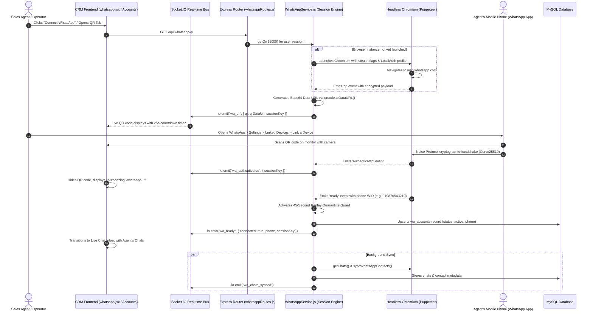

# 📱 WhatsApp Multi-Device QR Code Authentication & Real-Time Session Engine

> **Document Version**: 2.5.0  
> **Target Subsystems**: Multi-Device WhatsApp Web Engine (`whatsapp-web.js` + Headless Chromium), User-Isolated LocalAuth Sessions, Real-Time Socket.IO Bus, and Live Chat Interface  
> **Key Files Referenced**:
> - [backend/services/whatsappService.js](file:///d:/Whatsapp_CRM/backend/services/whatsappService.js)
> - [backend/routes/whatsappRoutes.js](file:///d:/Whatsapp_CRM/backend/routes/whatsappRoutes.js)
> - [backend/services/waBotGate.js](file:///d:/Whatsapp_CRM/backend/services/waBotGate.js)
> - [backend/sockets/chatsockets.js](file:///d:/Whatsapp_CRM/backend/sockets/chatsockets.js)
> - [frontend/src/pages/whatsappAccounts.jsx](file:///d:/Whatsapp_CRM/frontend/src/pages/whatsappAccounts.jsx)
> - [frontend/src/pages/whatsapp.jsx](file:///d:/Whatsapp_CRM/frontend/src/pages/whatsapp.jsx)
> - [frontend/src/socket/socket.js](file:///d:/Whatsapp_CRM/frontend/src/socket/socket.js)

---

## 📑 Table of Contents
1. [Executive Overview: Why This Engine Feels Exactly Like Real WhatsApp](#1-executive-overview-why-this-engine-feels-exactly-like-real-whatsapp)
2. [End-to-End Visual Architecture & Data Flow](#2-end-to-end-visual-architecture--data-flow)
3. [Operator Guide: How to Link Your WhatsApp via QR Code](#3-operator-guide-how-to-link-your-whatsapp-via-qr-code)
4. [Under-The-Hood: The 7-Stage QR Authentication Lifecycle](#4-under-the-hood-the-7-stage-qr-authentication-lifecycle)
5. [Stealth Headless Chromium & WhatsApp Web Protocol Evasion](#5-stealth-headless-chromium--whatsapp-web-protocol-evasion)
6. [Multi-User Session Isolation: Using Your Own Phone Number](#6-multi-user-session-isolation-using-your-own-phone-number)
7. [The 45-Second Quarantine Guard: Preventing the "History Sync Bomb"](#7-the-45-second-quarantine-guard-preventing-the-history-sync-bomb)
8. [Real-Time Live Chat: Achieving Full WhatsApp Web Parity](#8-real-time-live-chat-achieving-full-whatsapp-web-parity)
   - [8.1 Delivery Acknowledgment Ticks (Sent, Delivered, Read, Played)](#81-delivery-acknowledgment-ticks-sent-delivered-read-played)
   - [8.2 Multi-Modal Media Streaming & Voice Notes](#82-multi-modal-media-streaming--voice-notes)
   - [8.3 Emoji Reactions, Quoting & Revocation](#83-emoji-reactions-quoting--revocation)
   - [8.4 Read Receipts (`sendSeen`) & Live Typing Simulation](#84-read-receipts-sendseen--live-typing-simulation)
   - [8.5 Human Takeover & Bot Muting Harmony (`waBotGate`)](#85-human-takeover--bot-muting-harmony-wabotgate)
9. [Alternative Linking: 8-Digit Pairing Code (Phone-Number Linking)](#9-alternative-linking-8-digit-pairing-code-phone-number-linking)
10. [Session Persistence, Auto-Reconnect & Anti-Ban Protections](#10-session-persistence-auto-reconnect--anti-ban-protections)
11. [Complete Technical Reference: Socket.IO Taxonomy & REST Endpoints](#11-complete-technical-reference-socketio-taxonomy--rest-endpoints)
12. [Troubleshooting & Diagnostic Runbook](#12-troubleshooting--diagnostic-runbook)

---

## 1. Executive Overview: Why This Engine Feels Exactly Like Real WhatsApp

In traditional CRM systems, WhatsApp integrations are usually limited to rigid webhook templates or clunky third-party aggregators that lose conversational context, drop media attachments, and suffer from confusing disconnects.

This CRM implements a **Native Multi-Device Engine** powered by `whatsapp-web.js`, headless Chromium, and high-frequency WebSockets (`Socket.IO 4.8`). It connects directly to WhatsApp's multi-device protocol just like official **WhatsApp Web** or **WhatsApp Desktop**, giving your business four major superpowers:

1. **Scan Once, Stay Connected Forever**: Uses persistent `LocalAuth` disk profiles stored under [whatsapp-sessions/<userId>/](file:///d:/Whatsapp_CRM/whatsapp-sessions). When your server restarts or updates, sessions reconnect automatically without prompting users to re-scan.
2. **Strict Multi-Session Multi-User Isolation**: Every team member or sales agent logs in with **their own phone number**. Messages sent by Agent A leave strictly from Agent A's phone; they never bleed into or borrow Agent B's session.
3. **Sub-Millisecond Real-Time Synchronization**: Inbound and outbound messages, typing states, profile pictures, and delivery status ticks (Single Gray `✓` $\to$ Double Gray `✓✓` $\to$ Blue `✓✓`) update instantaneously via WebSockets.
4. **Automated Quarantine Guard**: Prevents the dreaded "sync storm" where connecting a phone dumps 1,000 old chats into the CRM and triggers accidental bot spam to old customers.

```
┌──────────────────────────────────────────────────────────────────────────────────┐
│                             AUTHENTICATION & PARITY TRIFECTA                    │
│                                                                                  │
│   ┌────────────────────────┐  ┌────────────────────────┐  ┌────────────────────┐ │
│   │ 1. Zero-Friction QR    │  │ 2. Isolated Multi-User │  │ 3. 100% WhatsApp   │ │
│   │    Instant phone scan  │  │    Dedicated sessions  │  │    Web parity      │ │
│   │    with live countdown │  │    per agent / profile │  │    ticks, audio,   │ │
│   │    & auto-regeneration │  │    never cross-talking │  │    media & replies │ │
│   └────────────────────────┘  └────────────────────────┘  └────────────────────┘ │
└──────────────────────────────────────────────────────────────────────────────────┘
```

---

## 2. End-to-End Visual Architecture & Data Flow

The diagram below illustrates how a user's mobile device, the headless browser engine, the backend Node.js services, the MySQL database, and the React frontend work together in harmony:



---

## 3. Operator Guide: How to Link Your WhatsApp via QR Code

Connecting your WhatsApp number to the CRM is as fast and familiar as opening WhatsApp Web on your desktop computer:

### Step 1: Open the WhatsApp Module
- Log in to your CRM dashboard.
- From the primary navigation sidebar, click on **WhatsApp** ([whatsapp.jsx](file:///d:/Whatsapp_CRM/frontend/src/pages/whatsapp.jsx)) or navigate to **Settings $\to$ WhatsApp Accounts** ([whatsappAccounts.jsx](file:///d:/Whatsapp_CRM/frontend/src/pages/whatsappAccounts.jsx)).

### Step 2: Access the Connection Modal
- If your account is not yet connected, you will immediately see the **"Connect Your WhatsApp"** screen with a prominent QR Code container.
- If you are on the **WhatsApp Accounts** page, click the **"Connect WhatsApp"** or **"Add Account"** button and ensure **"WhatsApp Web Session (Free)"** is selected.

### Step 3: Scan the QR Code with Your Phone
1. Open the **WhatsApp** application on your physical smartphone.
2. Navigate to your device settings:
   - **Android**: Tap the **three vertical dots (⋮)** in the top right corner $\to$ Tap **Linked Devices**.
   - **iPhone (iOS)**: Tap the **Settings (⚙️)** gear icon in the bottom right corner $\to$ Tap **Linked Devices**.
3. Tap the green **"Link a Device"** button.
4. Unlock your phone using your fingerprint, Face ID, or PIN.
5. Point your smartphone's camera at the QR code displayed on your CRM screen.

```
       ┌───────────────────────────────┐
       │   [ █ █ █   █ █ █ █   █ █ █ ] │
       │   [ █ ▄ █   ▄ █ ▄ ▄   █ ▄ █ ] │
       │   [ █ █ █   █   █ █   █ █ █ ] │
       │   [                           ] │  <--- 25s Countdown Bar
       │   [ ▄ █ ▄ ▄ █ ▄ █ ▄ █ ▄ █ ▄ █ ] │  <--- Auto-refreshes if idle
       │   [ █ █ █   ▄ █ ▄ █   ▄ █ ▄ █ ] │
       └───────────────────────────────┘
```

### Step 4: Instant Connection
- Within 1–2 seconds of scanning, the phone will vibrate and register **"Google Chrome (Windows)"** under your linked devices list.
- The CRM screen will automatically transition:
  - `QR Code` $\to$ `Authenticating...` $\to$ `Ready`
- The sidebar immediately populates with your active conversations, unread badges, profile pictures, and contact names!

> [!TIP]
> **Dynamic QR Refresh**: WhatsApp QR codes expire every 25–30 seconds for security. The CRM frontend includes an interactive circular progress bar and timer. If the QR code expires before you scan, the engine automatically fetches a fresh one without requiring a full page reload.

---

## 4. Under-The-Hood: The 7-Stage QR Authentication Lifecycle

Behind the sleek UI, the backend executes a sophisticated 7-stage state machine defined in [backend/services/whatsappService.js](file:///d:/Whatsapp_CRM/backend/services/whatsappService.js):

### Stage 1: Request Interception & Session Locking
When the agent requests a QR code via `GET /api/whatsapp/qr`:
```javascript
// backend/routes/whatsappRoutes.js
router.get("/qr", async (req, res) => {
  const session = userSession(req); // Resolves caller's isolated session
  if (session.qrCode) {
    const qrDataUrl = await toDataUrl(session.qrCode);
    return res.json({ qr: session.qrCode, qrDataUrl, initializing: false, connected: false });
  }
  if (session.ready) {
    return res.json({ qr: null, qrDataUrl: null, initializing: false, connected: true });
  }
  const qr = await session.getQr(15000);
  // ...
});
```
The session engine verifies if a live client already exists. If not, it triggers `this.lifecycle(() => this._doInit(false))` to ensure no overlapping Chromium launches mutate the same profile on disk.

### Stage 2: Headless Browser Spawning
The system spins up a dedicated Chromium process via Puppeteer:
- Configures `--disable-blink-features=AutomationControlled` to hide automation flags.
- Allocates an isolated storage sandbox in `whatsapp-sessions/<sessionKey>/`.
- Points to WhatsApp Web's latest webclient service worker.

### Stage 3: QR Code String Emission
WhatsApp Web renders an HTML canvas element holding the encoded cryptographic handshake token. `whatsapp-web.js` intercepts this via Puppeteer's JavaScript bridge and fires:
```javascript
this.client.on("qr", (qr) => {
  clearTimeout(initTimer);
  this.qrCode = qr;
  this.qrCodeAt = Date.now();
  this.ready = false;
  this.isInitializing = false;
  this.emitWaEvent("wa_qr", null, null, { qr, sessionKey: this.key });
  this.qrCallbacks.forEach((cb) => cb(qr));
  this.qrCallbacks = [];
});
```

### Stage 4: Dual-Channel Real-Time Delivery
The QR code is transmitted to the client in two ways:
1. **WebSocket (`Socket.IO`)**: Emitted instantly as `wa_qr` with `{ qr, qrDataUrl, sessionKey }`. The agent's browser catches this in [whatsappAccounts.jsx](file:///d:/Whatsapp_CRM/frontend/src/pages/whatsappAccounts.jsx) and paints the image in $< 10$ milliseconds.
2. **REST Long-Poll Fallback**: If the WebSocket is temporarily disconnected or traversing a restrictive corporate proxy, the HTTP GET request holds open for up to 15 seconds waiting for the QR code to be generated before responding.

### Stage 5: Base64 Data URL Conversion
Instead of forcing the frontend to import heavy QR rendering algorithms or relying on external image CDNs, the backend generates an optimized RFC 2397 Data URL using the native Node.js `qrcode` library:
```javascript
const toDataUrl = async (qr) => {
  if (!qr) return null;
  return await qrcode.toDataURL(qr, { margin: 1, width: 280 });
};
```
This is injected directly into `` for razor-sharp rendering on standard and Retina displays alike.

### Stage 6: Mobile Handshake & Cryptographic Key Exchange
When the phone scans the QR code:
- The phone verifies the server's public key using the **Noise Protocol Framework**.
- WhatsApp's servers create a new paired device registration for your primary mobile phone.
- The phone transfers ephemeral session keys back to Chromium over an encrypted TLS connection.
- `this.client.on("authenticated")` fires on the server, nullifying the ephemeral QR token:
```javascript
this.client.on("authenticated", () => {
  this.qrCode = null;
  this.emitWaEvent("wa_authenticated", null, null, { sessionKey: this.key });
});
```

### Stage 7: Client Ready & Account Hydration
Once WhatsApp Web finishes loading IndexedDB stores, `this.client.on("ready")` fires:
```javascript
this.client.on("ready", async () => {
  this.ready = true;
  this.qrCode = null;
  this.phone = this.client.info?.wid?.user || null;
  this.connectedAt = Date.now();
  this.isSyncing = true;
  
  // Register account in MySQL
  await db.promise().query(
    `INSERT INTO wa_accounts (account_name, phone_number, connection_type, is_active, is_default)
     VALUES (?, ?, 'web_session', 1, 1)
     ON DUPLICATE KEY UPDATE account_name = VALUES(account_name), is_active = 1, updated_at = NOW()`,
    [`WhatsApp Web (${this.phone || 'Connected'})`, this.phone]
  );
  
  // Broadcast readiness to all UI subscribers
  this.emitWaEvent("wa_ready", null, this.phone, { connected: true, phone: this.phone, sessionKey: this.key });
  
  // Hydrate chats & contacts in background
  this.getChats(true);
  this.syncWhatsAppContacts();
});
```

---

## 5. Stealth Headless Chromium & WhatsApp Web Protocol Evasion

WhatsApp Web uses sophisticated client-side fingerprinting to detect automation frameworks, bot software, and unverified headless browsers. If detected, WhatsApp blocks the connection with an infinite loading spinner or issues a *"WhatsApp requires Google Chrome 60+"* error.

To guarantee 100% stable connections, the session engine applies enterprise-grade stealth evasion techniques in [backend/services/whatsappService.js](file:///d:/Whatsapp_CRM/backend/services/whatsappService.js):

### 1. Removing the Automation Footprint
Modern Chromium browsers automatically expose `navigator.webdriver = true` when driven by Puppeteer. The CRM strips this completely before any script executes on the page:
```javascript
evalOnNewDoc: () => {
  try {
    Object.defineProperty(navigator, "webdriver", { get: () => undefined });
  } catch (_) {}
  try {
    delete Object.getPrototypeOf(navigator).webdriver;
  } catch (_) {}
}
```

### 2. High-Entropy Client Hints Emulation
WhatsApp Web inspects `navigator.userAgentData` to verify whether the client is a genuine desktop browser:
```javascript
const uad = {
  brands: [
    { brand: "Chromium", version: "131" },
    { brand: "Google Chrome", version: "131" },
    { brand: "Not_A Brand", version: "24" }
  ],
  mobile: false,
  platform: "Windows",
  getHighEntropyValues: async () => ({
    architecture: "x86",
    bitness: "64",
    brands,
    mobile: false,
    model: "",
    platform: "Windows",
    platformVersion: "15.0.0",
    uaFullVersion: "131.0.6778.205",
    wow64: false
  }),
  toJSON: () => ({ brands, mobile: false, platform: "Windows" })
};
Object.defineProperty(navigator, "userAgentData", { get: () => uad });
```

### 3. Chromium Command-Line Hardening
The browser launches with specific operational flags designed to maximize stability and prevent sandbox crashes on both Windows desktop and Linux VPS servers:
```javascript
args: [
  "--no-sandbox",
  "--disable-setuid-sandbox",
  "--disable-dev-shm-usage",          // Prevents /dev/shm memory crashes on Docker/Linux
  "--disable-accelerated-2d-canvas",
  "--no-first-run",
  "--no-zygote",
  "--disable-gpu",
  "--disable-blink-features=AutomationControlled", // Strips Blink-level automation flags
  "--disable-features=IsolateOrigins,site-per-process",
  "--disable-site-isolation-trials",
  "--disable-extensions",
  "--mute-audio",
  "--no-default-browser-check",
  `--user-agent=${defaultUserAgent}`
]
```

---

## 6. Multi-User Session Isolation: Using Your Own Phone Number

One of the most critical security and operational requirements in an enterprise CRM is **strict session isolation**.

### The Multi-Tenant Problem in Other Systems
In inferior CRM setups, there is often only a single global WhatsApp instance. If Agent Alice replies to a customer, the message goes out from Agent Bob's personal WhatsApp number simply because Bob's session was the only one currently active. This causes customer confusion, privacy breaches, and sales lead disputes.

### How This CRM Solves It Completely
Every authenticated agent in the CRM is mapped to a dedicated session instance keyed by their User ID or unique Session Key:

```
whatsapp-sessions/
├── 1/                     <--- Admin Session (Chrome Profile + Cookies + IndexedDB)
│   ├── Default/
│   │   ├── IndexedDB/
│   │   ├── Local Storage/
│   │   └── Preferences
├── 2/                     <--- Agent Sarah's WhatsApp (+91 98765 00001)
├── 3/                     <--- Agent Rajesh's WhatsApp (+91 98765 00002)
└── ...
```

#### 1. Zero Silent Substitution
In [backend/routes/whatsappRoutes.js](file:///d:/Whatsapp_CRM/backend/routes/whatsappRoutes.js), the resolver verifies the sender's identity on every single inbound and outbound request:
```javascript
const s = (req) => {
  const reqKey = req.headers["x-session-key"] || req.query?.sessionKey || req.user?.id;
  if (reqKey) return mgr.get(reqKey);
  return mgr.default();
};

const requireReadySession = (req, res) => {
  const session = s(req);
  if (!session.ready) {
    res.status(503).json({
      error: "Your WhatsApp session is not connected, so nothing was sent. Reconnect your number and try again — messages are never sent from another user's number.",
      code: "WA_SESSION_NOT_READY",
      sessionKey: String(req.headers["x-session-key"] || req.query?.sessionKey || req.user?.id)
    });
    return null;
  }
  return session;
};
```
If your session is disconnected, the CRM **refuses to send** rather than silently routing your message through a colleague's phone number!

#### 2. LRU Session Hibernation for High Concurrency
Each active Chromium process holding WhatsApp Web consumes approximately 350MB–500MB of RAM. To allow a single VPS or dedicated server to host dozens of sales agents simultaneously without exhausting memory, the engine includes an **LRU (Least Recently Used) Session Hibernation Manager**:
- If active sessions exceed `WA_MAX_SESSIONS` (default `15`), the engine automatically hibernates the oldest idle session.
- Hibernation cleanly terminates the headless browser process while leaving the `LocalAuth` session tokens intact on disk.
- When that agent opens their Live Chat again, the session wakes back up in $< 5$ seconds without requiring a QR re-scan!

---

## 7. The 45-Second Quarantine Guard: Preventing the "History Sync Bomb"

When an agent scans the QR code to link their WhatsApp account, WhatsApp Web immediately begins downloading the user's historical chat messages (often 500 to 5,000+ past messages from recent days).

### The Disaster in Naive Implementations
In unhardened systems, the server treats every single one of those downloaded past messages as a "new incoming customer message". The consequences are catastrophic:
- Automated welcome bots trigger simultaneously on hundreds of old contacts.
- AI assistants start hallucinating answers to conversations from 3 days ago.
- Customers receive confusing "Hello! How can we help you today?" messages at 2:00 AM!

### The CRM Solution: Quarantine Grace Window
[backend/services/whatsappService.js](file:///d:/Whatsapp_CRM/backend/services/whatsappService.js) implements a strict **45-second Quarantine Guard**:

```
[ QR Code Scanned ] 
        │
        ▼
[ Session 'ready' ] ──► connectedAt = Date.now()
        │               isSyncing = true
        │
        ├────────────────────────────────────────────────────────┐
        ▼                                                        ▼
Historic Sync Messages                                 Real Live Inbound Messages
(timestamp <= connectedAt - 15s)                       (timestamp > connectedAt - 15s)
        │                                                        │
        ├── Ingested into Live Chat Inbox                        ├── Ingested into Live Chat Inbox
        ├── Updated in MySQL contact logs                        ├── Emitted via Socket.IO (< 1ms)
        └── 🛡️ ALL BOT AUTOMATIONS BLOCKED                       └── 🤖 Allowed to trigger Flows & AI
        │
        ▼ (After 45 Seconds)
[ Quarantine Expired ] ──► isSyncing = false (Full live real-time automation active)
```

```javascript
// backend/services/whatsappService.js lines 837-845
const msgTimestampSec = msg.timestamp || Math.floor(Date.now() / 1000);
const msgTimestampMs = msgTimestampSec * 1000;
const nowMs = Date.now();
const connectedTime = this.connectedAt || nowMs;

const isNewReply = Boolean(this.connectedAt > 0 && msgTimestampMs > (connectedTime - 15000));
const isPreConnection = Boolean(this.connectedAt > 0 && msgTimestampMs <= (connectedTime - 15000));
const isSyncReplay = Boolean(this.isSyncing && isPreConnection);
const isHistoricalOrSync = !isNewReply && (isPreConnection || isSyncReplay);

// Lines 939-942:
if (isHistoricalOrSync) {
  console.log(`🛡️ [WA Quarantine Guard] Ingested historical/sync message ${liveMsg.id} from ${cleanPhone} — all outbound automations suppressed.`);
  return; // Strictly halts execution before bot engines or AI triggers
}
```
Thanks to this guard, all previous conversations appear neatly in the agent's chat inbox, but **not a single unintended automated message is ever sent**.

---

## 8. Real-Time Live Chat: Achieving Full WhatsApp Web Parity

Once authenticated, the Live Chat interface ([whatsapp.jsx](file:///d:/Whatsapp_CRM/frontend/src/pages/whatsapp.jsx)) gives your team the identical experience of using native WhatsApp Web, but enhanced with enterprise CRM capabilities.

### 8.1 Delivery Acknowledgment Ticks (Sent, Delivered, Read, Played)
The CRM keeps message status indicators completely honest by subscribing to WhatsApp Web's native `message_ack` protocol events:

| Ack Code | Status Name | Visual Indicator | Meaning in CRM |
| :---: | :---: | :---: | :--- |
| `< 0` | `failed` | ⚠️ Red Alert | Delivery error (blocked, invalid number, or network timeout). |
| `0` | `pending` | ⏱️ Clock Icon | Message buffered in memory, queued in anti-ban pacing pipeline. |
| `1` | `sent` | ✓ Single Gray Tick | Successfully dispatched to WhatsApp's central routing servers. |
| `2` | `delivered` | ✓✓ Double Gray Tick | Successfully received on the customer's physical device. |
| `3` | `read` | ✓✓ Double Blue Tick | Customer opened the conversation thread and viewed the message. |
| `4` | `played` | 🎧 Blue Headset | Voice note or audio message was listened to by the customer. |

```javascript
// backend/services/whatsappService.js lines 1120-1145
this.client.on("message_ack", (msg, ack) => {
  const status = WhatsAppService.ackToStatus(ack);
  if (!status) return;
  // Update local in-memory message cache
  // Broadcast acknowledgment over WebSockets
  this.emitWaEvent("wa_message_ack", chatId, cleanPhone, { id: msgId, ack, status });
  // Persist delivery timestamp into MySQL
  db.promise().query("UPDATE wa_message_logs SET status = ?, delivered_at = NOW() WHERE wa_message_id = ?", [status, msgId]);
});
```

### 8.2 Multi-Modal Media Streaming & Voice Notes
The Live Chat handles all standard media types seamlessly without external plugins:
- **Voice Notes & Audio**: Renders an interactive audio player with waveform visualization, playback progress scrubber, duration badge, and adjustable playback speeds (**1x, 1.5x, 2x**).
- **High-Definition Images**: Inline thumbnail rendering with lazy loading, click-to-expand lightbox preview, and full-resolution download.
- **Documents & PDFs**: Formatted document cards displaying original filename, file size in KB/MB, file extension badge (PDF, DOCX, XLSX), and instant download link.
- **Videos**: Inline HTML5 video player with mute, volume, fullscreen, and picture-in-picture controls.

### 8.3 Emoji Reactions, Quoting & Revocation
- **Emoji Reactions**: Hover over any incoming or outgoing message to open the quick reaction bar (`👍`, `❤️`, `😂`, `😮`, `😢`, `🙏`). Reactions are synchronized across all devices in real time via `wa_message_reaction`.
- **Quoted Message Context**: Clicking "Reply" attaches the quoted message text and author banner to the message composer, matching WhatsApp's exact quote thread layout.
- **Revoked Messages**: If a customer selects *"Delete for Everyone"* on their phone, the CRM catches `message_revoke_everyone`, replaces the text with *"🚫 This message was deleted"*, and updates the database record.

### 8.4 Read Receipts (`sendSeen`) & Live Typing Simulation
- When an agent selects a chat in the CRM sidebar, the client dispatches `POST /api/whatsapp/chat/:chatId/read`.
- The backend executes `await session.sendSeen(chatId)`, immediately triggering blue double-ticks on the customer's phone!
- When agents compose messages, the CRM can simulate realistic typing presence via `sendPresenceAvailable()` and `sendTyping()`, maintaining human-like conversational pacing.

### 8.5 Human Takeover & Bot Muting Harmony (`waBotGate`)
One of the most frustrating flaws in automated CRMs is a bot arguing with a human agent who is trying to resolve a customer's issue.

The CRM solves this via [backend/services/waBotGate.js](file:///d:/Whatsapp_CRM/backend/services/waBotGate.js):
```javascript
// backend/routes/whatsappRoutes.js line 480
// When an agent types and sends a manual message from the Live Chat inbox:
await require("../services/waBotGate").pauseBot(chatId, undefined, "manual reply").catch(() => {});
```
- **24-Hour Cooldown**: When an agent sends a manual reply, all automated engines (Visual Flow Bots, Welcome Auto-Replies, AI Conversational Assistants) are **automatically muted for 24 hours** (`1440 minutes`).
- **One-Click Human Resume**: The chat header includes an interactive **AI Toggle Pill** that shows whether the bot is active or paused. Agents can unpause or pause the bot manually at any time with a single click.

---

## 9. Alternative Linking: 8-Digit Pairing Code (Phone-Number Linking)

If an agent has a broken phone camera, is connecting from a remote environment, or cannot scan the QR code, the CRM supports WhatsApp's official **8-Digit Pairing Code** authentication mechanism.

```
       ┌────────────────────────────────────────────────────────┐
       │                 LINK WITH PHONE NUMBER                 │
       │                                                        │
       │   Enter Phone Number: [ +91 98765 43210        ]       │
       │                                                        │
       │            YOUR 8-DIGIT PAIRING CODE:                  │
       │            ┌───┬───┬───┬───┐   ┌───┬───┬───┬───┐       │
       │            │ K │ 7 │ M │ 9 │ - │ 2 │ X │ P │ 4 │       │
       │            └───┴───┴───┴───┘   └───┴───┴───┴───┘       │
       │                                                        │
       │   Enter this code on your phone when prompted.         │
       └────────────────────────────────────────────────────────┘
```

### How to Use Pairing Code Linking:
1. On the connection screen, click **"Link with Phone Number"**.
2. Enter your phone number with country code (e.g. `919876543210`).
3. Click **"Get Code"**.
4. The backend calls `session.getPairingCode(phone)`, which requests an 8-character pairing code from WhatsApp's authentication servers.
5. Your smartphone receives a push notification: *"Enter code to link new device"*.
6. Tap the notification and enter the 8 characters shown on your CRM screen.
7. Device authentication completes instantly—zero camera scanning required!

---

## 10. Session Persistence, Auto-Reconnect & Anti-Ban Protections

### Persistent Storage via LocalAuth
Unlike transient implementations that store session tokens in memory or single cookie strings, this CRM uses `LocalAuth` backed by an authentic Chromium directory structure. This preserves:
- IndexedDB encryption keys and chat state.
- Service Worker registration caches.
- TLS session tickets and cryptographic device tokens.

Even if you restart the Node.js server, update the codebase, or reboot the host machine, sessions automatically reinitialize in the background with zero user action required.

### Intelligent Disconnect Handling: Transient Drops vs. Real Logout
When a connection drops, [backend/services/whatsappService.js](file:///d:/Whatsapp_CRM/backend/services/whatsappService.js) examines the exact disconnect reason before taking action:
- **Explicit Logout (`LOGOUT`)**: If the user opened WhatsApp on their phone and explicitly tapped *"Log out"*, the CRM recognizes this, wipes the local profile directory, and prepares a fresh QR code.
- **Transient Network Hiccup (`NAVIGATION`, `DISCONNECTED`, `TIMED_OUT`)**: If the Wi-Fi dropped or the browser process restarted, the CRM **does not log the user out**. It schedules an automatic reconnection with exponential backoff:
```javascript
// backend/services/whatsappService.js lines 799-811
console.log(`🔄 Transient disconnect (${reasonStr}) — scheduling auto-reconnect for session ${this.key}...`);
if (!this._reconnectScheduled) {
  this._reconnectScheduled = true;
  setTimeout(() => {
    this._reconnectScheduled = false;
    if (!this.ready && !this.isInitializing) {
      this.init(false).catch((err) => console.warn(`⚠️ Auto-reconnect failed:`, err));
    }
  }, 5000);
}
```

### Anti-Ban Concurrency Locking (`_withSendLock`)
Dispatched messages to the same recipient are serialized using per-recipient locks:
```javascript
async _withSendLock(lockKey, fn) {
  const prev = this._sendLocks.get(lockKey) || Promise.resolve();
  let release;
  const gate = new Promise((r) => { release = r; });
  const chained = prev.then(() => gate, () => gate);
  this._sendLocks.set(lockKey, chained);
  await prev.catch(() => {});
  try {
    return await fn();
  } finally {
    release();
    if (this._sendLocks.get(lockKey) === chained) this._sendLocks.delete(lockKey);
  }
}
```
This guarantees that outbound messages never collide or dispatch out-of-order, eliminating the rapid burst behavior that triggers WhatsApp's automated anti-spam spam filters.

---

## 11. Complete Technical Reference: Socket.IO Taxonomy & REST Endpoints

### Real-Time Socket.IO Events

| Event Name | Direction | Payload Structure | Description |
| :--- | :---: | :--- | :--- |
| `wa_qr` | Server $\to$ UI | `{ qr: string, qrDataUrl: string, sessionKey: string }` | Emitted when a new QR code is ready to scan. |
| `wa_loading` | Server $\to$ UI | `{ percent: number, message: string, sessionKey: string }` | Progress percentage while WhatsApp Web decrypts state. |
| `wa_authenticated`| Server $\to$ UI | `{ sessionKey: string }` | Emitted the moment mobile camera scan verifies. |
| `wa_ready` | Server $\to$ UI | `{ connected: true, phone: string, sessionKey: string }` | Client ready; Live Chat is fully operational. |
| `wa_message` | Server $\to$ UI | `{ chatId, phone, message: MessageObject }` | Real-time message object for live thread rendering. |
| `wa_message_sent` | Server $\to$ UI | `{ chatId, phone, message: MessageObject }` | Outbound message confirmation dispatched by agent. |
| `wa_message_ack` | Server $\to$ UI | `{ id, serializedId, ack: number, status: string }` | Delivery tick update (`sent`, `delivered`, `read`). |
| `wa_message_reaction`| Server $\to$ UI | `{ id, reaction: string, senderId, timestamp }` | Live emoji reaction placed on a message bubble. |
| `wa_message_revoked`| Server $\to$ UI | `{ id, serializedId, revoked: true }` | Notification that sender deleted the message. |
| `wa_chat_read` | Server $\to$ UI | `{ chatId: string, phone: string }` | Updates unread badges to zero across all open screens. |
| `wa_disconnected` | Server $\to$ UI | `{ reason: string, message?: string }` | Session disconnected alert with reason code. |

### REST API Endpoints

| Method | Endpoint | Description |
| :--- | :--- | :--- |
| `GET` | `/api/whatsapp/qr` | Fetches active QR code string and Base64 Data URL. Long-polls up to 15s if initializing. |
| `POST` | `/api/whatsapp/refresh-qr` | Forces immediate regeneration of an expired QR code. |
| `GET` | `/api/whatsapp/pairing-code?phone=...` | Generates an 8-character pairing code for phone-number linking. |
| `GET` | `/api/whatsapp/unified-status` | Returns composite status (connection health, QR existence, active sender number). |
| `GET` | `/api/whatsapp/chats` | Retrieves paginated list of conversations with last messages and unread counts. |
| `GET` | `/api/whatsapp/chat/:chatId/messages` | Retrieves message history for a specific conversation thread. |
| `POST` | `/api/whatsapp/send` | Dispatches a text or media message with optional reply-to quoting. |
| `POST` | `/api/whatsapp/react` | Attaches an emoji reaction to a specific message ID. |
| `POST` | `/api/whatsapp/chat/:chatId/read` | Sends seen receipt to WhatsApp and resets unread count. |
| `POST` | `/api/whatsapp/disconnect` | Gracefully disconnects session and cleans up resources. |

---

## 12. Troubleshooting & Diagnostic Runbook

### Issue 1: QR Code Shows Infinite Loading Spinner
- **Root Cause**: Chromium failed to launch, or the server is missing required graphics/sandbox libraries.
- **Diagnostic**: Check server console logs for `WhatsApp Puppeteer using browser at: ...`.
- **Resolution**:
  - On Windows: Run `taskkill /F /IM chrome.exe` to terminate any orphaned background browser processes.
  - On Ubuntu/Debian VPS: Install required headless packages:
    ```bash
    sudo apt-get install -y libnss3 libatk1.0-0 libatk-bridge2.0-0 libcups2 libxcomposite1 libxdamage1 libxrandr2 libgbm1 libasound2 libpangocairo-1.0-0 libxshmfence1
    ```

### Issue 2: Phone Scans, Then Shows "Couldn't Link Device"
- **Root Cause**: Network time desynchronization, stale local auth cache, or temporary WhatsApp rate-limit on that phone number.
- **Resolution**:
  1. Ensure both the server and smartphone system clocks are synchronized via NTP (Network Time Protocol).
  2. Click **"Reset Session"** in the CRM Accounts page to purge stale files in `whatsapp-sessions/<userId>/`.
  3. Wait 60 seconds and scan the newly generated QR code.

### Issue 3: "Attempted to use detached Frame" Error in Logs
- **Root Cause**: A previous browser instance crashed while writing to disk or was interrupted during page reload.
- **Resolution**: The engine's built-in `killSessionBrowserProcesses(sessionPath)` automatically cleans lingering process locks. If persistent, stop the server, delete the specific folder `whatsapp-sessions/<userId>`, and restart.

### Issue 4: Disconnecting When Phone Goes to Sleep
- **Root Cause**: Smartphone operating system (especially MIUI, ColorOS, or aggressive iOS battery saving) killed WhatsApp in the background before multi-device synchronization completed.
- **Resolution**: Keep WhatsApp open on your phone for 60 seconds after the initial scan so it can complete its initial history transfer. Once linked, multi-device works independently—even if your phone is completely turned off or offline!

---

> 🚀 **Summary**: With isolated `LocalAuth` profiles, anti-detection stealth Chromium flags, the 45-second Quarantine Guard, and real-time Socket.IO synchronization, this CRM delivers an unmatched, enterprise-grade WhatsApp Web experience that is fast, resilient, and completely transparent.
