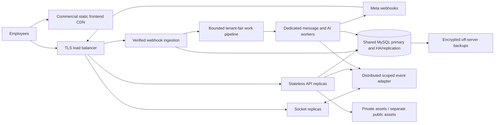

# Capacity review: 4 GB RAM / 100 GB SSD

The requested full workload is **NO-GO on one 4 GB VPS with a 100 GB SSD**. The changes in this branch improve efficiency and provide bounded resource controls for a measured pilot. They do not certify the requested production volume, 25,000 simultaneous users, or maintenance-free operation.

The complete static source inventory is in [capacity_file_audit.md](capacity_file_audit.md); machine-readable counts and source hashes are in [capacity_audit.json](capacity_audit.json). Every inventoried file was scanned for source size and selected patterns. That inventory is not an exhaustive semantic review of every legacy feature. The runtime review and tests concentrate on authentication, shared inbox, routing, webhook ingestion, local storage, AI, R2, and deployment operations.

## 1. Your workload, calculated

Assume 200 business customers, five organizations each, 25 distinct employees per organization, 100 customer interactions per employee per day, and 20–50 total inbound/outbound messages per interaction.

| Quantity | Calculation | Result |
|---|---|---:|
| Organizations | 200 × 5 | 1,000 |
| Employee identities | 1,000 × 25 | 25,000 |
| Customer interactions/day | 25,000 × 100 | 2,500,000 |
| Messages/day | 2,500,000 × 20–50 | 50,000,000–125,000,000 |
| Average messages/second, spread over 24 hours | Daily volume ÷ 86,400 | 579–1,447 |
| Average messages/second, eight-hour business day | Daily volume ÷ 28,800 | 1,736–4,340 |
| Planning burst, five times the eight-hour average | Assumed burst factor, not a measurement | 8,681–21,701 |

Delivery/read receipts create additional webhook work. For example, the event rate is message rate plus outbound message rate multiplied by the number of receipts received. Requests can also contain several events. Do not equate HTTP requests, messages, and status events.

These are interactions, not necessarily new unique people. If customers repeat, CRM contact growth is much smaller. If all 2.5 million interactions are new people daily, contacts and conversations also grow rapidly. The existing model treats each `tenants` row as an organization/workspace; the scenario therefore means 1,000 scoped organizations. A separate parent business/billing-account entity and a five-organization product quota are not introduced by this performance work.

CPU cores, storage IOPS/latency, bandwidth allowance, concurrent active employees, number of supervisors, media traffic, AI usage, and customer reuse are still unknown. RAM and SSD size alone cannot establish throughput.

## 2. Disk is a hard limit even without message bodies

The selected policy keeps WhatsApp bodies in each employee's device cache. MySQL still stores identifiers, delivery state, routing, deduplication, contacts, notes, and indexes.

Illustrative arithmetic, **not measured row sizes**:

| Retained state | Assumption | Low volume | High volume |
|---|---|---:|---:|
| One message metadata row | 250 bytes × daily messages × 30 days | 375 GB | 937.5 GB |
| One dedupe claim per message | 150 bytes × daily messages × 14 days | 105 GB | 262.5 GB |
| Combined illustrative footprint | Before receipts, extra indexes, CRM, binlogs and backups | 480 GB | 1,200 GB |

Actual sizes must be measured with realistic provider IDs and `information_schema.tables`. These assumptions deliberately show how a small per-message record becomes large at this volume. Extra receipt claims can increase the result. Keeping only bodies out of MySQL does not make 100 GB sufficient.

Keep at least 20 GB of disk headroom during a pilot, including MySQL temporary work and logs. The operations check warns at 80% usage or under 20 GB free, and reports critical pressure at 90% usage or under 10 GB free. Contacts and notes are not automatically deleted to make the disk fit. Their retention/deletion policy needs a business decision.

R2 holds explicit business assets and can host a separately configured encrypted backup repository. It does not provide MySQL RAM, query throughput, free bandwidth, chat-history retrieval, or additional VPS filesystem space for database tables.

## 3. Frontend hosting

Vercel's Hobby plan is for personal, non-commercial use. This business CRM needs a hosting arrangement that permits commercial use; do not plan production around the free Hobby entitlement. See [Vercel Hobby](https://vercel.com/docs/plans/hobby) and [fair-use guidelines](https://vercel.com/docs/limits/fair-use-guidelines).

The app remains a static SPA. Vercel serves HTML, JavaScript, CSS and public images; API and socket traffic go directly to the VPS API origin. Use an app/API pair under your business domain for the selected cookie policy. No frontend environment variable may contain Meta, AI, database, backup, R2, or operator credentials.

The measured main JavaScript gzip bundle was approximately **494 kB before route splitting and 133 kB afterward**, about 73% smaller. This is the entry bundle, not the sum of all lazy route chunks. Visiting a feature downloads its required chunks. Repeat measurements after dependency or UI changes.

## 4. Implemented hot-path changes

| Area / files | Change and implication |
|---|---|
| `frontend/src/App.js` | Feature/branch routes load lazily. Removed client anti-sleep pings intended for an old hosting setup. |
| `SharedTeamInbox.jsx`, `inboxRefreshScheduler.js` | Known-chat bodies/receipts update from scoped socket events without fetching the inbox. Unknown chats and record changes coalesce; search waits 300 ms. Hidden tabs skip polling but continue caching authorized live events. Connected reconciliation is jittered around two minutes; disconnected fallback around 30 seconds. |
| Inbox list and cursor service | The frontend requests activity ordering with keyset cursors. Existing numeric-ID pagination remains the default for older clients. A selected chat outside page one is checked separately instead of being treated as revoked. Loading more deduplicates IDs while the live list changes. |
| `WALayout.jsx` | Admin sender-status polling reduced from ten seconds to roughly two minutes while visible. Removed a failed-request fallback to the frontend origin. |
| Organization analytics | Replaced global cross-organization counts with scoped aggregates, bounded lists and date ranges. Dashboard uses 11 table aggregates instead of more than 30 separate counts, with a bounded 30-second tenant cache and one in-flight build per tenant. Analytics refreshes on organization changes, rejects late responses, skips hidden-tab polling, and no longer requests unused webhook rows. |
| `waLocalCache.js` | IndexedDB schema v2 preserves old cached bodies and adds small size/age metadata records. Budget enforcement scans metadata instead of reserializing all cached bodies on every write. Limits remain seven days, 500 messages/conversation, 5 MiB/item and 25 MiB serialized payload/device; browser index/file overhead is additional. Logout invalidates queued writes. |
| `tenantMiddleware.js` | Tenant, active user and membership verification use one joined query instead of three. Repeated guards reuse verification only inside that request. Permissions are not cached between requests. |
| `sharedInboxService.js` | Existing valid owners avoid the organization routing lock. New assignment and rebalance still serialize capacity decisions. Transactions use READ COMMITTED so late-acquired assignment locks see current committed counts. Deadlock retries remain bounded. |
| Scoped event recipients | Current conversation metadata and number linkage are read together; recipient checks remain fresh. Compact state accompanies live events so status/assistant labels do not require a separate list request per message. |
| `waWebhookRoutes.js` | Duplicate claims are checked before conversation routing. In device-history mode, redundant webhook request/event rows are skipped. Removed redundant updates after a complete shared-message insert. Overload returns 503 before claiming new work; accepted webhook work retains its slot until processing finishes. |
| `database.js`, `capacity.js` | Ten pooled connections by default and a finite queue of 128, replacing a default pool of 25 and unlimited queue. Limits are configurable and bounded. A larger pool is not automatically faster. |
| Database readiness | A single-flight, bounded SQL probe runs periodically. Health rejects failed or stale results and recovers after a successful probe, rather than reporting the one-time startup connection forever. The operator endpoint includes probe latency. |
| `requestAdmission.js` | Defaults: 64 active HTTP requests, two multipart uploads, 16 webhook handlers. Busy requests return retryable 503. Health remains available. These are resource fuses, not proven sustainable loads. |
| `sharedInboxAssistant.js` | Four provider calls at once, 32 provider wait slots, five-second wait expiry. Tenant settings cache is bounded, lasts 30 seconds and is invalidated through settings updates. No provider response or chat body archive is added. |
| Shared bot flows | Ten editable organization-owned starters, published snapshots, permission-scoped initiation and real Cloud API delivery. Four workers, at most 64 pending tasks, 256 transient sessions and 16 KiB of collected variables/session. Definitions cache at most 16 MiB. These limits are pilot safeguards. See [enterprise_flows.md](enterprise_flows.md) for supported steps, template approval, privacy and executed tests. |
| `waRateLimiter.js`, browser sessions | Refresh has a separate budget from login, avoiding the old 35-login quota shared by an office IP. Login uses both IP and hashed account controls. Rate/throttle maps have bounded key counts, and trusted request IP takes precedence over client-supplied proxy-looking headers. |
| Migration and retention | Added provider-ID, activity and expiry indexes. Cleanup runs every five minutes in bounded batches; operators can see a backlog warning. It preserves existing retention periods, notes, contacts and unresolved sends. |
| Sockets and process | Incoming socket frames capped at 64 KiB; transport count has a configurable fuse. PM2 uses one process, a 768 MiB Node heap and 1,100 MiB RSS restart threshold. Shutdown advertises draining, disconnects transports and allows up to 30 seconds before forced termination. |

At 25,000 visible connected employees, changing reconciliation from every 15 seconds to every 120 seconds mechanically reduces idle list polls from about 1,667/s to 208/s. This alone is still material traffic. Avoiding per-message list fetches is more significant. These calculations are not a measured full-user load test.

The cleanup budget is at most 10,000 expired rows per table per five-minute run: roughly 2.88 million rows/table/day if every run completes. It cannot keep up with 50–125 million new rows/day. Full-scale retention needs a separately tested partitioning/archival strategy on suitable database infrastructure. Index additions to large existing tables need a reviewed maintenance plan before rollout; do not assume they complete within a normal deploy readiness timeout.

Analytics summarize retained records, not an immutable all-time ledger. Legacy reply ratios are activity-count ratios, not verified unique-customer conversion cohorts. Full-scale dashboards also need incremental rollups so a page refresh does not repeatedly count millions of retained rows. The remaining legacy offset-based contact/log views and campaign workflows require their own large-cardinality staging tests; route splitting and bounded responses alone do not certify them at the requested volume.

## 5. Small-VPS configuration and operations

The production example now selects `WA_RUNTIME_PROFILE=small-vps` and includes explicit pool, admission, upload, socket, AI and cleanup settings. A 1,000-transport socket cap is a ceiling protecting resources, **not evidence that 1,000 simultaneous employees are supported**. One browser may use more than one connection, and namespace objects also consume memory.

The profile requires a private operator token and configured encrypted backups before production preflight succeeds. Do not copy the example without completing its required values. The selected MySQL/R2/body-privacy controls stay intact.

Supplied operational files:

- `backend/deploy/mysql-4gb.cnf.example`: a starting point with a 1 GiB buffer pool and 40 MySQL connections, retaining durable commit settings. Validate real memory use before installing. See [MySQL memory use](https://dev.mysql.com/doc/refman/8.0/en/memory-use.html).
- `backend/deploy/wa-crm-logrotate.conf`: private app logs rotate daily or above 20 MB; seven compressed rotations. Adjust the path to your actual data directory. Do not enable a competing rotation mechanism for the same files.
- `wa-crm-ops.service` / `.timer`: local readiness, disk, RSS, event-loop delay, AI queue, cleanup backlog and optional backup-age checks about once a minute. `/api/ops/metrics` requires an operator-only bearer token; unauthorized requests return 404. Customer identifiers and message bodies are not included.
- `wa-crm-backup.service` / `.timer`: nightly encrypted streaming MySQL backup through restic. It avoids writing a plaintext SQL dump on the VPS. It uses a private MySQL login path and a separate backup password file. Restic must support `--stdin-from-command`, which [cancels a backup if the source command fails](https://restic.readthedocs.io/en/latest/040_backup.html).
- `wa-crm-backup-maintenance.service` / `.timer`: weekly repository metadata check and pruning of unreferenced packs. Metadata checks are not full data restore verification. A shared local lock prevents backup/maintenance overlap. Both jobs have memory/priority limits.

Backup snapshots retain seven daily, four weekly and three monthly restore points. Forgotten data is physically reclaimed by the maintenance job. A successful backup/retention run records a small private timestamp; a required backup older than 36 hours produces a critical operations result. Pre-deploy local dumps are separate, private, compressed files; only the latest two are retained.

Node heap and PM2 RSS thresholds are not hard whole-machine memory reservations. MySQL per-connection memory, filesystem cache, TLS, multipart buffers, restic and other processes also use RAM. Avoid repository maintenance and large campaigns during peak traffic. Watch measured memory and disk pressure rather than assuming the sum of configuration limits is safe.

### One-time setup on the actual VPS

These are reviewable deployment instructions. They have not been run on your VPS:

1. Install the declared Node 24 runtime, MySQL tools, PM2, NGINX, logrotate and a compatible restic version. Keep Node/MySQL/Redis ports private and configure TLS on the public API.
2. Fill private `backend/.env`, including stable auth/encryption keys and an operator token. Set `WA_ENABLE_CRM_SWEEP=0` for this standalone inbox deployment so the legacy full-CRM table sweep is not started.
3. Create the `wa-crm-backup` MySQL login path using `mysql_config_editor`. Grant only the database/backup permissions needed. Keep passwords out of command arguments and source control.
4. Create a **private** off-server S3/R2 repository for backups, save its independent encryption password outside the VPS as well, and initialize it explicitly. Set `RESTIC_REPOSITORY=s3:https://<account>.r2.cloudflarestorage.com/<private-backup-bucket>`, `RESTIC_PASSWORD_FILE`, and the backup-specific access keys. Do not reuse a public campaign bucket.
5. Run `npm run backup:mysql` once, and restore that snapshot into an isolated staging database. Confirm the expected tenant, contact and note records. Only then set `BACKUP_REQUIRED=1` and run production preflight. Missing R2 credentials currently prevent live verification; local transport tests do not replace it.
6. Review unit paths, usernames, Node executable and log paths. Install the supplied services/timers in `/etc/systemd/system`, reload systemd and enable the three timers. Install the logrotate file. Confirm timer execution and inspect a deliberately failed readiness check.
7. Configure an **external** uptime/alert destination, backup failure notification, certificate renewal and host security updates. An observer on the same VPS cannot report a dead VPS. This code does not silently send email/webhook alerts to an unspecified recipient.
8. Use a permitted commercial frontend plan, configure app/API domains and credentialed CORS, then test real Meta inbound messages, replies, receipts, media, human takeover, account revocation and restarts on those domains.

Useful operator commands after setup:

```bash
cd /home/wauser/app/backend
npm run production:preflight
npm run production:readiness
npm run ops:check
npm run verify:r2
systemctl list-timers 'wa-crm-*'
journalctl -u wa-crm-ops.service -u wa-crm-backup.service
```

No secrets, paid hosting upgrades, system services, firewall rules, repositories or external alert recipients were provisioned by the local code changes. Operations timers and the restic/S3 backup path still need an actual Linux deployment test with your credentials. A local unit check cannot prove an off-server restore.

## 6. Full-target architecture and release gate

Keep one **logical shared database** and tenant/organization isolation. Scaling does not require one database or WhatsApp session per employee.



This distributed topology is a **migration design**, not implemented multi-instance support in this branch. Before adding API replicas, implement shared socket delivery, distributed rate/admission state, explicit scheduler/worker ownership, tenant fairness, provider/account rate budgets and bounded retries. Do not increase PM2 instance count and assume the local assistant queues become distributed.

Webhook durability needs an explicit content decision. With no durable server-side body capture, a crash, disconnection or missed event can leave a permanent text gap. There is no arbitrary Meta text-history API to fill it. A short encrypted broker payload with TTL still retains message content server-side and must be approved as a policy change; it has not been silently added here.

Use a staging host matching the intended CPU, RAM, SSD and network. Load realistic tenant/contact/message cardinalities and provider IDs. Run mixed signed webhooks, receipts, new assignments, existing chats, notes, refreshes, sockets, transfers, imports and bounded campaigns; include slow providers, DB stalls, retry storms, process death and a backup/restore drill. Record throughput, p50/p95/p99 latency, loss/duplicates, backlog age, pool wait, RSS, disk/IOPS and event-loop delay. A request shed with 503 is protected overload, not successfully handled business volume.

Start with a small pilot and increase enrollment only after those measurements remain healthy. The full requested workload remains blocked on hosting capacity, a distributed implementation, a suitable retention/durability design and production load verification. No fixed worker count or RAM purchase is asserted sufficient without that test.

## 7. Evidence and limits

- An isolated local MySQL metadata benchmark exercised 200 existing-owner updates at concurrency eight. Two runs observed 320–471 operations/s, p95 23–35 ms, eight SQL statements/update, and **zero organization routing-lock queries**. This is a small, hot-fixture service test on Windows/Node 26; it excludes the HTTP pipeline, sockets, Meta, real AI, realistic data cardinality and the proposed VPS. It is not production capacity certification.
- Real MySQL tests cover concurrent equal assignment, ownership/number/tenant limits, notes, customer edits, receipts/privacy, cursor pagination, body redaction, AI handoff, R2 transport and expiry cleanup.
- Actual browser tests cover cookie/CORS login against the full backend and MySQL, scoped HTTP requests, durable notes, signed inbound webhook to real WebSocket delivery, local cache/reload and mobile layout. A known chat's live message does not require an inbox list fetch.
- A separate actual-browser cache test verifies v1-to-v2 migration without discarding existing bodies, payload-size eviction, oversized item rejection, account isolation and cancellation of writes queued before logout.
- Unit checks cover coalescing, hidden tabs, non-overlapping polling, bounded provider queues, retryable overload, health availability, resource thresholds and backup-age alerts.
- Targeted lint, syntax, auth/webhook regressions and frontend production compilation run locally. Existing unrelated legacy warnings remain. Repeat release checks on Node 24. Restic/R2 live backup and restore, NGINX, systemd, MySQL tuning and the full requested traffic have not been exercised on the target VPS.

Reproduce source inventory and local benchmarks without touching production data:

```powershell
node backend/scripts/capacity-audit.js
node backend/tests/test_capacity_controls.js
node backend/tests/test_local_cache_browser.js
$env:INBOX_TEST_MYSQL_PORT='13307' # isolated test MySQL only
$env:INBOX_TEST_BENCHMARK='1'
node backend/tests/test_shared_inbox_mysql.js
```

Automation reduces routine work. Backups must still be restored in drills; credentials, certificates, dependencies, operating-system updates, storage growth and provider policy changes still need an accountable operator. No implementation can honestly promise permanent unattended operation on a single finite server.
