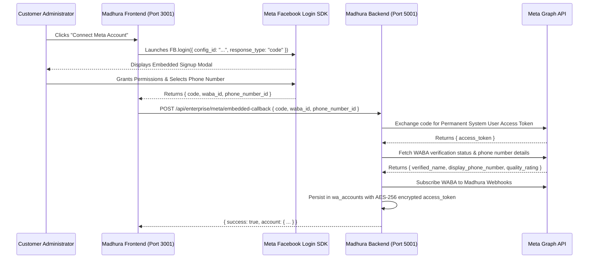

# META WHATSAPP PRODUCTION INTEGRATION SPECIFICATION
## Embedded Signup, Official Cloud API & Multi-Sender Architecture

---

### 1. Integration Scope & Meta Requirements

The Madhura platform interfaces with Meta's official WhatsApp Business Platform through two primary interfaces:
1. **Facebook Login for Business (Embedded Signup)**: Client-side popup allowing customers to authorize their Business Manager, select or create a WABA, and register phone numbers without developer assistance.
2. **WhatsApp Business Cloud API (Graph API v21.0/v22.0)**: Server-to-server REST interface for outbound messages, media uploads, interactive messages, templates, and webhook subscriptions.

---

### 2. Embedded Signup Customer Onboarding Flow



---

### 3. Multi-Number Concurrency Engine

A single customer tenant can connect **5 or more phone numbers** concurrently.

#### Sender Dispatch & Load Balancing
- Implemented in `backend/services/concurrentSenderEngine.js` and `backend/services/waLoadBalancer.js`.
- Each number is tracked independently with:
  - Phone Number ID
  - Meta Tier Limits (Tier 1K, 10K, 100K, Unlimited)
  - Current Daily Sent Counter
  - Quality Rating (GREEN, YELLOW, RED)
  - Warm-up Stage (for newly registered numbers)
- Senders can be allocated to specific functional pools:
  - **Support Pool**: Dedicated numbers for inbound service tickets.
  - **Sales Pool**: Numbers assigned to sales reps for outreach.
  - **Broadcast Pool**: High-throughput numbers allocated to marketing campaigns.
  - **Transactional Pool**: Immediate delivery for OTPs and payment confirmations.

---

### 4. Cloud API Messaging Capabilities

#### 4.1 Supported Message Types
- **Text Messages**: Plain text with optional preview URLs.
- **Approved Template Messages**: Transactional, Marketing, and Utility templates with dynamic parameter substitution (`{{1}}`, `{{2}}`).
- **Interactive Messages**:
  - Quick Reply Buttons (up to 3 buttons)
  - List Messages (up to 10 options with sections)
  - Flow Messages (Meta native interactive flows)
  - Call-to-Action Buttons (URL, Phone Call)
- **Media Messages**:
  - Images (JPEG, PNG)
  - Documents (PDF, DOCX, XLSX)
  - Audio (AAC, MP4, MP3)
  - Video (MP4)
  - Location (Latitude, Longitude, Name)

#### 4.2 Webhook Signature & Security
- Inbound webhooks delivered to `/api/whatsapp/webhook` or `/api/wa/webhook`.
- Signature verified using HMAC-SHA256 with the app secret:
  ```javascript
  const hmac = crypto.createHmac("sha256", process.env.WA_APP_SECRET);
  const digest = "sha256=" + hmac.update(rawBody).digest("hex");
  if (req.headers["x-hub-signature-256"] !== digest) {
    return res.status(403).send("Invalid signature");
  }
  ```
- Claims table (`wa_webhook_claims`) records incoming `wamids` to prevent duplicate processing on retried webhook deliveries.

---

### 5. Delivery Receipt Lifecycle
```
[OUTBOUND QUEUED] -> [SENT TO GRAPH API] -> [RECEIVED: wamid]
  └── Inbound Webhook: status = 'sent'
        └── Inbound Webhook: status = 'delivered'
              └── Inbound Webhook: status = 'read'
```
Every status transition updates `messages` and `wa_message_logs`, emits a real-time event to connected Socket.IO clients, and updates campaign analytics.
