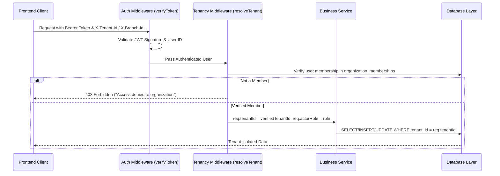

# TENANT & WORKSPACE ISOLATION SPECIFICATION
## Madhura Multi-Company Architecture & Agency Isolation

---

### 1. Isolation Principles

1. **Zero Cross-Tenant Leakage**: Queries, webhook handlers, queues, storage, and web sockets are strictly isolated by `tenant_id`.
2. **Deny by Default**: If a request does not prove legitimate membership in the requested tenant scope, it is rejected immediately with HTTP 403 Forbidden.
3. **Backend Enforcement**: Frontend visibility or route guards are UI conveniences only. The API and database query drivers enforce boundaries on every operation.

---

### 2. Tenant Context Resolution Pipeline



---

### 3. Layer-by-Layer Isolation Mechanisms

#### 3.1 Database Layer (SQL Scoping)
- Every query executes with parameterized tenant checks:
  ```sql
  SELECT * FROM wa_contacts WHERE tenant_id = ? AND phone = ?
  ```
- Write operations enforce tenant binding:
  ```sql
  INSERT INTO wa_contacts (tenant_id, phone, name) VALUES (?, ?, ?)
  ```
- Cross-tenant updates or deletes return 0 affected rows or throw a tenancy constraint violation.

#### 3.2 Inbound Webhooks Layer
- When Meta sends an inbound webhook, the system resolves the tenant via the registered `phone_number_id` or `waba_id` in `wa_accounts`:
  ```javascript
  const [account] = await db.promise().query(
    "SELECT id, tenant_id FROM wa_accounts WHERE phone_number_id = ? AND is_active = 1 LIMIT 1",
    [phoneNumberId]
  );
  if (!account) throw new Error("Unknown sender phone number ID");
  const tenantId = account.tenant_id;
  ```
- All subsequently created contacts, messages, conversations, and automation dispatches inherit that resolved `tenant_id`.

#### 3.3 Asynchronous Queue Isolation (BullMQ)
- Every queue job payload carries an explicit `tenant_id`:
  ```json
  {
    "jobType": "SEND_CAMPAIGN_MESSAGE",
    "tenantId": 1,
    "senderId": 4,
    "recipientPhone": "+919876543210",
    "templateName": "festive_offer_v1"
  }
  ```
- Workers set process context to the job's `tenantId` prior to database writes or Meta Graph API calls.

#### 3.4 File Storage Isolation (R2 / Disk)
- Files and media are namespaced by tenant directory:
  - Local Disk: `D:\var\data\uploads\tenant_<tenantId>\...`
  - Cloudflare R2: `madhurawa/tenants/<tenantId>/media/...`

#### 3.5 Real-Time WebSockets (Socket.IO)
- Socket clients join rooms partitioned by organization and branch:
  ```javascript
  socket.join(`tenant:${user.tenant_id}`);
  socket.join(`branch:${user.tenant_id}:${user.branch_id}`);
  ```
- Message events, delivery receipts, and notification broadcasts are emitted only to the appropriate room.

---

### 4. Agency vs. Client Company Scoping
- **Agency Organization**: Has `tenant_type = 'agency'`.
- **Client Company**: Has `tenant_type = 'company'` and `parent_tenant_id = <agency_id>`.
- Agency operators can switch into client company workspaces only if granted explicit authorization in `organization_memberships`.
- All actions taken by agency operators while scoped to a client workspace are recorded in `branch_audit_events` with the operator's actual user identity.
