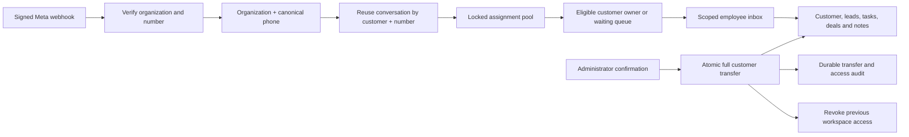

# Employee workspace implementation

## Audit and decisions

- Authentication uses verified browser sessions or JWTs, with active organization membership checked by `tenantMiddleware`. `sharedWorkspaceGuard` prevents employees from using unscoped legacy APIs.
- `wa_contacts` is the organization customer identity; `conversations` is unique by organization, sender and customer. Conversation ownership is `owner_user_id`. Branch managers have explicitly assigned branch membership. `staff_sender_assignments` limits business numbers.
- Existing inbox APIs already scope messages, notes and attachments; assignments use MySQL transactions and routing locks. Routing initially supports round robin, availability and capacity only.
- Most legacy CRM routes are administrator-only. Legacy `telecalls` capture matches phone suffix globally and must gain tenant predicates. Global client portal tables are not safe employee CRM endpoints.
- Leads use `wa_enquiries`, rather than a second lead table. Add contact linkage. Add tasks, deals and activities because no customer-linked equivalents exist in this backend.
- Customer ownership uses the existing `wa_contacts.assigned_agent_id`. Historical ambiguous contacts are not automatically granted to employees. Administrators can explicitly transfer them after review.
- MySQL has no application-user row-level security. Parameterized organization and ownership predicates, transactional rechecks, and restricted endpoint access enforce isolation. Database credentials must stay server-side.

## Transfer contract

Full customer transfer locks the routing pool, customer and conversations; validates every destination number/branch; updates all conversations and contact ownership together; records previous owner, actor, reason and timestamp. Existing notes, attachments, leads, tasks and deals retain their IDs and inherit customer access. Pending tasks follow the customer; completed tasks preserve their completing actor. Active conversation automations pause within the transaction, preventing scheduled steps from continuing under a stale owner. Campaign membership remains attached to the same contact; delegated campaign delivery rechecks current ownership and skips recipients transferred away from its creator. Legacy employee campaign APIs remain restricted. No history is deleted. A stale expected owner causes a conflict.

Conversation-only reassignment changes chat access only. It does not grant access to unrelated private customer work. Device-only message bodies cannot be recovered from Meta as arbitrary historical chat; full history transfer requires server history retention. Existing metadata and notes remain available.

## Acceptance tracking

### Implemented

- `/employees` redirects to `/whatsapp/employees`. Existing employee creation and activation remain in place. Routing controls now show open workload, availability, capacity, number restrictions, skills, strategy and workspace permissions, with confirmation for sensitive changes.
- `/whatsapp/workspace` serves persisted, paginated customers, leads (`wa_enquiries`), tasks, deals, call logs, meeting notes, activities and transfer history. The employee layout explicitly permits this route. Inbox customer links open it by contact ID.
- `/api/v2/workspace` enforces organization membership, record ownership and configurable module view/edit grants. Direct record IDs, search, pagination, CSV export and aggregates use server-side predicates. Customer writes lock the customer so a simultaneous transfer cannot authorize a stale employee write.
- Customer access requires one consistent owner across linked conversations. A second business number inherits that owner when eligible, otherwise waits for administrator action. A conversation-only reassignment can intentionally quarantine full customer access until ownership is reconciled. No phone suffix is used to merge contacts across countries or organizations.
- Full transfers preserve record IDs and history; move linked legacy lead/client ownership and pending reminders where those links exist; pause conversation bots; and create customer activities plus a durable organization audit entry. Destination access to every number is validated. Manual transfers may deliberately exceed automatic routing capacity; automated recovery rechecks capacity under the routing lock.
- Round robin, lowest open workload and manual assignment are persisted per organization. Availability, sender restrictions, branch membership, active account/membership, capacity and optional required skill constrain automatic candidates. Branches are the existing team scope; this does not introduce a second team hierarchy or arbitrary rule scripting.
- Inactive ownership recovery runs every 60 seconds, bounded to 25 organizations and 25 customers per organization per pass. Cursors prevent unresolved records from starving later records. Actor `0` identifies the internal worker. Set `WA_AUTO_REASSIGN_INACTIVE=0` to disable automatic recovery. An administrator can trigger a recovery batch from employee management. Customers without conversations use the CRM intake pool; manual routing or no eligible destination leaves the record for review.
- Customer counts, client lifecycle, leads/qualified leads, tasks/overdue/completed work, deals/wins, active conversations, retained unread counts and average first-response samples respect the caller's scope. Response measurements cover the first inbound and first employee reply observed per conversation in seven days of retained metadata, not every response or lifetime history.
- Workspace permission, routing and skill changes have durable audit entries. Transfers have a dedicated immutable-by-API ledger; no delete API is provided. `/api/v2/workspace/audit` is administrator-only and cursor paginated.
- Legacy lead capture, client conversion, automation lookups, CRM event broadcasts and client-portal staff record access have additional organization checks. Global portal settings require a platform administrator. Historical rows without known organization ownership are not assigned to an organization automatically.
- Regression tests now use temporary SQLite state or disposable MySQL databases. They do not use the local application database. An initial run found two fixture rows left in the old local SQLite file; those exact fixture rows were removed, and the unsafe test setup was replaced.

### Continued implementation: CRM intake, delegated campaigns and attachments

- New workspace customers and enquiries use the existing `wa_contacts` identity and are created/assigned in one MySQL transaction. CRM intake has its own `crm_strategy` and `crm_required_skill` settings, round-robin/workload/manual choices, availability and active membership checks, and `max_open_leads` per employee. Leads count against capacity until converted to clients. Existing ownership and existing WhatsApp conversations are preserved. The employee management page configures both routing policies and can assign a bounded batch of 50 waiting CRM customers.
- `/whatsapp/workspace/campaigns` and `/api/v2/workspace/campaigns` provide employee-owned drafts, paginated audiences/results, approved sender/template choices, and explicit start/pause/resume/cancel controls. The `campaigns` module defaults to **denied** for employees until an administrator grants it. Customer-view permission is also required for recipient access. Campaigns-only accounts can see their assigned campaign audience without gaining access to customer notes or the chat inbox; they can receive CRM-only customer ownership, but cannot receive conversation ownership.
- Delegated campaigns use existing `wa_campaigns` / `wa_campaign_messages`, with `audience_policy='assigned_customers'`, stable contact references and a unique request key. Up to 100 selected recipients are accepted per draft. Template parameters are stored once per campaign; message text is not copied into recipient rows. Saving a draft never starts delivery.
- The existing worker rechecks active organization/user/membership, module permission, customer ownership, number/branch scope, opt-in, opt-out and current template approval at delivery. Transferred/revoked recipients are skipped. Campaign results join the current authorized customer scope, so old owners cannot retrieve transferred recipients' details. Static-header/body-parameter campaigns support `{name}`, `{phone}` and `{email}` from the authorized current contact.
- A MySQL polling worker recovers running and due scheduled delegated campaigns after restart, with at most two concurrent campaigns per process and a default five-second poll. `WA_EMPLOYEE_CAMPAIGN_WORKER=0` disables it; `WA_EMPLOYEE_CAMPAIGN_POLL_MS` accepts 1000–60000 ms. Stale `sending` rows become `unknown` after five minutes; they are never automatically retried. Provider-confirmed sends with failed local bookkeeping are also treated as uncertain rather than retried.
- The inbox composer now supports direct Meta multipart uploads, attachments, approved body/header variables, media template headers and variable URL buttons. Uploads are bounded to 8 MB, images to 5 MB, with MIME/signature checks and safe filenames. Uploaded bytes go directly to Meta, without a public local or R2 URL; only provider IDs and metadata enter the message log. Downloads still require live conversation authorization. Campaigns require static headers/buttons; use the inbox composer for media templates.
- Attachment/template sends use the existing deduplication ledger. Uncertain sends retain their request ID in browser session storage across refresh; a separate send requires explicit acknowledgement. No message is resent automatically. This request ID is not an authentication credential.
- New manual/CRM/inbound contacts start without marketing consent. Existing flags are preserved. Customer-workspace consent changes require permission, evidence when granting, confirmation, a consent record and an audit/activity event. An employee cannot restore an opted-out customer; an administrator must review new evidence. Previous opt-out markers are copied into the customer's activity history before clearing the active marker. Marketing campaigns and marketing templates require a current opt-in.
- Transactional scope checks use the transaction's existing connection, including supervisor branch checks. Customer and conversation reads revalidate current account, organization membership, role and access level. Attachment sends recheck these after upload, so deactivation or ownership changes during upload prevent the provider message request.
- Employee status supports `banned` and `inactive` consistently in the API, login and MySQL schema. Bootstrap extends existing status enums without discarding custom values and no longer narrows the role column to four legacy roles. Inactive accounts cannot sign in; existing ownership enters the bounded recovery workflow.

### Verified locally

- Three organizations with 6, 4 and 3 employees. The same phone remains a separate customer per organization.
- Twelve concurrent new conversations in the four-employee organization distribute three per employee. Repeated messages reuse the conversation.
- Direct HTTP record-ID substitution, foreign organization selection, private task access, unauthorized transfer and read-only writes are denied.
- Full transfer preserves linked lead/client ownership, pending reminders, notes, tasks and deals. Injected SQL failure rolls the entire transfer back. Two simultaneous transfers with the same expected owner produce one commit and one conflict.
- Previous owner loses API access; the new owner receives subsequent inbound messages on the original conversation. Module revocation also removes its counts from analytics.
- Actual built React frontend, cookie login, signed webhook, real WebSocket, inbox-to-customer navigation, task creation, MySQL persistence, hard refresh and mobile layout were exercised in Chrome against an isolated backend.
- Existing flow/template, signup/billing and scoped inbox regressions pass with local provider transports. No live customer messages, provider payments or orders were initiated.
- Real multipart uploads, media-header templates, private attachment downloads, duplicate/uncertain-send protection, permission revocation during upload, explicit campaign launch through the actual worker, transfer/revocation skips, interrupted-send recovery, CRM intake rollback and consent audit paths were exercised against the actual backend and isolated MySQL. The built campaign/upload UI also passed Chrome checks, including mobile layout.

### Remaining release work and intentional limits

- This is not a claim that the entire legacy application has been rewritten or that every requirement has production acceptance. Delegated template/flow **editing**, arbitrary team/rule scripting and explicit customer sharing grants remain unimplemented. Their legacy management APIs stay restricted to administrators. Employees can use approved templates and published bots through the scoped inbox.
- Attachment/template upload and delivery were verified with real HTTP/multipart transport against a local provider fixture. Live Meta credentials/delivery and media lifetime are not verified. Permanent media archival to R2 is not enabled by the direct Meta upload path.
- Historical unlinked enquiries/clients/leads require a reviewed mapping to contacts. New enquiries link to the organization contact, and new workspace records link at creation; ambiguous old data is not silently backfilled.
- Average response time for every message, campaign attribution to employees and lifetime performance accounting are not provided by the seven-day first-response measurement.
- Device-only chat bodies cannot be copied from another employee's device or reconstructed from Meta's API. Database metadata, notes, tasks and other persisted context transfer, but full chat-body history requires an explicit retention/storage decision. An outbound provider request already in flight cannot be recalled by a transfer.
- Actual Vercel/VPS deployment, MySQL least-privilege deployment grants, live Meta/R2 verification, backup restore, Node 24 release verification and sustained concurrency/load tests remain release work. A 4 GB VPS is not validated for the previously requested tens of millions of messages per day.
