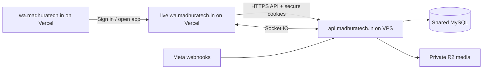

# Production domains and the signed-in blank screen

The VPS is not connected yet. These changes prepare the source and builds; they have not been deployed to Vercel or the VPS.

| Service | Domain | Project root |
|---|---|---|
| Landing page | https://wa.madhuratech.in | `landing_page` |
| CRM | https://live.wa.madhuratech.in | `frontend` |
| API and Socket.IO | https://api.madhuratech.in | `backend` on the VPS |



## What caused the blank screen

A read-only browser reproduction of the deployed CRM found requests going to `live.wa.madhuratech.in/api/...`. Vercel returned the SPA HTML with status 200. The chat code treated that HTML as records and crashed with `map is not a function` or `Cannot read properties of undefined (reading 'length')`.

The updated app uses the dedicated API origin, rejects HTML API responses, validates list payloads before updating React state and displays connection errors. Demo chats skip backend template/quick-reply requests. A root error boundary provides a reload action for unexpected rendering failures. GET requests have a bounded timeout. Existing session/profile data is retained during an API outage.

An unavailable API cannot authenticate users, load shared CRM records, publish flows or send messages. The corrected frontend remains visible while the API is unavailable. A cached user profile is not proof of a valid server session.

## Redeploy the two Vercel projects

1. Deploy the updated source with the correct project roots from the table above.
2. In the CRM project's production environment, set:

   ```dotenv
   REACT_APP_API_URL=https://api.madhuratech.in
   REACT_APP_SOCKET_URL=https://api.madhuratech.in
   REACT_APP_MARKETING_URL=https://wa.madhuratech.in
   ```

3. In the landing project's production environment, set:

   ```dotenv
   VITE_APP_URL=https://live.wa.madhuratech.in
   VITE_API_URL=https://api.madhuratech.in
   ```

4. Replace stale values in existing Vercel project settings, then trigger new production builds. These variables are compiled into the browser bundle; changing them without rebuilding does not update an existing deployment. Both `vercel.json` files also include the intended public values.
5. Hard-refresh the new deployment. In browser Network, API and socket requests must target `api.madhuratech.in`. They must not target the static CRM host or localhost.

All listed variables are public addresses. Keep database passwords, signing/encryption keys, R2 credentials and Meta tokens exclusively on the backend.

## Connect the VPS later

1. Point the API DNS record at the VPS public IP when available. Configure HTTPS for `api.madhuratech.in`.
2. Merge `backend/deploy/domains.env.example` into the existing server configuration:

   ```dotenv
   PUBLIC_BASE_URL=https://api.madhuratech.in
   ALLOWED_ORIGINS=https://live.wa.madhuratech.in,https://wa.madhuratech.in
   AUTH_COOKIE_SAME_SITE=lax
   ```

3. Complete `backend/.env.production.example` using real server-side credentials and persistent storage. Do not replace an existing filled configuration with the example. Use Node 24 as declared by the project.
4. Use `backend/deploy/nginx-api.conf` for the HTTPS reverse proxy after its certificate files exist. It forwards HTTP and Socket.IO to port 5001. Install only one API NGINX site; the older alternative under `deploy/nginx/` is a generic template. Validate with `nginx -t` before reloading.
5. Start the backend with its production process/service configuration. Check `/health` and the documented readiness check before testing browser login. HTTP 200 alone does not prove database readiness.
6. Verify login, reload, organization switching, assigned chats, notes, flow saving/publication and socket reconnection from the CRM domain. Then verify actual Meta delivery and private R2 upload/download separately with authorized test accounts.

The API owns secure HttpOnly session cookies. The custom app and API HTTPS domains share the same site; keep the exact CORS allowlist and credentialed requests. No wildcard cookie domain is required. Session tokens remain server-managed; browser storage holds profile/UI context and the bounded device message cache.

## Verification in this workspace

- Frontend: 14 suites / 31 tests passed; production build completed with existing legacy lint warnings.
- Backend: 7 safe core suites passed. No destination VPS was contacted.
- Browser: six built-app scenarios (HTML 200, malformed JSON, offline API, each with demo and cached signed-in profiles) passed navigation and hard refresh without a blank page or rendering fallback. Provider/API responses were intercepted; no live customer requests were sent.
- Landing: production build and internal-link validation passed. The existing large-bundle warning remains.
- Node in this workspace is 26.1.0; repeat release checks under Node 24 before server deployment.

Live DNS/TLS, production cookies, Meta and R2 still require checks after the VPS is connected. See `release_check.md` and `plan_live.md` for the broader release constraints.
