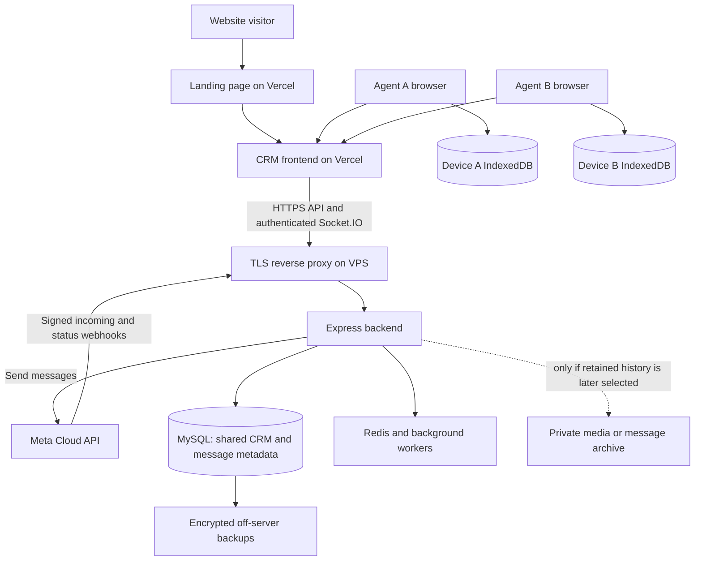
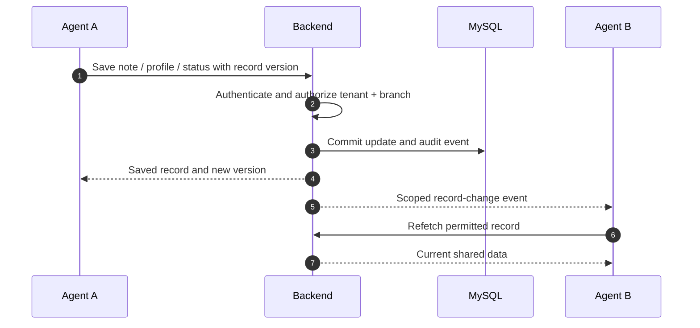
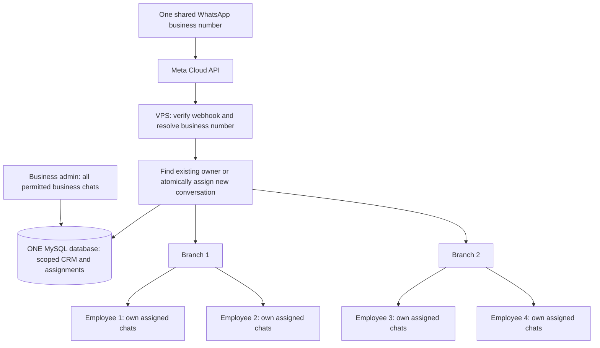
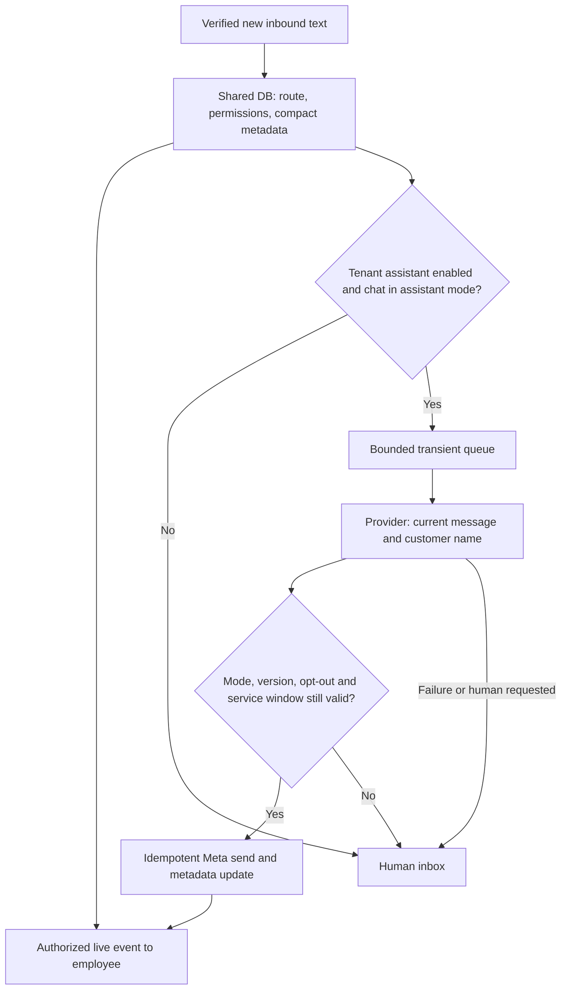

# Live deployment and shared CRM plan

25 October domain update: the landing page is `https://wa.madhuratech.in`, the CRM is `https://live.wa.madhuratech.in`, and the planned API is `https://api.madhuratech.in`. The VPS is not connected yet. The signed-in blank screen was reproduced and corrected in source; deployment settings, verification and the remaining connection steps are in [live_domains.md](./live_domains.md). Redeploy the frontend and landing projects to apply these changes.

Prepared: 24 October 2026. Status: the core shared-number implementation is present and tested locally on `feature/shared-number-assignment`. Production deployment has not been performed. Section 19 records the implemented behavior, verification, and remaining deployment work; optional alternatives elsewhere remain proposals.

Open [plan_live_visual.html](./plan_live_visual.html) in a browser for an animated walkthrough. This file contains the detailed plan and Mermaid diagrams; Markdown viewers may require Mermaid support.

## 1. Your intended setup

- Landing page and CRM frontend: two Vercel projects.
- Backend, webhook receiver, Socket.IO, and background workers: VPS.
- Exactly one shared MySQL database for all businesses, branches, employees, contacts, clients, notes, assignments, statuses, and settings. Tenant and branch permissions isolate records within that database; do not create a database per employee or WhatsApp number.
- Chat bodies: avoid permanent server storage by default, with the limitations below made visible to users.
- Browser storage: personal preferences and a device chat cache; authentication needs separate treatment.
- Product goal: a team inbox with CRM, campaigns, automation, and optional AI, comparable in workflow to tools such as WATI. This is a proposed feature set, not a claim of feature parity or an analysis of those vendors' internals.

Confirmed routing example: one business admin, two branches, two employees in each branch, and one shared WhatsApp number. Also support multiple numbers through the same backend. Eight eligible new conversations can be distributed as two per employee. Branch-specific routing and existing ownership take precedence over equal distribution. Domains below are examples. VPS capacity and retention periods are starting proposals to measure and adjust.

## 2. The key decision: Meta is transport, not your inbox database

Do not design a normal Cloud API inbox around “fetch any old conversation from Meta whenever a user opens it.” Meta's documented messages endpoint sends messages and marks incoming messages read; incoming content and delivery updates arrive through webhooks. The published collection does not supply a general-purpose conversation-history listing endpoint. Therefore this plan treats history reconstruction from Meta as unavailable unless a specific, supported integration proves otherwise. See [Meta's official Messages collection](https://www.postman.com/meta/whatsapp-business-platform/folder/o48mro7/messages) and [Meta's received text webhook example](https://www.postman.com/meta/whatsapp-business-platform/overview).

Coexistence/history onboarding is a separate capability to evaluate for eligible accounts. Do not promise that it provides an unlimited, repeatable history API. Meta's direct documentation returned access/rate-limit errors during this review, so its current eligibility, history scope, and deadlines must be checked before building that feature.

Consequences of storing chat only in the browser:

| Situation | What the user gets |
|---|---|
| Agent connected when the message arrives | Live message; optionally cached on that device |
| Same device later, cache still present | Previously cached content |
| Another agent or new laptop | Shared CRM records; no guaranteed earlier message bodies |
| Every agent offline | Metadata can be recorded; body is unavailable later unless a durable content buffer exists |
| Browser storage cleared or evicted | Local chat history is lost |
| Backend accepts webhook then crashes before broadcasting | Live body can be lost without durable capture |
| AI asks for earlier conversation context | Only explicitly available context; no fabricated history |

**A fully reliable shared message history requires shared durable message content somewhere.** Moving it from MySQL into Redis, files, or object storage changes the storage system, not this requirement.

## 3. Three storage choices

| Mode | Body storage | Shared history / offline recovery | Tradeoff |
|---|---|---|---|
| A. Browser-only bodies — primary plan matching your request | Transient processing in backend memory; IndexedDB on receiving devices | Not guaranteed | Small server footprint; visible history gaps |
| B. Temporary shared buffer — optional compromise | Encrypted server buffer with a proposed 24–72 hour TTL, then delete | Only within the retention window | Still stores bodies on the server; requires retention and recovery work |
| C. Shared team history — optional later | Encrypted content retained for a chosen period, e.g. 30/90 days | Yes, within retention and backup recovery limits | More storage and retention management |

Start with A only if its limitations are acceptable. Use C for a team inbox whose requirement is that every authorized agent sees the same retained conversation. Choose B when short offline catch-up is enough. B and C require additional implementation; changing `WA_SERVER_CHAT_STORAGE` alone does not implement encrypted archives, TTLs, reconnect replay, or complete isolation.

In A, the UI should say: “Chat history is saved on this device. Earlier messages may be unavailable on other devices.” Show “Message content unavailable on this device” for known metadata without a body. Do not render that as an empty conversation or silently invent a preview.

## 4. Deployment map



Proposed hostnames:

| Host | Target | Responsibility |
|---|---|---|
| `example.com`, `www.example.com` | Vercel landing project | Public website and links to the app |
| `app.example.com` | Vercel frontend project | Login and CRM interface |
| `api.example.com` | VPS reverse proxy | API, `/socket.io`, `/webhook`, health probes |
| Private DB/Redis addresses | Loopback or private network | Never browser-accessible |

Prefer direct `https://api.example.com` API and socket connections for this rollout. Allow the exact frontend origin in backend CORS. A Vercel API rewrite is an alternative, but it adds another routing layer to validate. A landing-page form calling the backend needs its own exact allowed origin and abuse controls.

Vercel announced general availability of WebSockets on 20 October 2026. The repository's older plan-specific WebSocket comments should not be treated as current platform guidance. Keeping sockets on the VPS is a deliberate fit for this existing persistent backend, workers, and optional browser engine. See [Vercel's announcement](https://vercel.com/changelog/websocket-support-is-now-generally-available).

## 5. Where each kind of data belongs

| Data | Authoritative location | Browser copy | Shared with team? |
|---|---|---|---|
| Business/tenant, branches, memberships, roles | MySQL | Small read cache | According to permissions |
| Contacts and customer profile fields | MySQL | Temporary query cache | Yes, within authorized scope |
| Clients, enquiries, deals, tasks, follow-ups | MySQL | Temporary query cache | Yes, within authorized scope |
| Internal notes, mentions, attachments to notes | MySQL + private file storage | Loaded on demand | Only authorized staff |
| Tags, custom fields, conversation status, assignment | MySQL | Temporary query cache | Yes |
| User read cursor and notification preferences | MySQL | Optimistic cache | Per user, consistent across devices |
| Inbound message ID, sender/account, direction, timestamps, type, delivery status | MySQL | Temporary cache | Authorized inbox participants |
| Chat text, captions, quoted content, interactive content | A: no permanent server copy | IndexedDB | Only devices that actually received/cached it |
| Last-message body/preview | Same policy as chat bodies | Derived from local cache in A | No shared body preview in A |
| Chat media, filenames, thumbnails, transcripts | A: stream transiently; no permanent archive | Optional bounded IndexedDB cache | No guaranteed replay in A |
| Template definitions, campaign content and recipient progress | MySQL | Editor state | Authorized team; intentionally retained business content |
| Workflow definitions and execution state | MySQL | Editor state | Authorized team; avoid retaining raw chat in run variables |
| AI settings, knowledge base, handoff state | MySQL + private document storage | Editor state | Authorized team |
| Consent/opt-out records and consent evidence | MySQL + private evidence storage when needed | Read cache | Authorized staff |
| Audit events and usage/billing records | MySQL | Dashboard cache | Role restricted |
| Theme, density, open panel, per-device filters | localStorage | This is the original | No |
| Draft messages | Memory or sessionStorage by default | Device only | No; shared drafts need an explicit DB feature |
| Login refresh credential | Host-only HttpOnly secure cookie + hashed DB revocation record | Browser-managed cookie | No |
| Short-lived access credential | Host-only HttpOnly secure cookie, 15 minutes | Browser-managed cookie; refresh through API | No |
| Meta access token, app secret, encryption keys | Backend secret configuration / encrypted credential records | Never | Never exposed as readable secrets |
| QR engine authentication state | Protected persistent VPS directory | Never | Backend only |
| Presence, typing indicators, reply ownership lease | Memory/Redis with TTL | Transient | Authorized connected agents |

Metadata still includes personal information. Minimize it and define deletion periods. “No chat bodies in DB” must not be described as “no customer data stored.” Internal notes and campaign text are intentionally retained content; label them separately from inbound chat privacy.

Use IndexedDB for bounded message/media caches; localStorage is synchronous and suited to small preferences. Cache keys must include `tenant_id`, account/sender ID, user ID, conversation ID, and schema version. Purge the relevant cache on logout, membership removal, business switch when appropriate, and expiry. Handle quota errors and eviction without losing the authoritative CRM record.

## 6. Authentication: what “session in localStorage” should mean

Browser login now uses HttpOnly cookies. New browser logins save only a display profile and a `cookieSession` marker in localStorage; they do not save access or refresh tokens there. Existing bearer clients remain compatible and can migrate by signing out and signing in again.

Implemented: a 15-minute signed access cookie and a rotating 14-day refresh session, both host-only and HttpOnly on the API host, Secure in production. MySQL stores the refresh-secret hash, user, expiry, and revocation state. Requests carry credentials; state-changing cookie requests validate Origin/Referer against exact allowed origins. Concurrent refreshes use compare-and-swap rotation, frontend single-flight refresh, and browser locks where available. Logout, logout-all, and password changes revoke browser sessions. Cookie sockets check the session at connection and expire with their access credential; the frontend refreshes and reconnects.

Keep preferences and an optional non-sensitive display profile in localStorage. The server must resolve membership, role, branch scope, and sender access on every request and socket subscription. Never trust `active_tenant_id`, `active_branch_id`, or a requested room name without checking access. Expired sessions and disabled memberships must stop both HTTP and socket access.

Use same-site custom domains: for example `app.madhuratech.com` on Vercel and `wa-api.madhuratech.com` on the VPS, with `AUTH_COOKIE_SAME_SITE=lax` and `AUTH_COOKIE_SITE_DOMAIN=madhuratech.com`. The latter is a preflight boundary check, not a cookie Domain attribute. A default `*.vercel.app` frontend is cross-site to this API and will not work with this lax-cookie configuration. Preview-domain access needs a separately tested origin/cookie policy.

## 7. How messages and CRM edits work

### Incoming message — primary privacy mode

```mermaid
sequenceDiagram
    autonumber
    participant C as Customer
    participant M as Meta
    participant B as VPS backend
    participant D as Shared DB
    participant A as Connected agent
    C->>M: Send WhatsApp message
    M->>B: Signed webhook
    B->>B: Verify signature; resolve tenant and sender
    B->>D: Dedupe and update permitted metadata/contact
    Note over B,D: Mode A does not persist body for replay
    B-->>A: Authorized live event including body
    A->>A: Display and cache in device IndexedDB
    B-->>M: Success after required processing
    Note over B,A: Crash or offline gaps cannot be replayed in A
```

For B/C: validate, durably capture the permitted payload with an event ID, then acknowledge promptly and process asynchronously. Couple claim state and work state so an event is not permanently marked done before processing succeeds. Replay duplicates safely; expire completed content according to policy. A cannot make the same durable-content recovery promise.

### Agent sends a reply

1. Browser submits an application request ID, account/conversation ID, and body.
2. Backend validates the agent's access, current assignment/handoff, opt-out state, and current Meta sending rules.
3. Queue or send through Meta. In A, immediate transient processing avoids a durable body queue; deferred sends and scheduled campaigns intentionally need persisted outbound content.
4. Persist send state and returned Meta message ID. Show accepted/sent/delivered/read separately.
5. If the HTTP call times out after Meta may have accepted it, mark delivery unknown and reconcile; do not blindly retry and create duplicate replies. An application request ID prevents duplicate app submissions, but is not a claim that Meta deduplicates every repeated send.
6. Status webhooks update receipts by message ID and event time. Notifications may arrive out of order; see [Meta's status webhook documentation](https://www.postman.com/meta/whatsapp-business-platform/request/rgtfq23/message-status-update-notifications).

### Notes, customer information, and assignments



Use database transactions for related changes and optimistic version checks for competing edits. A stale edit gets a conflict response and a refresh option. On reconnect, refetch authoritative CRM data using a cursor or full scoped refresh. Sockets notify; the database is the source of truth. Persisted event/outbox delivery is needed when a missed event must be replayed. Agent B in this illustration must have access to that contact/conversation; ordinary employees do not receive other employees' assigned chat updates.

## 8. Shared records and access boundaries

Use the existing schemas where possible; these are logical requirements, not instructions to create duplicate tables:

- Tenant, branch, user, membership, role, and sender-account records.
- Contacts keyed by tenant plus normalized WhatsApp identity/phone. Record country explicitly rather than always assuming India.
- Conversations keyed by tenant, sender account, and contact. Track assignment, status, last inbound time, and per-user read cursors.
- Notes linked to tenant and contact/conversation, with author and timestamps.
- Metadata keyed by tenant, sender account, and provider message ID. Status events need their own dedupe identity; one message can receive several receipts.
- Campaign recipient jobs, workflow runs, consent records, audit events, and revocable login sessions.

Every table, join, export, background job, file download, and socket event must enforce tenant scope. Enforce branch scope where applicable. Include tenant/account scope in unique indexes, dedupe claims, queue keys, and caches. Two tenants with the same customer phone must not share records or events.

Do not default an authenticated request with missing scope into tenant 1. Separate super-admin privileges from normal tenant admin access. Internal notes must never be sent to the customer or exposed to the client portal.

## 9. Existing code findings that affect launch

This table records the original inspection findings. See section 19 for the changes now implemented; do not treat the original findings as the current implementation status.

| Evidence in this repository | Launch action |
|---|---|
| `frontend/package.json`: React/CRA; `landing_page/package.json`: React/Vite | Separate Vercel roots and output folders |
| `frontend/vercel.json` forwards API, uploads, sockets, and health to Render | Replace/remove stale rewrites consistently with direct VPS routing |
| No `landing_page/vercel.json` found | Configure SPA fallback for any client-side routes; test deep links |
| `frontend/src/config/index.js` centralizes API/socket configuration | Set production URLs and check computed values in the deployed bundle |
| `frontend/src/auth/AuthContext.jsx` and `config/axios.js` use localStorage tokens | Keep current behavior documented; migrate auth as one coordinated change |
| `frontend/src/utils/waLocalCache.js` scopes IndexedDB primarily by user ID | Add tenant/account scope, expiry, size limits, and logout verification |
| `backend/services/waChatPrivacy.js` redacts selected SQL columns when the storage flag is off | Audit all write paths, tables, logs, queues, files, AI traces, and backups; this filter is not a complete privacy guarantee |
| Enterprise inbox routes update `conversations` last-message fields, beyond the filter's listed tables | Check these previews and all parallel schemas for retained bodies |
| Privacy flag controls future writes | Existing stored bodies, uploads, old backups, and caches need a separate reviewed cleanup/migration policy |
| `backend/.env.production.example` contains `USE_SQLITE=1` | Override deliberately for the MySQL rollout; do not copy unchanged |
| `backend/config/database.js` also selects SQLite when R2 is configured | Disable this integration for MySQL initially; separate archive storage from DB selection before enabling R2 |
| Runtime defaults allow degraded startup and an ephemeral JWT secret | Use explicit production settings and readiness criteria; process alive is insufficient |
| Backend and frontend package engines specify Node `24.x`; backend README says Node 20 | Use the package-supported runtime and verify dependencies; correct stale documentation later |
| Cloud API service pins Graph API `v22.0` | Verify support lifecycle and account compatibility before launch; do not choose a new version by guesswork |
| QR engine and Cloud API both exist | Default production to Cloud API; optional QR sessions require separate persistent backend state and recovery testing |

## 10. Concrete hosting configuration

### Vercel projects

| Setting | CRM frontend | Landing page |
|---|---|---|
| Root directory | `frontend` | `landing_page` |
| Install | `npm ci` | `npm ci` |
| Build | `npm run build` | `npm run build` |
| Output | `build` | `dist` |
| App domain | `app.example.com` | `example.com` |
| Public variables | `REACT_APP_API_URL=https://api.example.com`, `REACT_APP_SOCKET_URL=https://api.example.com` | `VITE_APP_URL=https://app.example.com`, `VITE_API_URL=https://api.example.com` if API is used |

These variables are public build inputs. A changed value needs a rebuild. Never place Meta, database, SMTP, AI, or signing secrets in `REACT_APP_*` or `VITE_*`. Verify auth pages and nested routes on refresh. Ensure anonymous landing forms do not depend on a staff login.

### VPS

Start with a measured pilot on approximately 2 vCPU / 4 GB RAM for Cloud API plus a small MySQL/Redis workload. This is a planning estimate, not a supported throughput promise. Browser-based QR sessions need additional measured resources. Upgrade or split the DB when sustained load, disk growth, or queue lag warrants it.

Use a supported Linux release, TLS reverse proxy, a non-root service user, and either the existing PM2 configuration or containers with restart policies. Begin with one application instance; verify scheduler ownership before adding instances or separate workers. Expose only HTTPS/HTTP and restricted administrative access; keep Node, MySQL, and Redis private. Configure WebSocket upgrade forwarding and test large uploads and proxy timeouts.

Example values to adapt, not a ready-to-paste complete secret file:

```dotenv
NODE_ENV=production
PORT=5001
TZ=Asia/Kolkata
PUBLIC_BASE_URL=https://api.example.com
ALLOWED_ORIGINS=https://app.example.com
REQUIRE_HARD_CONFIG=1
ALLOW_START_WITHOUT_DB=0
DB_HOST=127.0.0.1
DB_PORT=3306
DB_NAME=achme_wa
USE_SQLITE=0
DB_ENGINE=mysql
DISABLE_R2=1
REDIS_URL=redis://127.0.0.1:6379
WA_ENABLE_WEB_ENGINE=0
WA_SERVER_CHAT_STORAGE=0
WA_DATA_DIR=/srv/whatsapp-crm/data
# Set DB_USER, DB_PASS, stable JWT_SECRET and SMTP_ENCRYPTION_KEY privately.
# Set Meta account credentials, verify token and app secret privately.
```

Confirm actual driver selection at startup. `DISABLE_R2=1` here prevents the existing R2-to-SQLite coupling; it is not the long-term media storage design. Give the app a restricted DB user, run reviewed migrations, and replace/remove seed credentials after account setup. Do not restore a database snapshot automatically over an existing live database.

Meta callback: use `https://api.example.com/webhook` (existing route mount), verify its GET challenge, subscribe the actual WABA/app to required events, and test real customer traffic. Verify POST signatures over raw request bytes using the correct account's app secret. Keep tokens backend-only. Check current onboarding, permissions, template, messaging-window, and opt-out requirements against Meta's documentation before enabling sends; this plan does not assume a permanent entitlement or fixed pricing.

### Backups and operations

- Encrypted MySQL backups off the VPS; define acceptable recovery point/time. Proposed initial targets: at most 24 hours of CRM data loss and recovery within 4 hours; tighten if the business requires it.
- Test a restore into an isolated database. A backup that has never restored is not a verified recovery path.
- Back up persistent QR authentication state only if that channel is enabled; protect it like a credential.
- Keep private files separate from public assets; authorize downloads or use short-lived signed URLs. Expiring Meta media links are not a durable attachment archive.
- Track readiness, DB driver/connectivity, disk, memory, webhook failures, queue depth/age, socket reconnects, delivery-unknown sends, and backup success.
- Redact authorization headers, secrets, bodies, captions, phone identifiers where unnecessary, and webhook payloads from logs. Apply retention to queues, dead letters, traces, AI providers, files, and backups as well as the main DB.
- Document mode A's body-loss behavior separately from CRM backup recovery. Backups cannot restore messages that were never stored.

## 11. Features and delivery order

| Phase | Work | Exit condition |
|---|---|---|
| 1. Production foundation | Domains, TLS, VPS service, explicit MySQL driver, stable secrets, Vercel roots, correct URLs | Real login/API/socket connection works; restart preserves shared records |
| 2. Shared CRM | Contacts, clients, notes, tags, status, assignments, branch permissions, audit | Two agents see committed edits; another tenant cannot read them |
| 3. Privacy-aware inbox | Signed webhooks, dedupe, body policy, local cache, honest gap state, media handling, receipts | A behaves correctly online and offline; no false history recovery promise |
| 4. Reliable sending | Unknown-delivery handling, recipient progress, opt-out enforcement, worker ownership | Duplicate submissions and restarts do not cause uncontrolled repeated sends |
| 5. Automation and AI | Persisted workflow checkpoints, minimal allowed context, explicit human handoff, AI failure handling | Human ownership pauses bot replies; runs resume safely after restart |
| 6. Optional retained history | Implement B or C only if selected, plus retention/deletion/replay | Offline/new-device history matches the selected retention contract |
| 7. Scale | Profile; isolate workers/DB; shared pub/sub when needed | Load and failure tests demonstrate the required service targets |

For team UX: show assigned agent, status, tags, notes, follow-up due time, per-user unread state, connection health, and whether displayed history is device-only or shared. Use a short reply ownership lease to reduce simultaneous agent replies, with server enforcement. Keep client-portal permissions separate from staff permissions.

AI must use only authorized context, record whether AI or a person sent a reply, and stop after handoff. Avoid retaining chat in prompts, run variables, provider logs, or summaries without explicitly including those stores in the policy. Persist necessary business outcomes (e.g. a requested callback) as CRM data with provenance.

## 12. Launch acceptance checklist

- [ ] Production bundles use the intended VPS domain; no old Render/local URLs remain in effective routing.
- [ ] Landing CTA, login redirect, nested app routes, and page refresh work on their deployed domains.
- [ ] Strict startup and readiness identify missing DB/Redis/keys instead of presenting a working inbox.
- [ ] Actual selected DB driver is MySQL; R2 credentials cannot silently change it.
- [ ] Real Meta incoming message, outgoing reply, attachment, and status update are tested.
- [ ] Invalid webhook signatures fail; repeated deliveries and out-of-order receipts are handled.
- [ ] Mode A has no unintended body persistence, including enterprise preview fields and non-SQL stores.
- [ ] Two agents share notes, contacts, assignments, and statuses after refresh/reconnect.
- [ ] An offline agent and a new browser see the documented history limitation in A.
- [ ] Local caches cannot leak across tenants/accounts and are cleared according to logout policy.
- [ ] Tenant/branch authorization covers list, detail, edit, export, download, sockets, and background jobs.
- [ ] Logout, expiry, password/session revocation, and membership removal terminate access.
- [ ] Backend restart preserves CRM data and safely handles jobs and workflow state.
- [ ] Unknown-delivery timeout is tested without blindly retrying messages.
- [ ] No duplicate scheduler executes when process count changes.
- [ ] Private backup restore is tested and off-server backup monitoring is active.
- [ ] Retention cleanup and failure alerts work; user-visible history claims match the selected mode.

Suggested repository checks during implementation: `npm run verify` and appropriate tests in `backend`; `npm run verify:api` and `npm run build` in `frontend`; `npm run check:links` and `npm run build` in `landing_page`. Inspect these scripts before running them with production credentials. This planning change does not assert that those checks currently pass.

## 13. Visual walkthrough storyboard

The companion HTML animates six steps: customer message → Meta webhook → VPS validation → shared metadata/CRM commit → authorized live delivery → device chat cache. Its second scenario animates a shared note save across two agents. Toggle body policy to compare local-only history with proposed retained history. Animation is illustrative, not connected to the live app.

Confirmed: one shared database, minimal necessary storage, one or more business numbers, employee access restricted to assigned chats, and automatic assignment. Mode A remains the default body policy. Final domains, VPS capacity, routing eligibility rules, and whether to add a short content retention window remain implementation choices. QR support is outside the default Cloud API rollout.

## 14. One number shared by two branches and four employees

The number belongs to the business, not to each employee's browser. Meta sends the number's events to the backend. The backend decides which branch and employee may access each conversation. An employee does not need a separate WhatsApp QR session to reply through the Cloud API.



With more numbers, resolve each webhook's `phone_number_id` to a tenant and sender account first. Keep conversations separate by `(tenant_id, sender_account_id, contact_id)` unless an explicit product feature combines their view. Employee access is the intersection of membership, allowed sender accounts, branch policy, and assignment. Sharing a number does not grant every employee access to every chat.

Suggested logical relationships in the one database:

| Relationship | Purpose |
|---|---|
| Business → branches → employee memberships | Define organization and permissions |
| Business → sender accounts | Register each connected WhatsApp number once |
| Sender account ↔ permitted branches | Allow one number to serve both branches |
| Employee ↔ allowed sender accounts, if restricted | Limit which business numbers an employee can use |
| Contact → conversations per sender account | Share person data while preserving conversation identity |
| Conversation → branch and one current employee owner | Enforce assigned-chat visibility |
| Conversation → notes, task links, status, read cursors | Keep necessary shared work state |
| Routing policy → eligible employee pool and cursor | Make assignment deterministic and fair |

Use existing tables where they already represent these relationships. Avoid a second contacts table or duplicated conversation model solely for the shared-number feature.

### Employee creation at `/employee`

Treat `/employee` as the requested admin-facing employee form; confirm the existing route before implementing it. Fields: name, login identity, role, branch membership, allowed number(s), assignment eligibility, availability policy, and maximum open conversations. Send a login invitation or approved account setup flow; never give the employee a Meta token.

Employee defaults:

- See and reply to their own assigned conversations only.
- See customer details, internal notes, and tasks linked to those authorized conversations according to field permissions.
- Cannot self-assign hidden conversations, change branch/owner, export unrelated contacts, or select unauthorized numbers.
- Can close or request transfer according to policy. Assignment changes are audited.

Branch managers may view their branch if explicitly granted. A business admin may view and manage both branches within that business. Platform administrators need a separate audited permission; the same physical database must never imply cross-business access.

## 15. Automatic assignment: eight new chats, four employees

Assume all four employees are eligible, available, under capacity, and equally weighted. Use transactional round-robin for new conversations. For this example the permitted pool spans both branches:

| New conversation | Assigned employee | Branch |
|---|---|---|
| C1 | E1 | Branch 1 |
| C2 | E2 | Branch 1 |
| C3 | E3 | Branch 2 |
| C4 | E4 | Branch 2 |
| C5 | E1 | Branch 1 |
| C6 | E2 | Branch 1 |
| C7 | E3 | Branch 2 |
| C8 | E4 | Branch 2 |

Result: two conversations per employee and four per branch. “Eight new chats” means eight distinct new conversations, not eight messages in an existing chat. Replies in C1 stay with E1; they do not consume new assignment turns.

If a customer has already selected a branch, or an existing account relationship fixes the branch, route within that branch first. Four new conversations for each branch can still produce two per employee. If all eight belong to Branch 1, distribute among E1/E2 subject to capacity; do not transfer private Branch 1 work to Branch 2 just to force a global 2/2/2/2 split. Equal distribution assumes equal eligibility.

### Concurrent webhook processing

1. Verify the webhook and resolve the tenant/sender from server-controlled account records.
2. Deduplicate the event using a scoped key. Distinguish receipt updates from new inbound messages.
3. Find the contact and conversation. A unique conversation key prevents two simultaneous first messages creating two active conversation records for the same identity.
4. In a DB transaction, lock the conversation and the applicable routing-pool cursor row. Use the same lock order across workers, short transactions, and bounded retries for deadlock/unique-key races.
5. If it already has a valid owner, retain ownership. Otherwise apply branch rules, then choose the next eligible employee; lock/recheck capacity before committing. Shared employees across pools need an employee-capacity lock to prevent overbooking.
6. Update the owner, branch, routing cursor, capacity accounting, and a small assignment audit event in the same transaction. No chat text is needed for this transaction.
7. After commit, publish only to the assigned employee and explicitly permitted supervisors. A duplicate delivery must not advance the cursor or create another assignment.
8. If nobody qualifies, keep the conversation in an unassigned branch queue visible to authorized managers. Alert the manager and retry assignment when eligibility changes. Do not silently expose it to all employees.

Round-robin equalizes new arrivals over time; it does not equalize existing workload. Offer least-open-conversations as an alternative policy when workload matters more, with round-robin tie-breaking and the same transactional guarantees. Availability is not just a browser connection: use an explicit available/away setting, recent presence, capacity, and a documented disconnected-agent timeout. Avoid reassigning immediately on a brief reconnect.

On close, release capacity once. On transfer, update the owner and branch atomically, audit the change, revoke the old owner's future HTTP/socket access, and notify both permitted participants. Already downloaded content cannot be remotely guaranteed erased from an uncontrolled device; clear app-managed caches on detected loss of access.

## 16. Why local sessions do not create shared chat history

There are three different things often called a session:

| Type | Where it belongs | What it does |
|---|---|---|
| Employee login session | Each employee's browser credential; small server-side revocation record | Identifies that employee and their permissions |
| Browser chat cache | That browser's IndexedDB | Remembers content that this device received |
| WhatsApp account connection | Backend Cloud API credentials | Connects the business number to Meta; not an employee browser session |

Example: a customer sends “Please send my quotation.” The backend receives the webhook and sends the body to assigned E1. E1's browser caches it. Later an admin transfers the conversation to E3. The shared DB can tell E3 who the customer is, which notes exist, and who owns the chat. If no shared body copy exists, it cannot supply the earlier sentence. E1's IndexedDB is not available to E3's browser, and the shared number does not turn it into a Meta history endpoint.

Employees can still share the same number and receive **new** assigned messages with no stored history. What cannot be guaranteed is past text on a new device, offline recovery, or complete text after reassignment. This is a storage/replay limitation, not a limit on how many employees can use the number.

Do not broadcast all bodies to every employee so their browsers act as backup storage. That violates assigned-only visibility and still fails when those devices are offline or cleared. Browser-to-browser sharing is also not an authoritative recovery system.

### What can actually be fetched from Meta?

| Data | Plan |
|---|---|
| Registered number/account properties | Fetch supported account fields through backend with correct permissions; cache briefly |
| Template definitions and current provider status | Fetch supported management APIs; cache with a refresh policy; keep local business workflow references |
| Media for a known provider media ID | Request authorized retrieval while the asset remains available; proxy to the employee without exposing tokens |
| New customer text and incoming media IDs | Receive through subscribed webhooks, then route to the assigned employee |
| Send/delivered/read notifications | Receive through status webhooks; retain compact latest state as needed |
| Arbitrary old text for every contact on the number | No general Cloud API history-fetch contract in the documented Messages collection; do not promise this |
| Internal notes, owner, branch, tasks, customer profile edits | Your shared DB; these are application records, not retrievable WhatsApp conversation data |

Meta media availability and temporary download URLs are not an unlimited archive. Confirm current media lifetime and access behavior against the selected API before relying on on-demand downloads. Reference: [Meta's official Cloud API collection](https://www.postman.com/meta/whatsapp-business-platform/overview) and [Messages endpoint documentation](https://www.postman.com/meta/whatsapp-business-platform/folder/o48mro7/messages). History features limited to specific onboarding/coexistence flows require their own verified contract.

## 17. Minimal storage and efficient queries

The default remains one MySQL database, no chat-body archive, no per-employee WhatsApp sessions, and no background media mirroring. Redis, if used, is an operational queue/presence store with bounded retention; it is not a second CRM source of truth and must not hide an unbounded message archive.

### Keep only the information needed to operate

| Store | Minimal useful records | Avoid |
|---|---|---|
| Business and staff | Memberships, roles, branch/number permissions, password hashes | Copies of full staff profiles in every record |
| Contacts and clients | One scoped person record, necessary custom fields, client link | Copying names/phones into every note and job |
| Conversations | Contact/sender links, branch, owner, status, last inbound timestamp, compact counters/version | Body previews, full transcripts, repeated customer profile JSON |
| Internal notes and tasks | Actual business note/task, author, links, timestamps | Automatic copies of every WhatsApp message as a note |
| Operational message state | Provider ID, scoped conversation link, direction/type/status, required timestamps, request ID | Raw webhook JSON, captions, attachment binaries, unbounded event history |
| Dedupe/work claims | Scoped event identity, processing state, short expiry | Permanent claims for every event forever |
| Routing | Pool cursor, eligible memberships, auditable assignment changes | Copying chat bodies into assignment logs |
| Login sessions | Hashed refresh identifier, user/device link, expiry/revocation | Browser cache contents or full Meta sessions |
| Reporting | Daily/period aggregates and essential billing evidence | Keeping detailed events forever just to count totals |

Per-message metadata is retained only for an explicit feature: dedupe, delivery tracking, pending sends, or scoped device status reconciliation. After those needs expire, purge or aggregate it. Do not grow a lifetime metadata row for every message merely because the body column is empty. Keep long-lived opt-outs and necessary consent/financial evidence separately from disposable delivery telemetry.

Suggested starting limits, subject to actual provider retry behavior and business requirements:

- Dedupe identities: retain through the documented provider retry horizon plus a safety margin. Verify this horizon before choosing the TTL.
- Completed delivery detail: propose 30 days, then aggregate/delete unless a required operational record needs longer retention.
- Completed queue jobs: short TTL and bounded count; failed jobs also need expiry and redacted errors. Preserve minimal unresolved failure state for human review.
- Device cache: propose seven days of text, a 25 MB per-user cache budget, and no automatic attachment downloads. Apply whichever limit is reached first; eviction must not affect shared CRM.
- Media: lazy load only when the authorized employee opens it; revoke object URLs after use and bound memory. Keep user-uploaded business documents only when that feature is explicitly used.
- Login records: expire/revoke per session policy; delete expired records after the audit grace period.
- Backups: rotate with a fixed policy. Deleted records may remain in older backups until expiry; document this rather than promising instant deletion everywhere.

Illustrative sizing only: 100,000 retained metadata records at an assumed 0.5 KB of application fields is about 50 MB before indexes, engine overhead, fragmentation, and backups. Real storage must be measured. Attachments can exceed that quickly, so skipping automatic media archives usually saves more space than removing necessary contact/assignment fields.

### Read and write efficiently

- Prefer compact relational fields and foreign-key links to repeated payload blobs. Store campaign content once and reference it from recipients; avoid embedding identical text in every recipient job when not required.
- Candidate indexes: conversations `(tenant_id, owner_user_id, status, updated_at, id)` for employee lists; `(tenant_id, branch_id, status, updated_at, id)` for managers; unique `(tenant_id, sender_account_id, contact_id)` for one current conversation per contact/sender. Add a thread discriminator if multiple threads are intentionally supported.
- Keep provider IDs as strings and timestamps as indexed native columns. Index scoped message lookup/dedupe keys; avoid indexing every custom field automatically. Confirm plans with `EXPLAIN` against real queries.
- Paginate inbox/contacts, for example 50 rows at a time, using stable cursor ordering. Request only fields needed for the current screen; avoid `SELECT *` and one query per inbox row.
- Maintain connection pooling and short transactions. Batch related reads/writes; bound cleanup batches to avoid long table locks. Measure latency, pool saturation, and slow queries before adding indexes/caches.
- Send compact record-change events; refetch the authorized record/version. Never send the whole customer database on login or reconnect.
- Cache provider metadata with TTLs and refresh on known provider changes. Credentials stay server-side, and cached provider fields are not a substitute for current permission checks.
- A short-lived in-memory body buffer can bridge transient delivery delays if desired, but bound its bytes/time and label it non-durable. Do not claim it survives restarts or provides full handoff history.

If reliable offline or transferred-chat text becomes mandatory, introduce a separately approved retention policy. The smallest durable option is a bounded shared text window with no automatic media archive, rather than keeping every webhook and attachment forever. That option still stores chat text and changes the current default; one shared physical DB can support it without creating employee databases.

## 18. Additional acceptance checks for your exact team setup

- [ ] One business number is linked to both permitted branches in one shared database.
- [ ] Employee creation assigns the intended branch, number access, capacity, and routing eligibility.
- [ ] Eight distinct concurrent new conversations with four equally eligible employees produce two assignments per employee, with no duplicate conversations or owners.
- [ ] A repeated webhook does not consume another assignment turn; later messages retain the existing owner.
- [ ] Branch-specific routing restricts the pool even when this prevents a global equal split.
- [ ] At-capacity/away employees are skipped; an empty pool produces a manager-visible unassigned queue.
- [ ] An employee cannot list, search, fetch, reply to, download from, or subscribe to another employee's assigned chat by changing an ID.
- [ ] Business admins and permitted branch managers can supervise only their authorized scope.
- [ ] Transfer revokes old-owner access and exposes exactly the history available under the selected body policy.
- [ ] Multiple numbers do not accidentally merge different sender-account conversations or leak provider credentials.
- [ ] Detailed metadata, queues, logs, browser caches, and backups have bounded retention and monitored size.
- [ ] The product does not claim to fetch arbitrary old chat text from Meta or recover discarded content.

## 19. Implementation delivered in this branch

### Shared number and assigned inbox

- One MySQL database remains authoritative. Existing tenant, branch, membership, sender, contact, conversation, and note tables are reused.
- Shared-number registration can link a number to all current active branches when `isShared` is selected; dedicated numbers require an explicit branch. Branch links can still be managed through the existing number/branch screens.
- Existing numbers must be registered under Accounts as shared senders and linked to the intended branches. A legacy environment-only number does not automatically become a shared sender. Do not copy credentials into each employee account.
- `/employee` redirects to the existing employee administration form. Employee creation, membership, branch membership, and seat checks are transactional. Employee updates validate branch ownership and release assignments when an account is deactivated or moved away from the conversation's branch.
- `/whatsapp/team-inbox` provides the shared inbox. Employees also land in it from `/whatsapp`; branch inbox pages use the same component with a branch filter. Employees receive a focused layout with their inbox and logout.
- New conversations use transactional round-robin assignment across eligible branch memberships for the receiving number. A tenant-level lock serializes concurrent decisions, while compact per-number/branch positions preserve fairness when several numbers receive interleaved traffic. Bounded deadlock retries are included. Existing valid ownership remains stable.
- Availability, eligibility, capacity, and allowed number(s) are editable in Employees under Automatic chat assignment. An empty allowed-number selection inherits the employee's linked branch numbers; an explicit selection restricts both routing and employee access to those numbers. Re-enabling capacity/availability also retries up to 100 waiting conversations. Administrators can explicitly retry the waiting queue from the inbox; the queue is bounded per rebalance operation.
- Managers/admins can assign or transfer a conversation to an eligible employee in a linked branch. HTTP reads, replies, notes, customer details, read markers, and attachment retrieval enforce tenant/branch/owner scope. Socket recipients are resolved from current DB ownership and active memberships before delivery.
- Agents can close/reopen conversations, edit the assigned customer's name/email, and save shared internal notes. A compact per-user read marker is saved in MySQL.
- Legacy chat/CRM/admin APIs are denied to ordinary staff through the workspace guard. Client portal, login, signed webhooks, and public plan catalog retain their separate access paths. Admins cannot join arbitrary other users' socket rooms.

### Minimal server storage

- Default production template: `DB_ENGINE=mysql`, `USE_SQLITE=0`, `WA_SERVER_CHAT_STORAGE=0`, `WA_ENABLE_WEB_ENGINE=0`. Configuring R2 no longer implicitly selects SQLite; an explicit MySQL selection wins.
- Shared inbound processing creates a contact/conversation and compact message state without permanently storing chat bodies, raw webhook payloads, previews, captions, or attachment files through this path. Internal notes and explicitly edited customer records are intentionally retained.
- Shared inbound contacts use the full provider WhatsApp identity. A later inbound profile name does not overwrite a manually edited customer name. Legacy contacts stored with only ten phone digits are not silently merged or deleted; reconcile them before importing the same people into the new shared-number workflow.
- New shared-number events are routed to employees and supervisors; they do not start the legacy per-session bots, campaign-reply flows, or automatic lead copies. STOP/opt-out handling still runs. The new tenant-scoped assistant is separately opt-in. Section 23 adds an organization-scoped published-flow runtime on this path; legacy session automation is not used by this inbox.
- Outbound replies require a real configured sender and return actual provider confirmation. Application request IDs prevent repeated submissions. Uncertain sends remain unknown and are not blindly retried. A confirmed provider send is not reported as failed solely because a subsequent local metadata write fails.
- Media is fetched only after an authorized employee requests a known attachment. The response is transient with `no-store`; automatic background media caching is off by default. Provider media expiry still applies.
- Browser IndexedDB is scoped by tenant and user; shared conversation keys include sender/account identity. Text is limited to seven days and 500 items per conversation. Cache entries are capped at 5 MB and the device cache at 25 MB, with eviction. Logout starts clearing the departing user's cache; detected access loss also clears app-managed cache.
- MySQL retention runs every five minutes by default and removes old webhook claims (default 14 days), webhook events/completed message metadata/completed send requests (30 days), and assignment audit events (90 days), in bounded batches. Contacts and notes are preserved. Unresolved pending/unknown sends remain for reconciliation; do not interpret this cleanup as a complete business-data deletion policy. This bounded cleanup cannot keep up with the full requested traffic on the pilot host; monitor backlog and follow the capacity report before increasing enrollment.
- No old production rows, files, or backups were deleted during implementation. Historical content created by older code needs a separate reviewed cleanup against the actual live database and backup policy.

### Hosting and readiness

- Frontend config honors the configured API/socket origins and has no hardcoded Render fallback. Set the two public build variables in Vercel; absent configuration means same-origin routing, which needs your own proxy. The included Vercel frontend config now serves the SPA and does not silently forward API traffic to Render.
- Landing page has a Vite Vercel configuration with a route fallback.
- Production examples select MySQL, disable the QR engine by default, and enable explicit configuration validation.
- Shared inbox requests return 503 until its schema migration completes. `/health` includes `sharedInboxReady`; `ok` requires both DB connectivity and inbox schema readiness.
- New migration `backend/migrations/shared_number_inbox.js` adds compact routing positions, employee-to-number permissions, assignment audit, read cursor, and send-request records, plus conversation links and indexes on existing message/note tables. It runs at backend startup after base tables are prepared and is idempotent.

### Verification evidence

| Check | Result |
|---|---|
| Real isolated MySQL test: eight concurrent new conversations / four agents | Passed: two per agent |
| Duplicate conversation identity, sender isolation, capacity, availability, waiting queue | Passed |
| Tenant/owner restrictions on list, messages, notes, replies, and transfer revocation | Passed |
| Shared notes, customer details, read markers, body redaction, uncertain-send dedupe | Passed |
| Fresh full schema and actual backend startup | Passed |
| Transactional employee creation/activation and signed Meta-format webhook | Passed against the local backend; no production Meta request was sent |
| Desktop/mobile browser workflow | Passed with fixture API responses; actual backend is covered by separate integration tests |
| Auth, webhook signature, privacy/receipt regression scripts | Passed |
| Static route authorization audit | Passed for registered route handlers; legacy static `/uploads` is explicitly outside that audit |
| Frontend and landing builds | Compiled; existing unrelated lint/chunk-size warnings remain |
| ESLint on new inbox/routing/cache/auth integration files | Passed without warnings |
| Existing browser UI storage isolation unit test | Passed |

Reproducible commands from the repository root:

```powershell
# Use an isolated local MySQL instance, never the production DB.
$env:INBOX_TEST_MYSQL_PORT = '13307'
node backend/tests/test_shared_inbox_mysql.js
node backend/tests/test_shared_inbox_boot.js
# Requires a frontend build and an installed Chrome/Edge or Puppeteer browser.
node backend/tests/test_shared_inbox_browser.js
node backend/tests/test_production_auth.js
node backend/tests/test_wa_webhook_auth.js
node backend/tests/test_wa_webhook_verify.js
node backend/tests/test_wa_privacy_and_receipts.js
node backend/scripts/audit-auth.js
```

The MySQL tests create and drop databases with unique test names and do not modify the real application database. The full-boot test starts a temporary backend on port 15317. The browser fixture uses port 15318 and blocks external requests. Local execution used the installed Node 26 runtime; repeat release checks on the declared Node 24 runtime before production rollout.

### Work still required for a live release

1. Provision the VPS/MySQL, configure actual domains/TLS/firewall/backups, and set private credentials and stable keys. Redis is needed only for other enabled services that require it; the shared routing uses MySQL and the selected assistant uses one process. These external resources were not provisioned by this code change.
2. Back up the existing live database, review migrations, reconcile legacy phone identities, and test with a staging copy before applying to production. Do not enable the MySQL-only shared routing on the legacy SQLite deployment.
3. Connect the real number in Accounts, link both branches, activate employees, and configure availability/capacity. Test real Meta inbound text, receipts, and on-demand media plus cross-device/offline history gaps.
4. Deploy Vercel projects with the correct public API/socket origins. Check CORS, deep links, real socket delivery, employee/manager views, and service restarts on the live domains.
5. Repeat the checks on Node 24, verify cookie login/refresh/logout on the actual custom app/API domains, and keep one backend process for the current assistant queue. Retained history B/C and distributed multi-instance assistant workers remain future changes.
6. Review old public files and external copies before launch. Production disables `/uploads` and rejects legacy disk uploads before writing unless explicitly enabled. Campaign uploads now use R2 when a separate public asset bucket and HTTPS domain are configured; otherwise use the wizard's Attach URL option. Replace old campaign URLs under the disabled `/uploads` mount. Authorized direct WhatsApp attachment sends remain available through the existing attachment route. Previously distributed files and backups are not remotely erased.

## 20. Continued implementation: browser sessions, assistant, and deployment

### Tenant-scoped assistant

Administrators can configure the assistant from the shared inbox. Settings and encrypted provider keys are isolated by tenant; the public settings response never includes the key. It starts disabled. OpenAI-compatible endpoints are fixed per supported provider; there is no arbitrary endpoint or global-key fallback.

- Employees can generate a draft for an authorized conversation and review it in the composer before sending. The provider receives the current supplied question, customer name, and business instructions. It receives no chat archive, internal notes, other contacts, or CRM tools.
- Administrators can explicitly enable automatic replies and optionally start them on new chats. Existing chats remain human unless an administrator resumes the assistant.
- Taking over, sending a manual reply, transferring, or closing a chat pauses automatic replies. The assistant checks a version after generation to suppress a pending reply when an employee takes over. Requests for a human and provider failures return the conversation to human mode.
- Automatic sends check opt-out/block status and the service window, record assistant attribution, and use durable request IDs to prevent duplicate sends. Unknown delivery outcomes require reconciliation rather than blind retries.
- Input bodies exist only in a bounded in-memory queue (200 pending tasks maximum, 4000 input characters each). This queue is **single-process and non-durable**. A restart can discard queued input. No history is reconstructed from Meta. Provider-side retention is separate; check the selected provider's settings before enabling it.



### Production files and checks

| File | Purpose |
|---|---|
| `backend/Dockerfile.cloud` | Node 24 Cloud API image, non-root runtime, no Chromium installation |
| `backend/deploy/nginx-api.conf` | HTTPS/WebSocket reverse-proxy example; replace hostname and certificate paths |
| `backend/scripts/production-preflight.js` | Reject unsafe DB, secrets, origins, cookie, runtime, state-path, and privacy settings; optional read-only DB check |
| `backend/scripts/readiness-check.js` | Require both database and inbox migration readiness |
| `backend/deploy/deploy.sh` | Clean checkout, private pre-deploy DB dump, dependency verification, preflight, PM2 restart and readiness gate |

Configure `mysql_config_editor` on the VPS with the private login path named by `MYSQL_BACKUP_LOGIN_PATH` (default `wa-crm-backup`). The deploy script requires a successful dump before updating code; it does not guess passwords or pass one on the command line. Local pre-deployment dump retention is two files. The separate nightly backup command streams MySQL into encrypted off-server Restic storage; configure its repository, credentials and password file and test restoration before launch. Code rollback does not restore the database or undo additive migrations; rehearse recovery on staging.

```bash
# On the configured VPS, using Node 24 and a private backend/.env:
cd backend
npm run production:preflight
bash deploy/deploy.sh
npm run production:readiness
```

Additional local verification:

```powershell
$env:INBOX_TEST_MYSQL_PORT = '13307'
node backend/tests/test_browser_sessions_mysql.js
node backend/tests/test_shared_inbox_mysql.js
node backend/tests/test_shared_inbox_boot.js
node backend/tests/test_production_preflight.js
# With a current frontend build:
$env:INBOX_TEST_COOKIE_BROWSER = '1'
node backend/tests/test_shared_inbox_browser.js
```

These checks cover hashed sessions, HttpOnly cookie login, CSRF rejection, refresh rotation/replay/concurrency, logout and socket revocation, the exact 8-chat/4-employee routing case, assistant drafts and opt-in sends, duplicate sends, takeover during generation, provider failure, storage redaction, and blocked legacy public uploads. External AI/Meta transports are fixtures; no real customer or provider calls were made. Browser tests cover both legacy bearer compatibility and cookie refresh with no token in localStorage.

The frontend production build and targeted lint checks run locally. The VPS deployment script receives a Bash syntax check. Docker and NGINX configuration are supplied for operator review; their actual image/proxy/TLS behavior has not been exercised here. Live DNS, certificates, Vercel projects, server credentials, backup destination, and real WhatsApp/provider configuration remain operator setup.

## 21. Frontend/backend integration and R2 object storage

### Dynamic workspace connections

- Both the shared API client and ordinary backend Axios requests attach the active organization/branch headers and browser credentials. These credentials and workspace headers are not automatically attached to external origins. Staff client-portal requests now use the same cookie-session integration; customer portal credentials remain separate.
- Enterprise context loads after login, clears organization/branch/role state after logout, and ignores old responses arriving after a newer workspace selection. It calls the configured backend directly; it does not retry a failed VPS request against the Vercel frontend origin.
- Signing into another account clears the previous branch selection. Backend `/api/v2/me` validates the selected organization and returns only permitted employee branches. Missing branch membership produces no branch rather than granting Head Office access. Auth workspace actions use the selected tenant, including tenant usage.
- Missing provider/context configuration is reported as an error. No fake organization-owner fallback is used by the frontend context.
- Logout disconnects both the inbox and notification sockets, including pending reconnects. The frontend no longer requests the global WhatsApp room. Main-namespace room joins are user-scoped; presence replies contain only the requesting user. Unused client-originated task/target rebroadcasts and direct message writes now return `REST_REQUIRED`; current application changes use authorized HTTP routes and scoped server events.
- `frontend/scripts/verify-api-link.js` uses the configured API origin, requires DB/inbox readiness, tests all workspace/cookie CORS headers, supplies Origin for the Socket.IO transport check, and tests the real `/api/v2/me` endpoint.

### R2 is storage alongside MySQL

MySQL remains authoritative for shared CRM records, assignments, notes, permissions, and message metadata. R2 configuration no longer changes the selected database engine in startup checks or environment validation. An explicitly selected MySQL engine also wins over a leftover `USE_SQLITE=1` setting. The old SQLite snapshot functions remain legacy alternatives; they do not back up or synchronize the selected MySQL database.

R2 is used only for explicitly uploaded business assets. No inbound WhatsApp body or attachment is automatically archived there by the shared inbox.

| Asset | Destination and access |
|---|---|
| Private business file | Primary private bucket, `tenants/<id>/assets/<uuid>.<ext>` |
| Private download/delete | Authenticated tenant-admin API; membership and key prefix checked on every request |
| Published campaign asset | Separate public bucket, `tenants/<id>/public-assets/<uuid>.<ext>`, served by the configured HTTPS asset domain |
| WhatsApp inbound attachment | Authorized, transient Meta download; unchanged device-history policy |
| Connection probe | Unique random 32-byte object; PUT, GET with byte comparison, then DELETE |

Private R2 downloads use `Cache-Control: private, no-store`, attachment disposition, and `nosniff`. Download paths include `tenant_id` so authorized browser navigation can resolve the intended organization; the server still checks active membership. API-relative paths must be resolved against the configured backend origin. Use the authenticated API client for workspace-aware programmatic downloads.

R2 upload endpoints accept up to 20 MB in memory. A failed or unavailable R2 upload returns an error; it does not silently create a file on VPS disk. Campaign file uploads use R2 only when the public bucket/domain pair is configured. Private bucket objects must not be published through that domain. Public and private bucket names cannot be the same. Public assets are intentionally public; deleting an origin object cannot erase copies already downloaded or cached elsewhere.

R2 object bodies are not duplicated in MySQL. Campaign records retain the asset URL/reference they need. Assets are deleted explicitly through the scoped deletion API or an operator-defined bucket lifecycle; there is no automatic campaign-asset garbage collector. Define lifecycle rules for abandoned uploads and failed probe leftovers, and avoid deleting assets still used by scheduled campaigns.

The S3 client follows the [Cloudflare R2 AWS SDK configuration](https://developers.cloudflare.com/r2/examples/aws/aws-sdk-js-v3/) with region `auto` and the account endpoint. New asset operations and probes have bounded request timeouts. Creating a client reports configuration only; it is not evidence of successful bucket access.

### Configure and verify R2 on the VPS

The checked local environment currently has R2 disabled and lacks the required credentials. A normal verification returned `disabled`; enabling R2 only for the verification process returned `not_configured`. **A live Cloudflare bucket round trip has not passed and is not claimed.** No private credentials were printed or invented.

Set these privately in `backend/.env` on the deployment:

```dotenv
DB_ENGINE=mysql
USE_SQLITE=0
DISABLE_R2=0
R2_ACCOUNT_ID=<your-account-id>
R2_ACCESS_KEY_ID=<bucket-scoped-access-key>
R2_SECRET_ACCESS_KEY=<bucket-scoped-secret>
R2_BUCKET_NAME=<private-business-assets-bucket>
# Optional: intentionally published campaign files only.
R2_PUBLIC_BUCKET_NAME=<different-public-assets-bucket>
R2_PUBLIC_DOMAIN=https://assets.your-business-domain.com
# Enable after successful verification when storage is required for readiness.
R2_REQUIRED=1
```

Keep the primary bucket private. Configure the public domain against the second bucket only. Grant the service the permissions required to upload, read, and delete its objects. Do not put these credentials in frontend/Vercel public build variables. Keep the selected MySQL database backups on the separately configured backup workflow.

```bash
cd backend
npm run verify:r2
npm run production:preflight
```

`verify:r2` loads the backend environment privately and performs the real PUT/GET/DELETE check. It exits nonzero for disabled, unconfigured, rejected, corrupted, or cleanup-failed storage. A failed cleanup requires checking the probe prefix before claiming a clean round trip. `R2_REQUIRED=1` makes startup/periodic connection checks affect readiness; `/health` separately reports configured/verified/check time. This periodic HEAD check does not replace the explicit write/read/delete verification or verify public-domain delivery.

Organization admins can also use `GET /api/storage/status`, `POST /api/storage/verify`, `POST /api/storage/upload`, and authenticated GET/DELETE on the returned asset path. The global SQLite sync action is restricted to platform administration and refuses the MySQL workflow.

### Executed integration evidence

- The built frontend was served on port 15318, the actual backend on 15317, and isolated MySQL on 13307. The browser signed in through the real form, received HttpOnly cookies, loaded organization-scoped requests, saved a note confirmed by SQL, received a signed Meta-format webhook through a real WebSocket, and recovered the locally cached body after reload. Mobile overflow and browser runtime checks passed. There were no API response fixtures in this test; Meta delivery was a locally signed event, not a real Meta account request.
- Real AWS SDK signed requests ran against a local S3-compatible HTTP fixture. Tests covered PUT/GET/DELETE, probe cleanup, private downloads, separate public campaign uploads, foreign-tenant and employee rejection, inaccessible global snapshot keys, and failed-upload behavior without local disk fallback. This verifies the transport/code paths, not the missing live Cloudflare credentials.
- Frontend regression tests cover workspace changes, late responses, login/logout state, external-origin header isolation, cookie-based staff portal access, and separate customer portal credentials. Targeted lint and the production frontend build passed; unrelated existing build warnings remain.
- Full-backend tests also created a second organization, switched the same administrator into it, confirmed its inbox was isolated, rejected a foreign employee's tenant selection, removed an employee's branch membership and confirmed no branch was implicitly granted, and ran the frontend API/CORS/socket link checker successfully.

To repeat the real browser integration, build once against the isolated test backend, then run the boot test. Use only an isolated MySQL instance:

```powershell
# In frontend/
$env:REACT_APP_API_URL='http://127.0.0.1:15317'
$env:REACT_APP_SOCKET_URL='http://127.0.0.1:15317'
npm.cmd run build
# From the repository root, while isolated MySQL is running:
$env:INBOX_TEST_MYSQL_PORT='13307'
$env:INBOX_TEST_REAL_BROWSER='1'
node backend/tests/test_shared_inbox_boot.js
```

Remove the temporary test-origin environment overrides and rebuild with the intended deployment settings before publishing. The final normal frontend build in this workspace was rebuilt without those test overrides. All executions here used the installed Node 26 runtime; repeat release checks under the declared Node 24 runtime. This evidence covers the workflows listed above, not every legacy CRM screen or external production integration.

## 22. Capacity, performance and operational controls

Read [capacity_report.md](capacity_report.md) for workload calculations, implemented limits, Linux setup, backup recovery requirements and the release gate. [capacity_file_audit.md](capacity_file_audit.md) and [capacity_audit.json](capacity_audit.json) provide a reproducible source-file inventory. The inventory is a static scan, not proof that every legacy feature is correct or tenant-isolated.

The requested 200 tenants x 5 organizations x 25 employees means 25,000 employees and approximately 50-125 million messages per day under the stated usage. **The full workload is not approved for a single 4 GB RAM / 100 GB SSD VPS.** The supplied small-vps settings protect a pilot against resource exhaustion; they do not certify that workload. Commercial hosting eligibility must also be checked before selecting the frontend plan.

Implemented controls include a bounded MySQL pool and wait queue, HTTP/upload/webhook admission, bounded AI provider concurrency, database readiness probes with stale/failure detection, protected operator metrics, retention backlog reporting, encrypted streaming backup scripts, Linux timer examples and backup-age/resource alerts. The small-vps production profile requires operator access and configured required backups. Linux units, remote backup restoration and live R2 credentials still require verification on the deployment host.

Frontend routes load on demand. Visible inbox polling is coalesced and adapts to socket connectivity; live messages for known conversations update local state without fetching the inbox again. Activity pagination uses indexed cursors. Browser cache upgrades preserve existing content while using small metadata records for bounded eviction. Analytics are organization-scoped, cached briefly, and discard stale responses after organization changes.

The shared database retains CRM records, assignments, notes and necessary delivery metadata. Device-only chat policy remains enabled: no text archive or hidden durable message queue was introduced. Redundant raw webhook event records are skipped in this mode. Missed/offline text cannot be reconstructed from arbitrary Meta history requests.

Local integration evidence covers MySQL routing and tenant permissions, actual backend/browser cookie and socket flows, signed webhook delivery, notes, local-cache migration, analytics isolation, SDK storage fixtures, admission controls and production builds. Full-scale load, every legacy workflow, live Cloudflare access and Linux recovery are separate release gates. Repeat release checks on the declared Node 24 runtime; this workspace currently runs Node 26.

## 23. Shared-number bots, builder and Meta templates

See [enterprise_flows.md](enterprise_flows.md) for the implemented lifecycle, ten starter bots, supported builder steps, permissions, privacy rules, execution limits and verification evidence. Flows now run on the shared-number webhook path and use the correct connected sender. Employees can start a published bot from an assigned chat; administrators own definitions, publications and template synchronization.

The library installs ten editable drafts and does not automatically activate bots. Published snapshots isolate live behavior from draft edits. Menu replies, validated input, conditions, variables, scoped contact name/email capture and human handoff share the same preview/runtime interpreter. Unsupported legacy steps fail validation explicitly. The separately configured shared AI assistant remains separate from legacy AI flow nodes.

Local templates are drafts until Meta confirms their identity/status. Synchronization uses the selected organization's business account; bot delivery verifies that account again. Text submission and synchronization are available in Message templates. Media/button/authentication template creation and automatic approval-status webhook subscription remain outside this local submission workflow.

Bot answers are transient, bounded and lost on restart; SQL run variables/event payloads remain null. A selected name/email field may be saved deliberately to shared CRM contact data. These changes preserve the device-only transcript policy and the full-scale hosting limits described above.

## 24. Create-page options and loading recovery

The create page now opens its step library and offers 13 selectable starters: the ten original bots plus account-service routing, dispute enquiry intake, and branch-hours/callback routing. The original bulk installation still creates ten drafts; the additional service starters are selected and saved individually.

New working controls include up to ten AND/OR conditions, stricter text and numeric comparisons, phone/reference/yes-no/allowed-answer validation, length/range/whole-number limits, configurable retries and recovery routes, timezone-aware office hours with overnight shifts, scoped contact snapshots and fixed-domain HTTPS portal buttons. Canvas connections, imports, preview and the shared runtime support these steps. The starter requiring a portal cannot publish until a real HTTPS destination is configured.

Pending organization context displays a visible status instead of returning an empty page. Demo mode can open the builder while organization context is pending. A route error boundary provides reload recovery for failed chunks and rendering errors. The backend still enforces actual organization membership and publication rights.

These are servicing/intake capabilities. Bank-system authentication, transaction execution, approval segregation and regulatory certification require separate implementations and verification. See [enterprise_flows.md](enterprise_flows.md) for the supported contract and production limits.

## 25. Final optimization and repeatable verification

[release_check.md](release_check.md) records the final code checks and remaining deployment requirements. The canvas now reuses its palette and graph indexes. Bot initiation validates a replacement before ending an active run, explicitly selected flows are resolved directly by organization/ID, and idle cleanup returns expired conversations to human mode with a version guard and a scoped UI update. Recovery routes keep the trusted contact snapshot separate from answer state.

`npm.cmd --prefix backend test` runs the safe core allowlist without loading development database settings. `verify:integration` and `verify:browser` additionally require an explicitly configured isolated MySQL port. The legacy runner is separate and is not part of these default release checks. Live Meta/R2, Linux recovery and realistic hosting capacity remain release gates.

