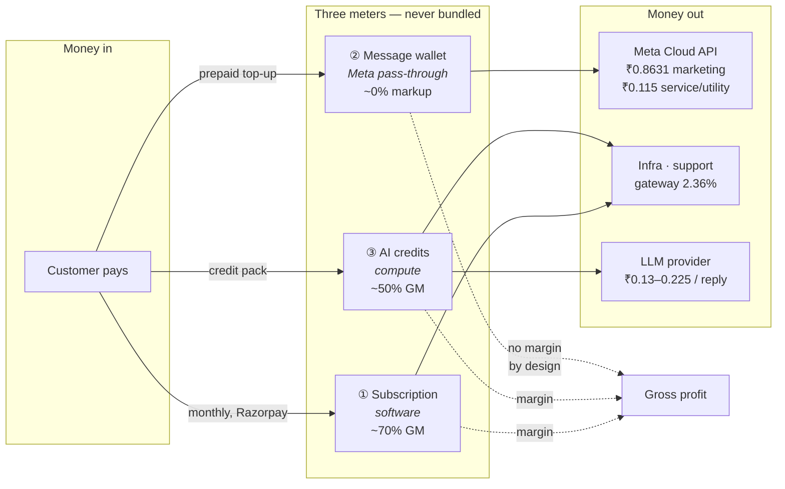
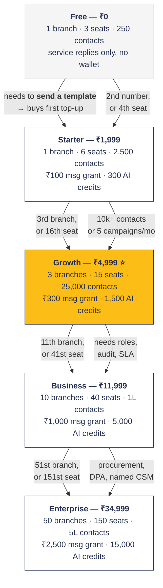
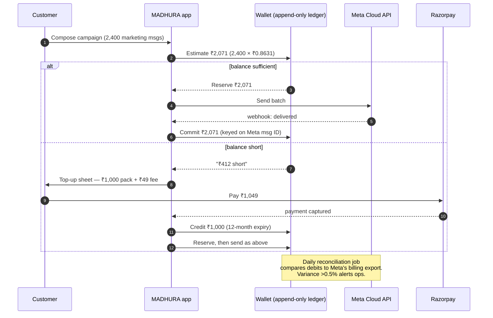

# MADHURA Pricing Model

**Status:** Historical alternative. Superseded for implementation by [pricing.md](pricing.md), which applies `profit.md` scenario B+. All prices, fees, examples and migration instructions below describe the earlier proposal, not the current catalog.
**Prepared:** 30 October 2026
**Scope:** Subscription plans, message wallet top-ups, AI credits, add-ons, migration from the current catalog
**Supersedes:** the seeded plan catalogs in `backend/migrations/enterprise_multi_tenant_multi_branch.js`, `backend/services/tenantPlanService.js`, and the demo-bot copy in `landing_page/src/pages/Landing.jsx`

> 📊 **Visual companion:** open [`pricing_visual.html`](./pricing_visual.html) in a browser for the mind map, money-flow diagram, plan ladder, price-vs-profit curve, lever waterfall, and margin curves. This file carries the prose and the Mermaid diagrams; Markdown viewers may require Mermaid support.

---

## 0. The decision in one page

We sell **three separate things**, not one bundled price:

| # | Meter | What it buys | How it scales | Margin role |
|---|---|---|---|---|
| 1 | **Subscription** | Software: branches, seats, numbers, contacts, automation | Per branch — the value metric | The actual business (~70% GM) |
| 2 | **Message wallet** | Meta's per-message fees, prepaid in ₹ | Per message delivered | Pass-through, ~0% markup |
| 3 | **AI credits** | AI reply compute + delivery | Per AI reply | High margin (~50%) |

**The single most important change:** stop bundling message counts into plans. The current catalog bundles 5,000 messages into a ₹1,499 plan. If those are marketing templates, that is **₹4,315 of Meta cost against ₹1,499 of revenue**. It is not a thin margin, it is a guaranteed loss on every sale. Plans must sell software. The wallet sells messages.

**Price ladder:** ₹0 · ₹1,999 · ₹4,999 · ₹11,999 · ₹34,999 — with **Growth at ₹4,999** as the recommended anchor.

---

## 1. Why the current catalog cannot ship

### The math, at Meta's published India rates (effective 1 Oct 2026)

| Plan | Price | Messages bundled | Cost if marketing (₹0.8631) | Cost if utility (₹0.115) | Verdict |
|---|---|---|---|---|---|
| Free | ₹0 | 500 | ₹432 | ₹58 | Fine (within Meta's 1,000 free service msgs) |
| Starter | ₹1,499 | 5,000 | **₹4,315** | ₹575 | **2.9× loss** |
| Growth | ₹3,999 | 25,000 | **₹21,578** | ₹2,875 | **5.4× loss** |
| Business | ₹9,999 | 100,000 | **₹86,310** | ₹11,500 | **8.6× loss** |
| Enterprise | ₹24,999 | 500,000 | **₹431,550** | ₹57,500 | **17× loss** |

You cannot know which category Meta will bill. A template submitted as utility is reclassified as marketing the moment its content reads promotional — and that is a **7.5× cost jump with no code change on our side**. Any plan that promises a message *count* is an unpriced short position on Meta's classifier.

### Three catalogs currently disagree

| Location | Free | Starter | Growth | Business | Enterprise |
|---|---|---|---|---|---|
| `migrations/enterprise_multi_tenant_multi_branch.js` | ₹0 | ₹1,499 | ₹3,999 | ₹9,999 | ₹24,999 |
| `services/tenantPlanService.js` | ₹0 | ₹1,499 | ₹3,999 | — | ₹9,999 |
| `landing_page/src/pages/Landing.jsx` (demo bot) | — | ₹1,499 | **₹3,499** | — | "Unlimited" |

`tenantPlanService` also gives Starter **3 numbers** and Growth **10 numbers**, while the migration gives Starter **1** and Growth **3**. Two different products are on sale depending on which code path answers. Fix before any paid traffic.

### Meta's rules that shape this model

| Fact | Consequence for pricing |
|---|---|
| Per-message billing since 1 Jul 2025; India card effective 1 Oct 2026 | Price per message, never per "conversation" |
| Marketing ₹0.8631 · Utility ₹0.115 · Authentication ₹0.115 | Marketing is 7.5× utility — the whole design problem |
| Service messages: first 1,000/number/month free, then ₹0.115 | Free tier can be genuinely free if it only replies |
| Inbound (customer → business) always free | Never charge for receiving |
| Volume tiers exist for utility/auth only (−6% to −24%) | Real margin only at Enterprise volume |
| Rates change only 1 Jan / 1 Apr / 1 Jul / 1 Oct, ≥1 month notice | Rate card must be data, not code |
| **INR billing mandatory for India businesses by 31 Dec 2026** | Wallet must be ₹-denominated; migrate accounts now |

---

## 2. Plan ladder

All prices **ex-GST**, monthly, in INR.

| | **Free** | **Starter** | **Growth** ⭐ | **Business** | **Enterprise** |
|---|---|---|---|---|---|
| **Price / month** | **₹0** | **₹1,999** | **₹4,999** | **₹11,999** | **₹34,999** |
| Annual (10 × monthly) | — | ₹19,990 | ₹49,990 | ₹119,990 | ₹349,990 |
| Effective annual / month | — | ₹1,666 | ₹4,166 | ₹9,999 | ₹29,166 |
| Branches | 1 | 1 | 3 | 10 | 50 |
| Seats (named) | 3 | 6 | 15 | 40 | 150 |
| WhatsApp numbers | 1 | 1 | 3 | 10 | 50 |
| Contacts | 250 | 2,500 | 25,000 | 100,000 | 500,000 |
| **Message credit grant / mo** | ₹0 | **₹100** | **₹300** | **₹1,000** | **₹2,500** |
| **AI credits / mo** | 0 | **300** | **1,500** | **5,000** | **15,000** |
| Live flows | 1 | 3 | 10 | 50 | Unlimited |
| Campaigns / mo | 1 (≤200) | 4 (≤2,500) | 30 (≤25,000) | Unlimited | Unlimited |
| Automation journeys | — | 3 | 15 | Unlimited | Unlimited |
| Support | Docs | Email 48h | Email 24h + chat | Priority 8h | Named CSM, 4h |
| ₹ per branch | — | 1,999 | 1,666 | 1,200 | 700 |

**Branch and seat counts above are included allowances, not caps.** Extra branches and seats are purchasable add-ons (§7).

### Why these numbers

- **Free ₹0** — permanent, not a 14-day trial. It is a distribution channel in a market that buys on peer reference. It costs us almost nothing because a free workspace can only reply inside Meta's 1,000 free service messages. It cannot send a single template, because it has no wallet balance. That is the wall, and it fires exactly when the business first wants to *initiate* a conversation.
- **Starter ₹1,999** — undercuts Interakt Growth (₹2,799) and sits below AiSensy's base plus AI add-on. Its job is to be a deliberate stopping point for one-outlet businesses, not the destination.
- **Growth ₹4,999** — the anchor. Priced above Interakt Advanced (₹3,799) because branch-aware routing + RAG AI + roles is not in that stack. Exactly 2.5× Starter so the ladder reads linear rather than punitive.
- **Business ₹11,999** — a 15-outlet chain would otherwise buy four Interakt accounts at ₹3,799. Here it is one tenant at ₹1,200/branch.
- **Enterprise ₹34,999** — a sales-assisted floor, not a checkout button. ₹700/branch is less than a branch manager's daily cost. Never list "dedicated account manager" below ₹50k ACV; use a named-but-shared CSM capped at 8 accounts.

**Badge rule:** exactly one badge in the catalog — Growth = "Recommended". Remove Starter's "Popular". Two recommended plans is zero recommended plans.

### The upgrade path, as a map

**The rule behind every arrow:** an upgrade trigger is a *limit the customer hits while doing something they already wanted to do*. Never an upsell prompt. The four triggers that actually fire, in order of frequency:

| Trigger | Fires when | Converts to |
|---|---|---|
| **First template send** | Wallet balance is ₹0 and the business wants to *start* a conversation | Free → Starter (buys a top-up, then needs a plan) |
| **4th agent logs in** | Team grew past the seat allowance | Starter → Growth |
| **4th branch created** | Second outlet opened | Growth → Business |
| **80% of AI credits** | Automation volume ramped | Any tier → AI pack, or tier up |

---

## 3. Feature gating matrix

`Limited(n)` = the number in brackets. `—` = not available.

| Capability | Free | Starter | Growth | Business | Enterprise |
|---|---|---|---|---|---|
| Shared team inbox | ✅ | ✅ | ✅ | ✅ | ✅ |
| Contacts + custom fields | Limited(3) | ✅ | ✅ | ✅ | ✅ |
| Tags | ✅ | ✅ | ✅ | ✅ | ✅ |
| Internal notes | ✅ | ✅ | ✅ | ✅ | ✅ |
| Manual assignment | ✅ | ✅ | ✅ | ✅ | ✅ |
| Round-robin / branch routing | — | Limited(3 rules) | ✅ | ✅ | ✅ |
| Multi-branch | Limited(1) | Limited(1) | Limited(3) | Limited(10) | ✅ |
| Campaign scheduler | Limited(1/mo, 200) | Limited(4/mo, 2,500) | Limited(30/mo, 25,000) | ✅ | ✅ |
| Visual flow builder | Limited(1 live) | Limited(3 live) | Limited(10 live) | Limited(50 live) | ✅ |
| Automation journeys | — | Limited(3) | Limited(15) | ✅ | ✅ |
| AI replies | — | Limited(300, canned) | Limited(1,500, RAG) | Limited(5,000, RAG) | ✅ |
| Knowledge base docs | — | — | Limited(25) | Limited(200) | ✅ |
| Template mgmt + pre-flight | ✅ | ✅ | ✅ | ✅ | ✅ |
| Team queues / SLA | — | Limited(1 queue) | ✅ | ✅ | ✅ |
| Roles + audit | Limited(2 roles, 30d) | Limited(3 preset, 90d) | Limited(3 custom, 6mo) | ✅ (1yr + export) | ✅ (SIEM, 3yr) |
| API / webhooks | — | — | Limited(read, 1 hook) | ✅ | ✅ (higher limits) |
| Analytics | Limited(30d, 4 reports) | Limited(90d, 8 reports) | Limited(12mo, funnels) | ✅ (custom + export) | ✅ |
| Consent / opt-out tracking | ✅ | ✅ | ✅ | ✅ | ✅ |
| Client portal | — | — | Add-on | ✅ | ✅ (white-label add-on) |

### Never gate these — on any plan, including Free

| Capability | Reason |
|---|---|
| **Consent / opt-out tracking** | DPDP Act exposure + Meta policy. One workspace blasting unconsented users damages its own quality rating. You cannot meter your way out of a legal problem. |
| **Template pre-flight validation** | Gating it means cheap-tier users submit broken templates, eat rejections, tank the number's quality rating, and file the ticket anyway. |
| **Basic audit log (30 days)** | This is the artifact that answers "who exported this customer list." Withholding evidence is indefensible. Depth is paid; existence is not. |
| **Internal notes** | Gate them and agents move context to WhatsApp DMs and personal phones — which destroys the assignment and audit data you sell on Business. |
| **Manual assignment** | Without it Free is a read-only feed, and activation never happens. |
| **Admin vs Member separation** | Security, not governance. One seat with delete rights is a data-loss incident you get blamed for. |
| **CSV export of contacts + conversations** | Refusing export is data hostage. "They won't let you leave" is the most damaging thing a peer can say in a referral market. |
| **Inbound message ingestion** | Never drop an inbound message over billing. The customer's customer is not a party to the dispute. |
| **Delivery receipts** | Without receipts nobody trusts the product at all. |

### The two upgrade triggers that matter

**Starter → Growth: the second WhatsApp number.** Not AI. The second number appears at a business event — a second outlet, a new city, or the sales-vs-support split most D2C brands and clinic chains make around month six. It has no workaround: seat pressure is solved by sharing a login, message caps by sending less, but two teams on one inbox is solved by nothing, and the cost of that workaround is leaked leads the owner feels in rupees. **AI wins trials; branches and numbers close deals.**

**Growth → Business: roles + audit trail.** At 15+ staff across 3 branches, someone leaves with the customer list. In Indian real estate, coaching and clinic chains this is a named fear, not a compliance abstraction. This tier is also bought by a *different person* — ops head, second-generation owner — who approves a large step-up for "I can prove who did what" far faster than for an API.

---

## 4. Wallet architecture

### Two wallets, both on the existing append-only ledger

| Wallet (`credit_type`) | Unit | Funded by | Debits |
|---|---|---|---|
| `message_credits` | **₹1 = ₹1 of Meta spend** | Monthly grant + top-ups | Every delivered outbound message |
| `ai_credits` | 1 credit = 1 standard AI reply | Monthly grant + AI packs | Every AI-generated reply |

`software_actions` stays in the schema as a fair-use guard for journey executions (5,000 / 25,000 / 100,000 / 500,000 included). **Never surface it on the pricing page** — it is an anti-abuse ceiling, not a SKU.

**Store rupees, never message counts.** Meta changes rates up to four times a year. A ₹ balance absorbs that with zero migration. A "5,000 messages" balance becomes a liability the day the rate moves.

### Debit order

1. **Monthly grant first** — expires at period end, no rollover.
2. **Purchased wallet second** — 12-month expiry from purchase.

Grant-first is deliberate: it makes the grant a real ceiling on exposure instead of a liability that accumulates.

**Reserve → commit is the whole safety model.** Meta charges on delivery, not on send. Reserving at send and committing on the `delivered` webhook is the only way to keep the wallet and Meta's invoice within rounding of each other — and the only way a failed send never costs the customer money.

### Mechanics that must be correct

| Rule | Behaviour |
|---|---|
| **Reserve → commit** | Reserve estimated cost at send; commit on `delivered`, release on `failed`. Meta charges on delivery, not send. |
| **Idempotency** | Debit keyed on Meta message ID. A webhook replay must never double-charge. |
| **Rate snapshot** | Store the rate used on each debit. A later rate change must not retroactively alter history. |
| **Category drift** | If Meta reclassifies a template, re-price at send time and show the new estimate before sending. |
| **Reconciliation** | Daily job compares wallet debits against Meta's billing export; any variance >0.5% alerts ops. |
| **No negative balance, ever** | An overdraft on a 100,000-message blast is an unsecured loan to a stranger. |

---

## 5. Per-message rate card

**Meta India list rates, effective 1 October 2026.** Charged at cost — see §6 for how the 0% markup claim survives.

| Category | Rate | Notes |
|---|---|---|
| Marketing | **₹0.8631** | Offers, launches, re-engagement, reminders |
| Utility | **₹0.1150** | Order, booking, payment, delivery updates |
| Authentication | **₹0.1150** | OTPs from an India-based business |
| Service | **₹0.1150** | Free-form replies; **first 1,000/number/month free** |
| Inbound (user → business) | **₹0.00** | Always free |
| Authentication-international | **₹2.4971** | OTP to a +91 number from an overseas business |

### International recipients

The rate depends on the **recipient's** country code, not ours. Store per-market rates in a table; never hardcode.

| Market | Marketing | Utility / Auth |
|---|---|---|
| India | ₹0.8631 | ₹0.1150 |
| UAE | ₹4.2114 | ₹1.1509 |
| Saudi Arabia | ₹4.2114 | ₹0.7834 |
| United Kingdom | ₹4.6496 | ₹1.6122 |
| North America | ₹1.8313 | ₹0.2491 |
| Singapore | ₹5.3664 | ₹1.1727 |

Full card: `developers.facebook.com/docs/whatsapp/pricing`. The table is a config row set with `effective_from`, editable without a deploy.

---

## 6. Top-up packs and the 0% markup claim

### Packs — face value, 1 credit = ₹1

| Pack | Credits | Expiry |
|---|---|---|
| ₹500 (minimum) | ₹500 | 12 months |
| ₹1,000 | ₹1,000 | 12 months |
| ₹5,000 | ₹5,000 | 12 months |
| ₹10,000 | ₹10,000 | 12 months |
| ₹25,000 | ₹25,000 | 12 months |

**Minimum ₹500.** Below that, support cost and chargeback risk exceed the transaction.

### How to cover payment fees without breaking the promise

UPI P2M has **zero MDR mandated in India**. Card costs 2% + 18% GST, which lands at **2.79%** of credit value once GST is charged on the GST-inclusive total.

| Payment method | Customer pays | Our cost |
|---|---|---|
| **UPI** | Face value | ~₹0 |
| **Card / netbanking** | **+2.79%**, shown as a separate disclosed line | 2.79% |

So: **UPI top-ups are exactly 0% markup. Card top-ups cost 2.79% more, and we say so on the same screen.** Never bury the fee inside the Meta rate — that is the moment the claim becomes a lie.

### The claim to publish

> ~~"0% markup on Meta fees"~~ → **"You never pay more than Meta's published India rate. Not a rupee."**

The original wording is false the moment we retain Meta's volume rebates (−6% to −24% on utility/auth at scale). The replacement is verifiable, survives the rebate, and is still a weapon against AiSensy (~24% marketing markup) and Interakt (~10%).

### Where the margin actually comes from

1. **The subscription** — the real product.
2. **AI credits** — ~50% gross margin.
3. **Meta volume rebates** — retained at portfolio level; meaningful only at Enterprise volume.
4. **Breakage** — ~3–5% of prepaid credits never get used (industry norm).
5. **Float** — prepaid balances fund 30–45 days of working capital.

Not from marking up messages. That is the honest trade: a lower-margin messaging layer buys the trust that makes the subscription defensible.

---

## 7. AI credits and add-ons

### AI credit pricing

| Item | Value |
|---|---|
| 1 credit | 1 standard reply (≤3,000 input / ≤300 output tokens) |
| Long-context / agentic reply | 3 credits |
| Image or document understanding | 5 credits |
| **Retail price** | **₹0.40 / credit** |
| Packs | 1,000 = ₹399 · 5,000 = ₹1,749 (₹0.35) · 20,000 = ₹5,999 (₹0.30) |
| Floor | **Never below ₹0.22** |

**Cost per reply (modelled — replace with real token logs after 30 days):**

| Component | Cost |
|---|---|
| Model compute (2,800 in / 220 out, Flash-class) | ₹0.08 |
| Embedding + vector query | ₹0.01 |
| App compute | ₹0.02 |
| **Delivery** — service message beyond the free 1,000 | ₹0.115 |
| **Total** | **₹0.225** |

At ₹0.40 → **44% gross margin**. Note the second debit: an AI reply is *also* a Meta message and must charge `message_credits` too. If it does not, AI looks like 50% margin and is actually 24%.

Market context: Interakt charges ₹0.50/AI message, AiSensy ₹1.35. We are the value player at a defensible margin.

### Add-ons

| Add-on | Price | Sold to | Why an add-on, not a tier |
|---|---|---|---|
| Extra seat | ₹149/mo | All paid | Near-zero marginal cost; keeps the ladder generous |
| Extra branch | ₹599/mo | Growth+ | The value metric — but selling it separately beats a 6th tier |
| Extra WhatsApp number | ₹349/mo | Business+ | Agencies and multi-brand groups run many numbers |
| White-label client portal | ₹999/mo | Growth, Business | Segment-specific (agencies, service firms) |
| Onboarding + WABA setup (one-time) | ₹4,999 Starter/Growth · ₹9,999 Business | All paid | Indian SMBs expect hand-holding; it removes the biggest support load |
| Migration from another BSP (one-time) | ₹7,499 | Starter+ | Switching cost is the real objection; price the removal of it |
| Compliance pack (DPDP export, retention, DPA review) | ₹1,999/mo | Business+ | Concentrated in healthcare, BFSI, edtech |

**Do not sell:** campaign burst packs (redundant — that is what the wallet is), priority support (tells every prospect your normal support is bad), or seat packs at Business+ (cannibalises the ladder).

---

## 8. Overage, zero balance, and expiry

| Balance | Behaviour |
|---|---|
| **₹200 remaining** | In-app + email to billing admin |
| **₹50 remaining** | Add WhatsApp alert to admin |
| **₹0** | **Hard stop** on marketing, utility, authentication, and AI. No negative balance. |
| **₹0, but a customer is live in the 24h window** | **₹250 courtesy buffer, service messages only**, auto-settled on next top-up, max once per 90 days. Never let a customer go dark mid-conversation over ₹11. |
| **Blocked marketing messages** | **Never queue for later.** They all fire on top-up, the customer calls it a bug, and disputes the charge. |
| **Auto-recharge** | Opt-in. Trigger at ₹300 or 15% of last pack. Recharge last pack size. Max 1 per 24h, ₹25,000/month cap. |
| **Plan expiry** | 7 days read-only → data retained 90 days |
| **Downgrade** | Read-only, never invisible. Extra branches and numbers keep full data visibility; they just cannot route or send. |

**Auto-recharge needs UPI Autopay / Razorpay Subscriptions — which we do not have today** (billing is one-time orders only). Ship the **one-click recharge link** (email + WhatsApp) as the interim. Build mandates before spending on paid acquisition, or involuntary churn stays 100% manual.

---

## 9. Annual plans

**Pay 10 months, get 12 = 16.7% off.** Between AiSensy (10%) and Interakt (20%). Never discount deeper than 20%.

| Tier | Monthly | Annual | Effective /mo |
|---|---|---|---|
| Starter | ₹1,999 | ₹19,990 | ₹1,666 |
| Growth | ₹4,999 | ₹49,990 | ₹4,166 |
| Business | ₹11,999 | ₹119,990 | **₹9,999** |
| Enterprise | ₹34,999 | ₹349,990 | ₹29,166 |

The Business annual lands exactly on ₹9,999 — the old list price — so it reads as "last year's price, locked." Annual prepay also kills 11 months of gateway fees and most of the churn curve.

Annual does not discount the wallet. Top-ups stay at face value.

---

## 10. Unit economics

At target usage, all grants fully consumed. Infra and support are modelled per tenant — **replace with 30 days of real data before locking.**

| | Starter | Growth | Business | Enterprise |
|---|---|---|---|---|
| Revenue | ₹1,999 | ₹4,999 | ₹11,999 | ₹34,999 |
| Infra / hosting | 250 | 400 | 900 | 2,500 |
| Support | 100 | 180 | 550 | 1,200 |
| CSM allocation | — | — | — | 6,500 |
| Gateway (2.36%) | 47 | 118 | 283 | 826 |
| Message grant (pass-through) | 100 | 300 | 1,000 | 2,500 |
| AI compute + delivery | 59 | 293 | 975 | 2,700 |
| **Total COGS** | **556** | **1,291** | **3,708** | **16,226** |
| **Gross margin** | **72.2%** | **74.2%** | **69.1%** | **53.6%** |

**Sanity check that the model now holds:** a Growth customer sending 25,000 marketing messages pays ₹4,999 + ₹21,578 (wallet, at cost) + fees ≈ **₹26,600**, and we make ~₹3,700 gross. Under the current catalog the same customer paid ₹3,999 and we lost ₹17,600.

**Free tier cost:** ~₹40/active workspace/month (infra + a little support, no AI, no paid messages). Acceptable as marketing spend.

---

## 11. Pricing psychology — how to present it

| Lever | Application |
|---|---|
| **Anchoring** | Show Enterprise first in the comparison, or list it in the nav. Growth at ₹4,999 reads reasonable only next to ₹34,999. |
| **Decoy / centre-stage** | Growth is visually dominant: filled CTA, "Recommended", subtle border. Starter and Business are outlined. |
| **Rule of 100** | Under ₹100: percentages ("save 17%"). Over ₹100: absolutes ("save ₹2,000"). Use "2 months free" on annual, not "16.7%". |
| **Rounded vs charm** | Round numbers (₹4,999 is fine, ₹5,000 is also fine) — this is a B2B trust purchase, not a consumer impulse buy. Avoid ₹4,997-style gimmicks. |
| **Mental accounting** | "₹1,200 per branch" beats "₹11,999 per month" on Business. Always show cost per branch. |
| **Loss framing on upgrade** | Not "unlock more seats" — "your 4th agent cannot log in yet." Losses land ~2× harder than gains. |
| **Pratfall** | Say plainly on the pricing page: "Messages are Meta's cost, passed through at cost. We make our money on the software." Admitting the model builds more trust than hiding it. |
| **Zero-price effect** | Free is psychologically different from ₹1. Keep a real Free tier — but let it stop at *initiating* conversations, not at *replying*. |
| **Paradox of choice** | Four visible options maximum (Free, Starter, Growth, Business). Enterprise lives behind "Talk to sales". Never show five cards. |
| **Goal-gradient** | In-app wallet meter: "₹340 of ₹1,000 used this month" with a refill CTA at 80%. |

**Never do:** countdown timers on B2B plans, fake "3 people viewing", or a discount code that undercuts a customer who already paid. In a referral market, one of those costs a whole cluster.

---

## 12. Migration from the current catalog

### Database changes

| Change | Detail |
|---|---|
| `plans.price_inr` | Keep. Monthly, **ex-GST**. |
| `plans.max_seats` | 3 / 6 / 15 / 40 / 150 |
| `plans.max_branches` | 1 / 1 / 3 / 10 / 50 |
| `plans.max_senders` | 1 / 1 / 3 / 10 / 50 |
| `plans.max_contacts` | 250 / 2,500 / 25,000 / 100,000 / 500,000 |
| `plans.max_monthly_messages` | **Repurpose as an anti-abuse ceiling, not a commercial quota:** 1,000 / 10,000 / 50,000 / 200,000 / 1,000,000. Volume is now wallet-limited. |
| **NEW** `plans.message_grant_inr` | 0 / 100 / 300 / 1,000 / 2,500 |
| **NEW** `plans.ai_credit_grant` | 0 / 300 / 1,500 / 5,000 / 15,000 |
| **NEW** `plans.annual_price_inr` | 0 / 19,990 / 49,990 / 119,990 / 349,990 |
| **NEW** `plans.gst_inclusive` | `0` (all prices ex-GST) |
| `plans.badge` | Only `growth` = "Recommended". Clear `starter`. |
| **NEW** `message_rate_card` | `(market_code, category, unit_price_inr, effective_from)` — ops-editable, no deploy |
| **NEW** `topup_packs` | `(id, credits_inr, price_inr, is_active)` |
| **NEW** `addons` | `(id, code, name, price_inr, interval, tier_eligibility_json)` |
| `wallet_accounts.credit_type` | Add `'message_credits'` |

### Code changes

| File | Change |
|---|---|
| `migrations/enterprise_multi_tenant_multi_branch.js` §18 | Replace the whole `plansCatalog` block with the table above |
| `services/tenantPlanService.js` | **Delete the duplicate catalog.** Read from `plans` instead. This is the source of the 3-numbers-vs-1-numbers contradiction. |
| `services/billingReconciliation.js:41` | Replace `const grant={growth:500,business:2500,enterprise:10000}[order.plan_id]||100` with grants read from `plans.message_grant_inr` **and** `plans.ai_credit_grant`. The hardcoded map silently grants ₹100 AI credits to Starter and ignores message credits entirely. |
| `services/billingService.js` | Add `debitWallet()`, `reserveCredits()`, `commitReservation()` — the ledger is append-only and already there, but there is no debit path today. |
| `routes/enterpriseBillingRoutes.js` | Add `POST /api/v2/billing/topup` (pack → Razorpay order → credit on capture) and `GET /api/v2/billing/rate-card`. |
| `landing_page/src/pages/Landing.jsx:628` | Fix the demo bot: it quotes ₹3,499 and "Unlimited Enterprise". Must read from the catalog or be rewritten. |
| Marketing site | Replace every "0% markup" string with "never more than Meta's published rate". |

### Rollout sequence

1. **Deploy schema first** (additive columns + new tables). Nothing breaks.
2. **Seed the new catalog** but keep `is_active = 0` on the new prices.
3. **Test on new signups only** for two weeks. New customers have no anchor and no relationship, so they give a clean read on whether the market accepts ₹1,999 / ₹4,999.
4. **Migrate existing tenants in 5–10% waves**, watching churn and support volume for a full cycle before expanding.
5. **Do not grandfather permanently.** A customer on ₹1,499 who should be at ₹1,999 is a ₹6,000/yr gap subsidised forever across the base. Grandfather as a *transition*: 60 days' notice, one month of message credits as a softener, old price honoured to the end of the paid term.

Expect some churn. The customers most likely to leave over a justified increase are the least profitable, highest-support, most price-sensitive accounts — and under the current catalog they are actively losing us money.

---

## 13. Risks and guardrails

| # | Risk | Guardrail |
|---|---|---|
| 1 | **Meta changes the rules again — and just proved it will.** Service messages went from free to billable on 1 Oct 2026; marketing rose on 1 Jan 2026; Meta may change rates four times a year on one month's notice. | Wallet in ₹, never message counts. Rate card in a DB table. ToS: "message prices are Meta's published rates and change with 30 days' notice." Never sell "unlimited messages". |
| 2 | **Template reclassification silently 7.5×'s our cost.** A utility template reclassified as marketing jumps ₹0.115 → ₹0.8631 with no code change. | Pre-send cost estimate with category and ₹ total in a confirmation modal. Category badge on every template. Alert the tenant when Meta changes a category. Per-campaign spend cap. |
| 3 | **Trial abuse and first-top-up fraud.** A card-free trial plus a ₹500 top-up is a cheap way to blast a stolen contact list. One WABA ban costs more than the revenue. | Zero paid-category messages before the first cleared top-up. GSTIN/legal-name KYC before marketing sends. Velocity cap: 500 marketing msgs/day for the first 30 days. Block prepaid/virtual cards. Hold first top-up 24h on new accounts. Per-tenant daily ceiling + admin kill switch. |
| 4 | **Involuntary churn.** No recurring mandates means every renewal is a manual payment. | Build UPI Autopay before scaling paid spend. Interim: recharge links at T-7, T-3, T-0. |
| 5 | **Three catalogs disagree.** Already true today. | One source of truth: the `plans` table. Delete `tenantPlanService`'s copy. |
| 6 | **Seat limits that don't survive shift work.** 6 seats for a 12-person floor produces shared logins, which makes assignment and audit fiction. | Generous seat ladder, warn on concurrent logins but never block, and ship shift handover. |
| 7 | **Caps that block inbound.** "You lost my lead" is the ticket that ends the relationship. | Cap imports and campaign audiences only. 80%/100% banners. 7-day grace. Read-only, never locked. |

---

## 14. Verify before publishing

| Item | Why | Confidence |
|---|---|---|
| India marketing ₹0.8631 | Confirmed against Meta's card effective 1 Oct 2026 and two provider cards | **High** |
| Utility/auth/service ₹0.115, 1,000 free service msgs | Confirmed same sources | **High** |
| Razorpay UPI pricing | Some plans charge a flat ₹2–5 per UPI txn, which changes §6 | **Medium — check the live plan** |
| Card surcharge 2.79% | Derived from 2% + 18% GST on the inclusive total | **Medium — confirm on a test transaction** |
| GST treatment of pass-through credits (pure agent vs reseller) | Determines whether input credit is claimable | **Low — ask the CA** |
| AI compute at ₹0.08/reply | Modelled on Flash-class pricing, not measured | **Low — measure after 30 days** |
| Infra and support per tenant | Modelled, not measured | **Low — measure after 30 days** |
| Enterprise ₹34,999 acceptance | No sales conversations have tested this | **Low — validate in the first 5 deals** |

**Also confirm:** Meta's INR migration deadline of 31 Dec 2026 applies to our accounts, and every WABA is migrated. After 1 Jan 2027 Meta says it will stop delivering messages for non-INR accounts of eligible India businesses.

---

## 15. Pricing page copy

### Hero

> **Pay for the software. Pass through the messages.**
> Plans start at ₹1,999/month. WhatsApp message fees are Meta's published India rates — you never pay more than Meta charges, not a rupee. Top up when you need to.

### Plan card subtitles

| Plan | Subtitle |
|---|---|
| Free | "Reply to customers forever. No card." |
| Starter | "One number, one team, done properly." |
| Growth | "Add a second location without leaking leads." |
| Business | "Prove who did what, across every branch." |
| Enterprise | "Contract terms, SSO, and volume pricing." |

### The wallet explainer (place directly under the plans)

> **How messages are billed**
> Meta charges per delivered message, and the price depends on the category. Marketing messages cost ₹0.8631. Utility and authentication cost ₹0.1150. The first 1,000 service replies per number each month are free.
>
> You prepay into a wallet. Every send debits the exact Meta rate. There is no markup and no monthly minimum. UPI top-ups cost face value; card top-ups add 2.79% to cover processing, shown separately before you pay.
>
> Your plan includes a small monthly credit so you can test without a top-up. It expires at the end of the month.

### FAQ

**Is there a per-message markup?**
No. You pay Meta's published rate for the recipient's country. We make our money on the subscription and on AI credits, not on hiding a margin inside your message cost.

**What happens when my wallet hits zero?**
Sending stops. You get a warning at ₹200 and ₹50. If a customer is mid-conversation, we let service replies through on a small courtesy buffer so nobody goes dark — it settles on your next top-up.

**What if Meta changes its rates?**
They can change up to four times a year with a month's notice. Your wallet is denominated in rupees, so a rate change re-prices future messages — it never invalidates your balance. We publish the new rate card before it takes effect.

**Do unused credits expire?**
The monthly grant expires at period end and does not roll over. Purchased top-up credits last 12 months.

**Can I change plans mid-cycle?**
Yes. Upgrades take effect immediately and are pro-rated. Downgrades take effect at period end, and your data stays visible either way.

**Why is Growth the recommended plan?**
Because the second WhatsApp number is where most teams actually need it. Starter runs one number well; Growth adds branches, routing, AI with your own knowledge base, and custom roles.

**Is Enterprise really unlimited?**
No, and we will not pretend it is. Enterprise includes 50 branches, 150 seats and 50 numbers, with contract-defined terms above that.

---

## Appendix A — Worked examples

### A retail chain, 3 outlets, 15 staff

- Plan: **Growth ₹4,999/mo**
- Monthly sends: 8,000 utility (order updates) + 1,200 marketing (offers)
- Meta cost: (8,000 × ₹0.115) + (1,200 × ₹0.8631) = ₹920 + ₹1,036 = **₹1,956**
- Less ₹300 grant = **₹1,656 top-up**
- AI: 900 replies inside the free 1,000 service quota = ₹0 Meta, 900 credits used of 1,500
- **Invoice: ₹4,999 + ₹1,656 = ₹6,655 + 18% GST**
- Our gross: ~₹3,700 on the subscription, ₹0 on messages

### A D2C brand running a festive campaign

- Plan: **Business ₹11,999/mo**
- Campaign: 60,000 marketing messages
- Meta cost: 60,000 × ₹0.8631 = **₹51,786**
- Needs a ₹25,000 + ₹25,000 + ₹1,786 top-up sequence (or one ₹52,000 custom pack)
- **Invoice: ₹11,999 + ₹51,786 = ₹63,785 + GST**
- Guardrail: pre-campaign spend estimate and a hard cap are mandatory at this size

### A single clinic

- Plan: **Starter ₹1,999/mo**
- Sends: 1,400 utility reminders, 200 marketing
- Meta: (1,400 × ₹0.115) + (200 × ₹0.8631) = ₹161 + ₹173 = **₹334**
- Less ₹100 grant = ₹234 top-up
- **Invoice: ₹1,999 + ₹234 = ₹2,233 + GST**

---

## Appendix B — Open decisions for sign-off

1. **Free tier: permanent or 14-day trial?** This doc recommends permanent, because it matches the existing signup flow and is nearly free to serve. The counter-argument is support load from businesses that never upgrade.
2. **Enterprise list price.** ₹34,999 is modelled, not tested. The first five sales conversations should decide it.
3. **Annual billing before mandates exist?** Annual prepay is cash-positive but creates a 12-month obligation we must honour even if a customer churns. Confirm refund policy first.
4. **Starter AI: 300 credits or none?** This doc gives a taste without the knowledge base, to make Growth's RAG the gate.
5. **Business at 40 seats or 50?** 40 creates a ₹149/seat add-on path; 50 is a cleaner story. This doc uses 40.
