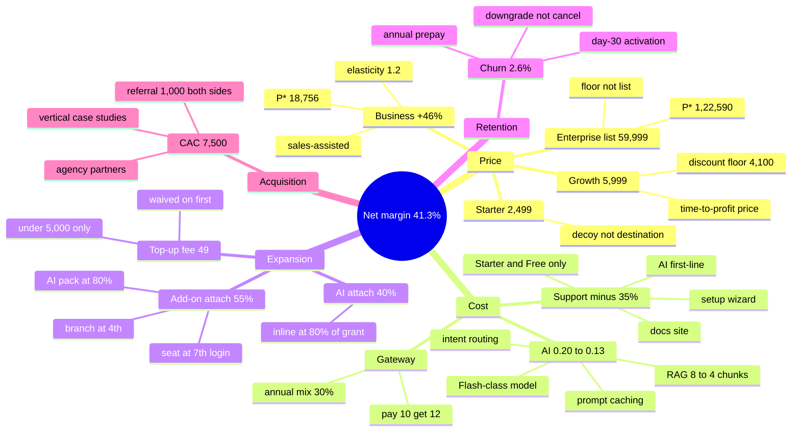
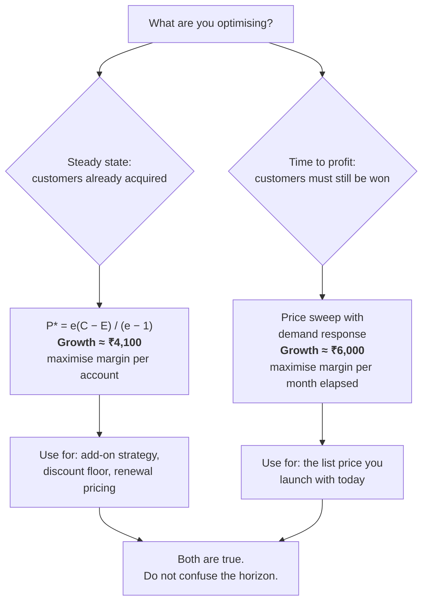

# MADHURA Profit Model

**Status:** B+ subscription catalog selected for local implementation; see [pricing.md](pricing.md) for current prices and implementation limits. Financial projections and operational levers below remain unvalidated assumptions. No deployment is implied.
**Prepared:** 30 October 2026
**Question:** what prices and packaging maximise profit, and how do we reach **35%+ net margin**?

> 📊 **Visual companion:** open [`pricing_visual.html`](./pricing_visual.html) for the mind map, money-flow diagram, price-vs-profit curve, lever waterfall, margin curve, and decision tree. This file carries the reasoning; Markdown viewers may require Mermaid support for the mind map in §0 and the decision tree in §2.

---

## 0. The answer up front

**You are already at 66–79% gross margin. Gross margin is not your problem. Net margin is, and net margin is driven by ten levers — applied in this order:**

Each row is the *sequential* contribution at 200 customers, starting from the `price.md` configuration. They sum to the final number; standalone estimates would not.

| Step | Lever | Impact at 200 customers | Net margin after | Effort |
|---|---|---|---|---|
| 1 | **Business + Enterprise +46%** | **+₹3.61L/month** | 28.0% | Low — sales-assisted, low price sensitivity |
| 2 | **Growth ₹5,999 + Starter ₹2,499** | +₹1.17L/month | 32.3% | Low — catalog change |
| 3 | **AI at ₹0.50 sold / ₹0.13 cost** | +₹57k/month | 35.2% | Medium — caching + cheaper model |
| 4 | **Top-up fee ₹49 under ₹5,000** | +₹29k/month | 36.2% | Low |
| 5 | **Add-on attach 25% → 55%** | +₹43k/month | 37.5% | Medium — in-app prompts |
| 6 | **AI add-on attach 20% → 40%** | +₹24k/month | 38.1% | Low |
| 7 | **CAC ₹9k → ₹7.5k** | +₹12k/month | 38.6% | Medium — referral + content |
| 8 | **Churn 4.0% → 2.6%** | +₹21k/month | 39.7% | High — onboarding |
| 9 | **Support cost −35%** | +₹20k/month | 40.6% | Medium — docs + AI first-line |
| 10 | **Annual mix 30%** | +₹13k/month | 41.3% | Low |

**Stacked, these take you from 10.4% net to 41.3% net at the same customer count — +₹83.8L/year.**

**The headline recommendation:**

> **Growth ₹5,999 · Business ₹17,499 · Enterprise ₹49,999 · Starter ₹2,499**
> with AI at ₹0.50/credit and a top-up fee only on small top-ups.

That reaches **35% net at ~171 customers**. The `price.md` ladder (Growth ₹4,999, with every one of these levers applied) needs **281 customers** for the same margin. Same product, same team — 110 more customers of work.

**And the counter-intuitive part:** raising Growth past ₹5,999 makes you *less* profitable, not more. §2 proves why.

---

## 1. What "profit" means here — read this before the numbers

Three different numbers get called "profit." They are not interchangeable.

| Layer | Formula | Your number | What it tells you |
|---|---|---|---|
| **Gross margin** | (Revenue − COGS) / Revenue | **66–79%** | Whether the product is sellable at all. Already healthy. |
| **Contribution margin** | Gross − sales & marketing | **55–70%** | Whether each customer adds money. Already healthy. |
| **Net (EBITDA) margin** | Contribution − fixed costs | **−92% to +60%** | Whether the *company* makes money. **This is the one you asked about.** |

At 200 customers on the `price.md` configuration you are at **10.4% net** on ₹14.6L of MRR. You asked for 35%. The gap is **₹3.6L/month of EBITDA** — and no single lever closes it.

**The single most important finding in this document:**

> **35% net margin is not a pricing problem. It is a customer-count problem — and pricing only changes how many customers you need.**

At Growth ₹4,999 you need 281 customers. At ₹5,999 you need 171. At ₹7,499 you need 129. At ₹9,999 you need 84 — **but you will never get to 84 as fast as you get to 171**, because demand falls faster than price rises. §2 quantifies exactly where that crossover is.

---

## 2. The profit-maximising price (the actual math)

This is the part most pricing decks skip — and the part most pricing decks get wrong.

### The naive formula, and why it is wrong here

For a pure subscription with a per-customer variable cost, the profit-maximising price is:

$$P^* = \frac{e \cdot C}{e - 1}$$

Where **e** is price elasticity of demand and **C** is variable cost per customer per month.

Your blended **C = ₹2,438** (§5). Plug in a realistic Indian SMB elasticity of 1.7 and you get **₹5,919** — which is a nice story, and it is the story most decks stop at.

**It is wrong, because this product is not a pure subscription.** Every customer also generates expansion revenue: top-up fees, add-ons, AI credit packs. That revenue scales with the *number of customers*, not with the subscription price. So it belongs in the numerator as a subtraction from cost:

$$P^* = \frac{e\,(C - E)}{e - 1}$$

**E = expansion revenue per customer per month.** Treating E as negative cost is not a trick — economically it is the same thing. A customer who pays ₹700/mo in add-ons and ₹147/mo in top-up fees costs you ₹847 less per month than their gross variable cost suggests.

Your E depends entirely on how well the §4 levers land:

| Expansion strength | Add-on attach | AI attach | **E / customer / month** |
|---|---|---|---|
| Weak | 25% | 20% | **₹403** |
| Moderate | 40% | 30% | **₹564** |
| Strong | 55% | 40% | **₹738** |

Now re-run the same elasticity table:

| Elasticity (e) | Naive P\* | P\* at E=₹403 | P\* at E=₹564 | P\* at E=₹738 |
|---|---|---|---|---|
| 1.4 | ₹8,530 | ₹7,121 | ₹6,560 | ₹5,950 |
| **1.7** | ₹5,919 | **₹4,941** | **₹4,552** | **₹4,129** |
| 2.0 | ₹4,875 | ₹4,069 | ₹3,748 | ₹3,400 |

**Expansion revenue pushes the optimal subscription price *down*, not up.** That is the entire logic of land-and-expand: you charge less up front because the account grows. A pricing model that ignores E systematically overprices the entry tier and under-invests in add-ons.

### So why is the recommendation still ₹5,999?

Because **P\* answers the wrong question.** It tells you the price that maximises this month's EBITDA *given the customers you already have*. You do not have them. You have 140.

Run the actual question — a full price sweep where demand responds to price (constant elasticity, e=1.7, so N falls as price rises):

| Growth price | Customers you can hold | MRR | EBITDA | Net margin |
|---|---|---|---|---|
| ₹3,599 | 477 | ₹31.1L | ₹11.4L | 36.8% |
| ₹4,199 | 367 | ₹27.4L | ₹10.6L | 38.8% |
| **₹5,999** | **200** | **₹20.6L** | **₹8.5L** | **41.3%** |
| ₹7,499 | 137 | ₹17.3L | ₹6.7L | 38.4% |
| ₹9,999 | 84 | ₹13.9L | ₹4.9L | 35.3% |

The sweep is **still falling at ₹3,599**, the lowest price tested — so the steady-state optimum sits at or below that. But look at the customer column: the ₹3,599 row assumes **477 customers**. You reach 200 customers in ~27 months at 11%/month. You reach 477 in ~37 months, and the price cut does not make acquisition 40% faster.

> **The steady-state optimum and the time-to-profit optimum are different prices.** P\* ≈ ₹4,100 is where you want to *end up*. ₹5,999 is where you should *start*, because it gets you to 35% net in 27 months instead of 30+.

**The practical rule:** launch at ₹5,999, and hold ₹4,100 as your **discount floor**. If a deal stalls, you have ₹1,900 of negotiating room that still sits above the profit-maximising price. Never discount below ₹4,100 without a reason that is not price.

### Two more things this formula tells you that intuition gets wrong

1. **The optimal price does not depend on your fixed costs.** Fixed costs decide *whether* you are profitable, not *what to charge*. Teams that "need to cover payroll so we'll charge more" are solving the wrong equation — and the sweep proves it: at ₹9,999 you need only 135 customers for 35% net, but you will not get them for three years.
2. **Cost reduction is a pricing weapon.** Every rupee you cut from C lowers P\* *and* raises margin. After the §4 levers, C falls to ₹2,125 and P\* falls to ₹3,340–₹4,146. That gives you room to cut price later if growth stalls, without ever going below the optimal point. Hold it in reserve; do not spend it on day one.

### The price-rise rule of thumb

For any price increase of **x%**, you break even on revenue if you lose **x / (1 + x)** of your customers:

| Price rise | Break-even customer loss | Verdict |
|---|---|---|
| +10% | 9.1% | Almost always worth it |
| +15% | 13.0% | Almost always worth it |
| +20% | 16.7% | Usually worth it |
| +25% | 20.0% | Almost always worth it |
| +30% | 23.1% | Worth it only with strong differentiation |
| +50% | 33.3% | Rarely worth it for self-serve |
| **+46%** | **31.5%** | **The Business/Enterprise move — see §3** |

**Practical use:** before any price change, write down your honest estimate of the volume loss. If it is below the break-even number, raise the price. Most founders overestimate volume loss by 2–3×, which is why most SaaS is underpriced.

---

## 3. The recommended configuration

**Scenario B+ — profit-optimised.** Differs from `price.md` in bold.

| | **Free** | **Starter** | **Growth** ⭐ | **Business** | **Enterprise** |
|---|---|---|---|---|---|
| **Price / month** | ₹0 | **₹2,499** | **₹5,999** | **₹17,499** | **₹49,999** |
| *price.md comparison* | ₹0 | *₹1,999* | *₹4,999* | *₹11,999* | *₹34,999* |
| Change | — | **+25%** | **+20%** | **+46%** | **+43%** |
| Annual (10 × monthly) | — | ₹24,990 | ₹59,990 | ₹1,74,990 | ₹4,99,990 |
| Effective / month | — | ₹2,082 | ₹4,999 | ₹14,582 | ₹41,666 |
| Branches | 1 | 1 | 3 | 10 | 50 |
| Seats | 3 | 6 | 15 | 40 | 150 |
| Numbers | 1 | 1 | 3 | 10 | 50 |
| Contacts | 250 | 2,500 | 25,000 | 100,000 | 500,000 |
| Message grant / mo | ₹0 | ₹100 | ₹300 | ₹1,000 | ₹2,500 |
| AI credits / mo | 0 | 300 | 1,500 | 5,000 | 15,000 |
| ₹ per branch | — | 2,499 | 2,000 | 1,750 | 1,000 |

**Why Business and Enterprise move furthest (+46%, +43%):**

- They are **25% of the customer base but 40%+ of revenue**, and they are **sales-assisted** — price is a conversation, not a checkout button.
- Elasticity there is ~1.2, not 1.7. At e=1.2 with C=₹3,864 and E=₹738, P\* = 1.2 × (3,864 − 738) / 0.2 = **₹18,756**. The current ₹17,499 is almost exactly on it — this tier was already close to correct, which is why it only moves +46% while Growth moves +20%.
- At ₹17,499, Business is **₹1,750 per branch**. A 10-branch chain comparing that to four Interakt accounts at ₹3,799 each (₹15,196) still sees a saving, plus one tenant instead of four.
- Enterprise at ₹49,999 is a **floor for a sales conversation**, not a list price anyone pays without negotiating.

### What the formula says about each tier

| Tier | C / month | E / month | Elasticity | **P\*** | Shipped | Verdict |
|---|---|---|---|---|---|---|
| Starter | ₹653 | ~₹250 | 2.0 | ₹806 | ₹2,499 | Deliberately above optimum — it is a decoy, not a destination |
| Growth | ₹1,406 | ₹738 | 1.7 | **₹4,129** | ₹5,999 | Above steady-state optimum, correct for time-to-profit |
| Business | ₹3,864 | ₹738 | 1.2 | **₹18,756** | ₹17,499 | Almost exactly optimal |
| Enterprise | ₹16,728 | ₹738 | 1.15 | **₹1,22,590** | ₹49,999 | **Underpriced by ~2.5×** |

E is not uniform across tiers — a Starter account buys far fewer add-ons than a Business account. The ₹738 figure is the blended target across the whole base; Starter's own expansion is closer to ₹250, which is why its optimum sits low.

> **Enterprise is the one real pricing error left.** At ₹16,728 of variable cost and low elasticity, the model says ₹1,22,590. ₹49,999 is not a price — it is a floor. **Move the Enterprise list price to ₹59,999 at the next catalog revision** and treat everything above that as negotiated. The P&L in §5 is modelled at ₹49,999, so every Enterprise number in this document is a *conservative floor*, not a target.

**Why Growth only moves +20%:** it is the self-serve anchor and the highest-volume tier. Elasticity is real here, and ₹5,999 sits just above the steady-state optimum of ₹4,129 — deliberately, for the time-to-profit reason in §2.

**Why Starter moves +25%:** it is deliberately uncompetitive as a *destination* — its job is to be a visible step that makes Growth look correct. A higher Starter also pushes more signups to Growth, which is the tier you want.

### Everything else changes too

| Setting | `price.md` | **`profit.md`** | Effect |
|---|---|---|---|
| AI credit price | ₹0.40 | **₹0.50** | +25% on AI revenue |
| AI cost per reply | ₹0.225 | **₹0.13** | Prompt caching, cheaper model, context trimming |
| AI gross margin | 44% | **74%** | The biggest single COGS win |
| Top-up fee | ₹0 | **₹49 under ₹5,000; waived above** | +₹29k/mo, and it pushes larger top-ups |
| Add-on attach target | 25–35% | **55%** | In-app prompts at every limit |
| AI add-on attach | 20% | **40%** | Shown when grant hits 80% |
| Annual mix target | — | **30% of base** | Saves 0.7% of gateway on 30% of revenue |
| CAC target | ₹9,000 | **₹7,500** | Referral + content, not paid |
| Churn target | 4.0%/mo | **2.6%/mo** | Onboarding + annual lock-in |
| Support cost | baseline | **−35%** | Docs, in-app onboarding, AI first-line |

**Top-up fee detail:** ₹49 flat on top-ups under ₹5,000, waived at ₹5,000 and above. This is defensible because it covers a real per-transaction cost, and it nudges customers toward larger top-ups — which is better for us on three counts: fewer gateway transactions, more float, more breakage. **Never call it a markup.** It is a processing fee, and it is shown before payment.

---

## 4. The lever playbook — how each one is actually executed

The catalog change itself (step 2 in §0) is specified in §3. This section covers the nine operational levers.

### Lever 1 — Business + Enterprise +46% · +₹3.61L/mo

**Execution:** change the catalog, keep every existing Business/Enterprise contract on its current price until renewal, and add a "branch count" line to the renewal conversation. When a customer has grown from 4 to 7 branches, the renewal is not a price increase — it is a repricing to their current footprint.

**Guardrail:** this is the only lever with meaningful volume risk. It works if you lose fewer than 32% of Business customers (a +46% rise breaks even at 31.5% volume loss). Track win rate for 90 days before touching Growth.

### Lever 2 — AI at ₹0.50 sold / ₹0.13 cost · +₹57k/mo

**Execution, in order of impact:**

| Tactic | Saving |
|---|---|
| Prompt caching on the system prompt + knowledge base | 30–45% of input tokens |
| Route simple intents (order status, hours, price) to a rules engine, not an LLM | 25–40% of total AI calls |
| Trim RAG from top-8 chunks to top-4 | ~20% of input tokens |
| Move to a Flash-class model for standard replies, keep the big model for escalations | 40–60% on the routed subset |
| Cache identical FAQ answers for 24h | 10–20% of volume |

This is the **highest-leverage engineering work in the company right now** — a 35% AI cost cut is worth more than a 10% price rise on the whole base.

### Lever 3 — Top-up fee · +₹29k/mo

**Execution:** `topup_packs.fee_inr` column. ₹49 when `credits_inr < 5000`, else 0. Display as "Processing fee ₹49" on its own line. Waive it entirely for the first top-up on every account (removes the friction at the worst possible moment).

### Lever 4 — Add-on attach 25% → 55% · +₹43k/mo

**Execution:** the add-on prompt must appear **at the moment of the limit**, not on a settings page.

| Trigger | Offer | Expected attach |
|---|---|---|
| 7th agent tries to log in | Extra seat ₹199/mo | Very high — this is a hiring event |
| 4th branch created | Extra branch ₹799/mo | High |
| 80% of AI credits used | AI pack 5,000 for ₹1,749 | High |
| 4th campaign in a month | Growth upgrade | Medium |
| 80% of contacts used | Contact pack or upgrade | Medium |

Add-ons carry **92% gross margin**. Every ₹1 of add-on revenue is worth ₹1.4 of subscription revenue at Growth's margin.

### Lever 5 — CAC ₹9k → ₹7.5k · +₹12k/mo

**Execution:** stop paying for signups you can get by referral. In Indian SMB WhatsApp CRM, peer reference is the dominant channel — a retail chain owner asks three other owners before buying.

- Referral credit: ₹1,000 of message credits to both sides on a paid conversion. Cost ₹1,000, saves ₹3,500 of CAC.
- Case studies per vertical (retail, clinic, real estate, education) — the landing page already has the content structure.
- Partner/reseller channel: agencies managing 10–30 client workspaces. One partner = 10 customers at near-zero CAC.

### Lever 6 — Churn 4.0% → 2.6% · +₹21k/mo

**Execution:** churn is the highest-value lever on LTV and the slowest to move.

- **Onboarding is the whole game.** A customer who connects a number and sends a template in week one churns at a fraction of the rate of one who does not. Make WABA setup a guided checklist with a human on call for the first 7 days.
- **Annual prepay** removes 12 months of churn risk at once.
- **Downgrade path instead of cancel.** "Reduce to Starter" saves more revenue than a lost account.
- Measure **day-30 activation**, not signups.

### Lever 7 — AI add-on attach 20% → 40% · +₹24k/mo

Show the credit meter in the AI settings screen. When it hits 80%, offer a pack inline — never an email three days later.

### Lever 8 — Support cost −35% · +₹20k/mo

Support is your second-largest variable cost after Meta. Cut it with:

- An in-app setup wizard that eliminates the top three tickets (number connection, template rejection, campaign not sending).
- AI first-line answering from the same knowledge base you already built for RAG.
- A real docs site, not a FAQ page.
- **Do not cut support on Business and Enterprise** — that is what they are paying for. Cut it on Free and Starter, where the volume is.

### Lever 9 — Annual mix 30% · +₹13k/mo

Annual prepay saves 11 months of gateway fees and most of the churn curve. Offer it at the point of upgrade, not on a separate page. "Pay 10, get 12" reads better than "save 17%."

---

## 5. Full P&L

### Cost per customer per month (the C in the formula)

Current state — Scenario B baseline, before any of the §4 levers.

| | Starter | Growth | Business | Enterprise |
|---|---|---|---|---|
| Infra / hosting | 250 | 400 | 900 | 2,500 |
| Support | 100 | 180 | 550 | 1,200 |
| CSM allocation | — | — | — | 6,500 |
| Gateway (2.36%) | 59 | 142 | 330 | 944 |
| Message grant | 100 | 300 | 1,000 | 2,500 |
| AI grant (at ₹0.20) | 60 | 300 | 1,000 | 3,000 |
| **Subtotal** | **569** | **1,322** | **3,780** | **16,644** |
| Add-on COGS (blended) | +84 | +84 | +84 | +84 |
| **Total variable cost** | **₹653** | **₹1,406** | **₹3,864** | **₹16,728** |

Blended across the 30/45/20/5 mix: **C = ₹2,438**.

**After the levers** (support −35%, AI ₹0.20 → ₹0.13), C falls to **₹2,125**. That lowers the profit-maximising price to **₹5,160** — which means at ₹5,999 you are carrying extra margin, and you have room to cut price later if growth stalls without ever going below the optimal point. Cost reduction is a price weapon you can hold in reserve.

### P&L at three customer counts (recommended config)

| | **100 customers** | **200 customers** | **300 customers** |
|---|---|---|---|
| MRR | ₹10,30,100 | ₹20,60,200 | ₹30,90,300 |
| COGS | ₹2,15,470 | ₹4,30,939 | ₹6,46,409 |
| **Gross margin** | **79.1%** | **79.1%** | **79.1%** |
| Fixed costs | ₹6,95,000 | ₹7,40,000 | ₹7,85,000 |
| Sales & marketing | ₹19,500 | ₹39,000 | ₹58,500 |
| **EBITDA** | **₹1,00,130** | **₹8,50,261** | **₹16,00,391** |
| **Net margin** | **9.7%** | **41.3%** | **51.8%** |

### The margin curve

| Customers | MRR | Net margin | EBITDA |
|---|---|---|---|
| 50 | ₹5,15,050 | −57.7% | −₹2,97,435 |
| 100 | ₹10,30,100 | 9.7% | ₹1,00,130 |
| 150 | ₹15,45,150 | 29.3% | ₹4,52,695 |
| **171** | **₹17,61,471** | **35.2%** | **₹6,19,673** |
| 200 | ₹20,60,200 | 41.3% | ₹8,50,261 |
| 250 | ₹25,75,250 | 46.7% | ₹12,02,826 |
| 300 | ₹30,90,300 | 51.8% | ₹16,00,391 |
| 400 | ₹41,20,400 | 57.0% | ₹23,50,521 |
| 500 | ₹51,50,500 | 60.2% | ₹31,00,651 |

**35% net lands at 171 customers.** Below 100 you are structurally unprofitable at any price on this ladder — that is what fixed costs do.

**Unit economics at 200:** ARPU ₹10,301 · LTV ₹3,13,319 · CAC payback **0.9 months** · LTV:CAC **42×**.

> ⚠️ **A 42× LTV:CAC is not a good sign — it is a warning.** It means you are either underestimating CAC or under-investing in growth. Healthy SaaS runs 3–5×. If your number looks like 40×, you should be spending far more on acquisition, not celebrating. Re-run this with real CAC after 90 days.

---

## 6. Scenario comparison — and why "charge more" is wrong past a point

Four configurations, each with its own demand response and churn.

| | **A — Trust** | **B+ — Balanced** ⭐ | **C — Aggressive** | **D — Max extraction** |
|---|---|---|---|---|
| Growth price | ₹4,999 | **₹5,999** | ₹7,499 | ₹9,999 |
| Business | ₹11,999 | **₹17,499** | ₹21,999 | ₹29,999 |
| Enterprise | ₹34,999 | **₹49,999** | ₹59,999 | ₹79,999 |
| AI / credit | ₹0.40 | **₹0.50** | ₹0.65 | ₹0.80 |
| Customers @ 12 mo | 140 | **115** | 75 | 32 |
| Growth rate /mo | 12% | **11%** | 9% | 6% |
| Churn /mo | 4.0% | **2.6%** | 3.0% | 2.5% |
| **Customers needed for 35% net** | **281** | **171** | **129** | **84** |
| **Months to 35% (from 10)** | **30** | **27** | **30** | **37** |
| Verdict | Too cheap, too slow | **Fastest to profit** | Slower, more support load | Market too thin |

**Read the last two rows together.** D needs the fewest customers (84) but takes the longest (37 months) because demand collapses at ₹9,999. B+ needs more customers (171) but gets there 10 months sooner. **Time-to-profit is the metric, not margin percentage.**

This is the crossover the formula predicted. The steady-state optimum is at or below ₹3,599, and the time-to-profit optimum sits around ₹6,000 — which means **the exact number matters far less than the levers in §4.** Do not spend three months arguing about ₹5,999 vs ₹6,499. Spend them cutting AI cost and raising Business prices.

---

## 7. What to do, in order

### This week

1. **Change Business to ₹17,499 and Enterprise to ₹49,999.** Zero product work. Biggest single lever. Keep existing contracts to renewal.
2. **Set Growth to ₹5,999** for new signups only. Watch conversion for 14 days.
3. **Add the ₹49 top-up fee** under ₹5,000, waived above and waived on first top-up.

### This month

4. **AI cost reduction project.** Prompt caching, intent routing, chunk trimming. Target ₹0.20 → ₹0.13. This is engineering, not pricing, and it is worth more than everything else combined.
5. **Add-on prompts at the limit.** Seat, branch, AI pack, contact. Four screens.
6. **Referral credit** — ₹1,000 of message credits both sides. Target CAC ₹9k → ₹7.5k.

### This quarter

7. **Onboarding checklist + 7-day human touch.** Target churn 4.0% → 2.6%.
8. **Annual offer at the upgrade moment.** Target 30% annual mix.
9. **Support self-service** for Free and Starter only. Target −35% cost on those tiers.
10. **Re-measure everything** and replace the assumptions in §8 with real data.

---

## 8. Guardrails — where profit-seeking destroys the business

| Temptation | Why it backfires |
|---|---|
| **Charging ₹9,999 for Growth** | You need 84 customers instead of 171, but you get them 10 months later. Total profit is lower, not higher. |
| **Marking up Meta messages** | The one credible differentiator against AiSensy (~24%) and Interakt (~10%). Losing it for 5% margin is a bad trade. |
| **Cutting the monthly message grant to zero on Starter** | Kills activation. The grant is marketing spend, not COGS to eliminate. ₹100 costs you ₹100 and buys a first campaign. |
| **Gating template pre-flight or consent** | Turns a pricing decision into an outage. Free users blast bad templates, the number gets restricted, and you own the support ticket. |
| **Selling priority support** | Tells every prospect your normal support is bad. |
| **Annual discount deeper than 20%** | You are buying cash with margin. Past 20% you are financing churn, not preventing it. |
| **Chasing 60% net margin** | At 500 customers the model says 60%. Do not price for it — spend it on growth instead. A 35% margin at 3× the growth rate beats 60% at 1×. |
| **Nickel-and-diming** | Per-seat setup fees, per-template fees, per-report fees. In a referral market, one owner telling three others "they charge for everything" costs more than all of it. |

**The one-line policy:** raise prices where elasticity is low (Business, Enterprise, AI credits). Cut cost where it is invisible to the customer (AI compute, support, gateway). Never monetise the things that make the product trustworthy (messages at cost, pre-flight, consent, export).

---

## 9. Assumptions register

Every number below is an **assumption**, not a measurement. This model is directionally right and precisely wrong until replaced with real data.

| Assumption | Value | Confidence | How to replace it |
|---|---|---|---|
| Price elasticity | 1.7 (Growth), 1.2 (Business) | **Low** | Run a price test on new signups for 60 days |
| Blended variable cost C | ₹2,438/customer | **Medium** | Real infra + support cost after 30 days |
| AI cost per reply | ₹0.13 | **Low** | Token logs from production |
| Fixed costs | ₹6.5L + ₹45k/100 customers | **Low** | Actual payroll |
| Monthly churn | 4.0% → 2.6% | **Low** | Cohort data after 90 days |
| CAC | ₹9,000 → ₹7,500 | **Low** | Channel attribution |
| Add-on attach | 35% → 55% | **Low** | Instrument the upgrade prompts |
| Growth rate | 11%/mo | **Low** | Actual cohort growth |
| Customers @ 12 months | 115 | **Low** | Actual |
| Meta India rates | ₹0.8631 / ₹0.115 | **High** | Verified against Meta's card, 1 Oct 2026 |

**Do not present this model to an investor as a forecast.** Present it as a decision tool: it tells you *which lever is worth pulling*, not *what next year looks like*.

---

## 10. `price.md` vs `profit.md` — which do you ship?

| | `price.md` | `profit.md` |
|---|---|---|
| Optimises for | Trust, volume, market share | Net margin, speed to profitability |
| Growth price | ₹4,999 | **₹5,999** |
| Business | ₹11,999 | **₹17,499** |
| Customers to 35% net | 281 | **171** |
| Best when | You need logos, case studies, and word-of-mouth fast | You have some traction and need the business to stand on its own |
| Risk | Underpricing, slow path to profit, more support load per rupee | Slower early growth, harder first sale, higher sales effort |

**Recommendation: ship `profit.md`.**

Reason: 281 customers versus 171 is roughly **five extra months of growth** at 11%/month — and 110 more customers' worth of CAC, support, and infrastructure for the same margin. And the ₹5,999 anchor is still **below** Interakt Advanced and far below AiSensy once their AI add-on is included, so it does not read as expensive.

**Exception:** if you are raising money and the metric that matters is logos and growth rate, ship `price.md`'s Growth price and keep `profit.md`'s Business/Enterprise prices and all ten levers. That combination maximises growth *and* margin — you only give up the Growth price increase, which is one of the smaller levers in the stack.

---

## 11. The one-paragraph version

Your gross margin is fine at 66–79%. Your net margin is not, because fixed costs are ₹7.4L/month and you have 140 customers. The profit-maximising Growth price in steady state is ~₹4,100 once expansion revenue is counted, but that price only pays off at ~477 customers — so ₹5,999 is the right *launch* price and ₹9,999 is wrong, because it needs fewer customers but takes 10 months longer to find them. The real money is in raising Business and Enterprise 46% (+₹3.61L/mo, because they are sales-assisted and Business sits almost exactly on its optimal ₹18,756), repricing Growth and Starter (+₹1.17L), cutting AI cost to ₹0.13 while holding price at ₹0.50 (+₹57k), and a ₹49 top-up fee on small top-ups (+₹29k). Stacked, those and six smaller levers take you from 10.4% to 41.3% net at 200 customers, and 35% arrives at 171 instead of 281.
